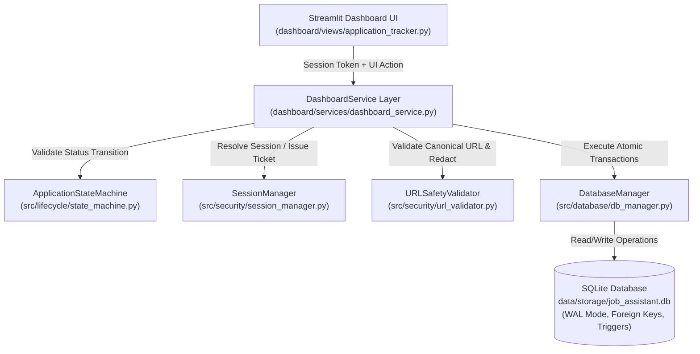
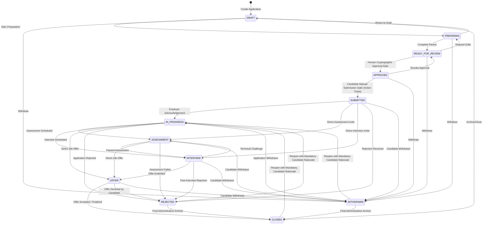
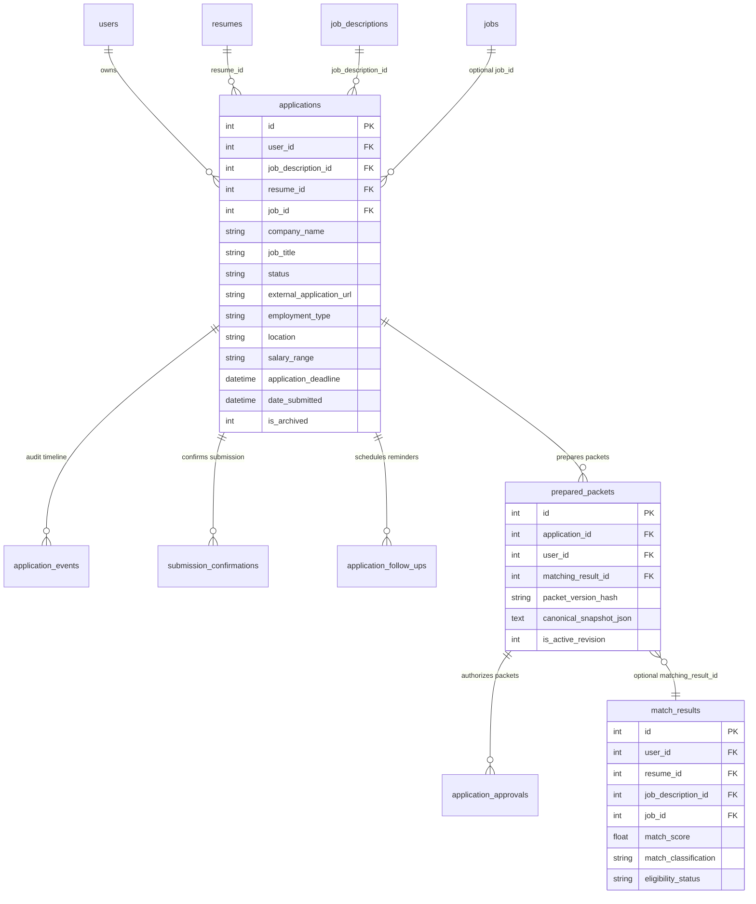
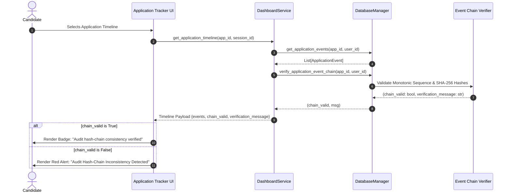

# PHASE 7.3 — CANDIDATE APPLICATION TRACKER
## Architecture, Security Model & Implementation Blueprint
### (Audited & Remediated Specification)

**Architecture Version:** v2.1.1
**Project:** Universal AI Job Application Assistant
**Document:** `docs/PHASE_7_3_CANDIDATE_APPLICATION_TRACKER_ARCHITECTURE.md`
**Current Commit SHA:** `0deafd7582f571a1beae3586644405a9591d222d`
**Branch:** `main`
**Phase:** 7.3.1 Audit Remediation — Candidate Application Tracker: Architecture & Design
**Implementation Phase:** 7.3.2 (Pending User Architecture Review & Authorization)
**Execution Mode:** Pure Architectural Blueprint & Design Specification (Zero production code changes; zero database modifications)

---

## 1. Executive Summary & Core Principles

The Universal AI Job Application Assistant has achieved a cryptographically verified, multi-user application preparation and state machine foundation through Phase 7.2.2.4 (690 passing unit, integration, and security tests across the entire repository). Candidates across any industry or career level can register, authenticate, upload resumes, ingest job descriptions, generate tailored application packets, and grant verified cryptographic approvals under active login sessions.

With the core state machine, atomic database transactions, immutable audit events, and manual submission confirmation backend operational in `src/lifecycle/state_machine.py`, `src/database/db_manager.py`, and `dashboard/services/dashboard_service.py`, the next essential milestone is providing candidates with an intuitive, unified, and secure **Candidate Application Tracker**.

The **Candidate Application Tracker** transforms the platform into an authoritative career management hub. It provides candidates with complete visibility and transparent control over every stage of their job search, from initial draft and document preparation, through cryptographic human review, safe external portal navigation, manual submission confirmation, follow-up management, and post-submission milestones (interviews, assessments, offers, and terminal closures).

### Core Non-Negotiable Operating Principles:

1. **Candidate Truthfulness (Zero Hallucination Policy):**
   - Application status, submission timestamps, and employer communication details reflect only candidate-verified facts. The assistant never invents fake job applications, fabricated interview dates, or embellished status updates.

2. **Strict Candidate Control & Human-in-the-Loop Safeguards:**
   - **Zero Automated Application Submissions:** The assistant **NEVER** automatically submits job applications or interfaces directly with third-party ATS portals (e.g., Workday, Greenhouse, Lever, Taleo) to execute submission actions.
   - External application links navigate the candidate to the employer portal in a separate browser tab, accompanied by explicit safety notices.
   - Status progression to `SUBMITTED` strictly requires explicit candidate confirmation, valid channel selection, and single-use cryptographic action ticket consumption.

3. **Browser Automation & Anti-Automation Ethics:**
   - The assistant strictly honors website Terms of Service, anti-bot protections, CAPTCHA boundaries, and rate limits. Automated evasion, credential harvesting, and bot attacks are strictly prohibited.

4. **Multi-User Isolation & Session Ownership (Zero IDOR):**
   - Every application record, audit event, prepared packet, submission confirmation, and follow-up reminder is strictly bound to the authenticated candidate's database `user_id`.
   - Client-supplied IDs in forms, URLs, query parameters, or session state are never trusted as proof of authorization. All operations fail closed if the session is invalid, expired, or belongs to a different candidate.

5. **Cryptographic Immutability & Audit Transparency:**
   - The application lifecycle is recorded in an append-only, tamper-evident audit timeline (`application_events`) with SHA-256 hash chain linkage and monotonic sequence numbers.
   - The tracker actively verifies this hash chain on every render, displaying `Audit hash-chain consistency verified` when intact. This verifies internal sequence and hash consistency; it does not claim absolute external authenticity against an attacker with root database access.

---

## 2. Independent Architecture Audit Findings and Resolutions

Prior to authorizing Phase 7.3.2 implementation, an independent audit of the initial Phase 7.3.1 blueprint identified several architectural and security gaps between the proposed design and the actual codebase. Each finding is categorized below with its concrete resolution:

| Audit Item | Audit Finding & Gap | Classification | Remediation & Architectural Resolution |
| :--- | :--- | :--- | :--- |
| **AUDIT-A** | **Dashboard KPI Double-Counting & Archive Filtering**<br>Proposed metric logic incremented `submitted` for `IN_PROGRESS` applications. Archive behavior was not explicitly defined or queried in `list_user_applications`. | **Planned Phase 7.3.2 Functionality** | Updated `get_candidate_tracker_metrics()`: `SUBMITTED` counts only genuinely submitted applications; `IN_PROGRESS` does not increment `submitted`; both contribute to `active_pipeline`. Applications with `is_archived = 1` are excluded by default from KPIs and lists via a planned query enhancement. Offers remain separated from concluded applications. |
| **AUDIT-B** | **Contradictory Kanban Grouping for `OFFER`**<br>Section 7 assigned `OFFER` to Column 5 ("Concluded"), while Section 4 assigned it to "Active Pipeline". | **Planned Phase 7.3.2 Functionality** | Standardized the canonical 5-column Kanban layout everywhere: 1. Preparation (`DRAFT`, `PREPARING`), 2. Review & Approval (`READY_FOR_REVIEW`, `APPROVED`), 3. Submitted & Active (`SUBMITTED`, `IN_PROGRESS`), 4. Assessment, Interview & Offers (`ASSESSMENT`, `INTERVIEW`, `OFFER`), 5. Concluded (`REJECTED`, `WITHDRAWN`, `CLOSED`). |
| **AUDIT-C** | **Service Layer Capability Boundary**<br>Blueprint conflated existing `DatabaseManager` methods with non-existent `DashboardService` wrappers, and claimed complex query filters were already implemented. | **Existing vs. Planned Distinction** | Explicitly documented that `db.list_user_applications`, `db.get_user_application`, status transitions, timeline retrieval, hash verification, and manual submission backend **already exist**. Follow-up CRUD **already exists in `DatabaseManager`**, but candidate-facing wrappers in `DashboardService` **do not yet exist and are planned for Phase 7.3.2**. Employment-type filtering, multi-status grouping (`status_in`), and deadline sorting are documented as **planned query enhancements**. |
| **AUDIT-D** | **Manual Submission Workflow & Ticket Lifetime Accuracy**<br>Blueprint claimed a 3600s ticket TTL, action-type in ticket string header, and a 16-step service method. | **Existing Implementation Alignment** | Corrected action ticket TTL to actual default: `ttl_seconds = 900` (15 min) in `SessionManager.issue_action_ticket`. Corrected ticket string format to `TKT-{key_id}-{nonce}.{timestamp}.{signature}`. Documented the exact **14-step operation** in `DashboardService.record_candidate_manual_submission()` while clearly distinguishing proposed UI interactions and validation. |
| **AUDIT-E** | **Confirmation Proof Upload Security Gap**<br>Service currently accepts caller-supplied path and hash without a secure file upload pipeline. | **Deferred / Planned Security Specification** | Specified a secure upload pipeline architecture (file byte reception, 10MB cap, extension + magic bytes check, server-generated path in private candidate storage, server-side SHA-256, authenticated download gate). If not implemented safely in Phase 7.3.2, proof file upload will be **deferred**, retaining optional confirmation reference and candidate notes. |
| **AUDIT-F** | **External URL Navigation Security Flaw**<br>`log_external_application_url_opened` currently calls `URLSafetyValidator.validate_url` before authentication and allows client URL substitution. | **Prerequisite Security Remediation** | Specified mandatory re-ordering before exposing the feature: 1. Resolve session, 2. Retrieve application, 3. Obtain stored canonical URL, 4. Validate URL, 5. Redact sensitive query/fragment, 6. Append audit event (status preserved!), 7. Return validated URL. Documented as a navigation request, not proof of employer visitation. Added regression tests. |
| **AUDIT-G** | **Audit Integrity Badge Terminology**<br>Blueprint described hash verification as an absolute guarantee of authenticity. | **Refinement & Accurate Terminology** | Replaced badge text with: `Audit hash-chain consistency verified`. Documented that SHA-256 chain establishes internal sequence/hash consistency, but cannot independently prove external employer activity or defend against an attacker with direct SQL access who rewrites all rows. |
| **AUDIT-H** | **Relational Match Data Provenance**<br>ER diagram incorrectly drew a direct `applications -> match_results` relationship. | **Relational Accuracy & Provenance** | Removed direct link. Documented that match results are linked via `prepared_packets.matching_result_id`. If unlinked, the UI displays match data as "Unavailable" rather than fabricating links. Work arrangement is derived from catalog job records when available, but not guaranteed for manual applications. |
| **AUDIT-I** | **Multi-Worker Concurrency & Sticky Sessions**<br>Blueprint claimed full multi-worker operation based solely on the database nonce table. | **Operational Constraint Clarification** | Clarified that while consumed nonces are persistent, active sessions and issued tickets reside in process memory. Multi-worker scaling strictly requires sticky sessions or a future centralized session/grant store. |
| **AUDIT-J** | **API & Authentication Boundary Clarification**<br>Blueprint presented REST routes with `session_id` query params as if required for Phase 7.3.2. | **Architecture Clarification** | Clarified that the frontend is pure Streamlit and consumes `DashboardService` methods directly in-process via `st.session_state`. REST routes are labeled as **conceptual future mappings**. Removed `session_id` from URL query strings in conceptual designs; specified `Authorization: Bearer` headers. |
| **AUDIT-K** | **Documentation Precision & Product Naming**<br>Stale commit SHA in header and occurrences of "Antigravity" as product name. | **Documentation Precision** | Updated header commit SHA to `0deafd7582f571a1beae3586644405a9591d222d`. Replaced "Antigravity" with "Universal AI Job Application Assistant" or "the assistant". |

---

## 3. Repository & Existing Architecture Audit Findings

An exhaustive source audit of the repository reveals the foundational state of the platform:



### Component Audit Matrix: Existing vs. Planned

| Subsystem | Existing Implementation & Status | Source Files | Tracker Architectural Role & Status |
| :--- | :--- | :--- | :--- |
| **Streamlit Framework** | Python 3.11/3.13 Streamlit multipage application utilizing `st.navigation`, `st.Page`, custom CSS, and session state (`st.session_state`). | `dashboard/app.py`<br>`dashboard/views/` | Hosts the Candidate Application Tracker page (`render_application_tracker`). **Status: Existing framework; Tracker view replacement planned for Phase 7.3.2.** |
| **Application Tracker View** | Legacy catalog job tracker querying `service.get_all_jobs_df()` from public scraper `jobs` table. Does not query multi-user `applications`. | `dashboard/views/application_tracker.py` | **Must be completely rewritten in Phase 7.3.2** to interface with candidate-scoped `DashboardService` lifecycle methods. |
| **Application State Machine** | Formal 12-status state machine (`ApplicationStateMachine`) enforcing canonical transition matrix, gate protection, terminal states, legacy aliases, and pairwise event types. | `src/lifecycle/state_machine.py` | Dictates valid next states, prevents illegal transitions, forbids generic bypasses of gate-protected states (`APPROVED`, `SUBMITTED`), and drives dynamic UI action buttons. **Status: Complete & Existing.** |
| **Service Layer (`DashboardService`)** | Contains methods for session resolution, application CRUD, state transitions, timeline retrieval, manual submission confirmation, and external URL logging. | `dashboard/services/dashboard_service.py` | **Existing:** Core lifecycle and submission methods.<br>**Planned Extensions for 7.3.2:** Follow-up wrappers, tracker metrics aggregation, and query parameter enhancements. |
| **Session & Cryptography** | `SessionManager` manages PBKDF2 authentication, 256-bit entropy sessions, HMAC-SHA256 action tickets (`ttl_seconds=900`), key rotation, and replay prevention registries. | `src/security/session_manager.py` | Validates candidate identity on every UI request and issues/consumes single-use cryptographic tickets for gate-protected actions. **Status: Complete & Existing.** |
| **Database & Persistence** | `DatabaseManager` backed by SQLite in WAL mode with foreign key enforcement (`PRAGMA foreign_keys = ON`), immediate write transactions (`immediate_transaction`), and append-only database triggers. | `src/database/db_manager.py`<br>`src/database/schema.sql`<br>`src/database/models.py` | Houses the fully normalized relational schema: `applications`, `application_events`, `submission_confirmations`, `application_follow_ups`, `prepared_packets`, and `application_approvals`. **Status: Complete & Existing.** |
| **URL Security** | `URLSafetyValidator` defends against SSRF, cloud metadata exfiltration, loopback/private IP scanning, and invalid URI schemes with injectable DNS resolvers. | `src/security/url_validator.py` | Validates employer application links. **Status: Existing utility; requires security remediation in `DashboardService.log_external_application_url_opened()` prior to UI exposure.** |

---

## 4. Lifecycle State & Transition Matrix

The platform strictly enforces 12 canonical universal statuses. Arbitrary string literals or unvalidated status mutations are rejected by `ApplicationStateMachine.validate_transition()`.



### Canonical Kanban Column Grouping

To ensure absolute consistency across wireframes, diagrams, logic, and metrics, the 12 canonical statuses are grouped into five discrete columns:

```
+-----------------------------------------------------------------------------------------------------------------------+
| 1. Preparation      | 2. Review & Approval  | 3. Submitted & Active | 4. Assessment,        | 5. Concluded            |
|                     |                       |                       |    Interview & Offers |                         |
+---------------------+-----------------------+-----------------------+-----------------------+-------------------------+
| • DRAFT             | • READY_FOR_REVIEW    | • SUBMITTED           | • ASSESSMENT          | • REJECTED              |
| • PREPARING         | • APPROVED            | • IN_PROGRESS         | • INTERVIEW           | • WITHDRAWN             |
|                     |                       |                       | • OFFER               | • CLOSED                |
+-----------------------------------------------------------------------------------------------------------------------+
```

### Detailed Lifecycle State Specifications:

| Status Enum | Display Label | Canonical Column | Semantics & Entry Conditions | Permitted Next Transitions | Gate Protection Level |
| :--- | :--- | :--- | :--- | :--- | :--- |
| `DRAFT` | Draft | 1. Preparation | Application workspace initialized; basic company and title captured; materials not yet generated. | `PREPARING`, `WITHDRAWN`, `CLOSED` | Standard (Candidate) |
| `PREPARING` | Preparing | 1. Preparation | Tailored resume, cover letter, and screening question responses are being drafted or edited. | `READY_FOR_REVIEW`, `DRAFT`, `WITHDRAWN` | Standard (Candidate) |
| `READY_FOR_REVIEW` | Ready for Review | 2. Review & Approval | Consolidated application packet generated and ready for candidate human inspection and sign-off. | `APPROVED`, `PREPARING`, `WITHDRAWN` | Standard (Candidate) |
| `APPROVED` | Approved | 2. Review & Approval | Application packet verified and cryptographically signed by candidate via `HumanApprovalGate`. | `SUBMITTED`, `READY_FOR_REVIEW`, `WITHDRAWN` | **Gate Protected:** Requires `HumanApprovalGate.authorize_universal_packet()` |
| `SUBMITTED` | Submitted | 3. Submitted & Active | Candidate has externally submitted on employer portal and recorded confirmation details. | `IN_PROGRESS`, `ASSESSMENT`, `INTERVIEW`, `REJECTED`, `WITHDRAWN` | **Gate Protected:** Requires `record_candidate_manual_submission()` with action ticket |
| `IN_PROGRESS` | In Progress | 3. Submitted & Active | Employer acknowledged application; under recruiter review; or reopened from terminal status. | `ASSESSMENT`, `INTERVIEW`, `OFFER`, `REJECTED`, `WITHDRAWN` | Standard (Candidate) |
| `ASSESSMENT` | Assessment | 4. Assessment, Interview & Offers | Candidate invited to complete online test, take-home project, or technical coding assessment. | `INTERVIEW`, `OFFER`, `REJECTED`, `WITHDRAWN` | Standard (Candidate) |
| `INTERVIEW` | Interviewing | 4. Assessment, Interview & Offers | One or more interview rounds scheduled (recruiter screen, technical, behavioral, executive). | `ASSESSMENT`, `OFFER`, `REJECTED`, `WITHDRAWN` | Standard (Candidate) |
| `OFFER` | Offer Received | 4. Assessment, Interview & Offers | Formal employment offer received from employer; under review or negotiation. | `CLOSED`, `REJECTED`, `WITHDRAWN` | Standard (Candidate) |
| `REJECTED` | Rejected | 5. Concluded | Formal rejection notice received from employer, or candidate not selected. | `CLOSED`, `IN_PROGRESS` *(Reopen requires rationale)* | Terminal Status |
| `WITHDRAWN` | Withdrawn | 5. Concluded | Candidate voluntarily retracted application from consideration. | `CLOSED`, `IN_PROGRESS` *(Reopen requires rationale)* | Terminal Status |
| `CLOSED` | Closed / Archived | 5. Concluded | Application lifecycle completed, position filled, offer accepted, or administratively archived. | `IN_PROGRESS` *(Reopen requires rationale)* | Terminal Status |

---

## 5. Candidate Application Dashboard Architecture & KPI Correctness

The dashboard computes real-time metrics strictly from candidate-scoped database queries, ensuring multi-user isolation.

### Correct KPI Metric Derivations

The KPI calculation in `get_candidate_tracker_metrics()` must adhere strictly to these invariants:
1. `submitted`: Counts **only** applications genuinely in `SUBMITTED` status. Applications in `IN_PROGRESS`, `ASSESSMENT`, or `INTERVIEW` must **not** increment `submitted`.
2. `active_pipeline`: Reflects all actively advancing opportunities: `SUBMITTED`, `IN_PROGRESS`, `ASSESSMENT`, `INTERVIEW`, and `OFFER`.
3. `offers`: Displayed as a dedicated metric chip, separated from concluded applications.
4. `concluded`: Reflects terminal applications: `REJECTED`, `WITHDRAWN`, and `CLOSED`.
5. **Archive Invariant:** By default, applications with `is_archived = 1` are **strictly excluded** from tracker KPIs and application lists. An explicit `include_archived=True` filter must be passed to include archived records.

### Proposed Implementation for Phase 7.3.2:

```python
def get_candidate_tracker_metrics(
    self,
    session_id: str,
    include_archived: bool = False,
) -> Dict[str, int]:
    """Computes real-time tracker KPIs for the authenticated candidate.

    Invariants:
    - 'submitted' counts ONLY applications currently in SUBMITTED status.
    - 'in_progress' does NOT increment 'submitted'.
    - 'active_pipeline' encompasses SUBMITTED, IN_PROGRESS, ASSESSMENT, INTERVIEW, OFFER.
    - 'offers' is tracked independently from concluded applications.
    - Archived applications (is_archived=1) are excluded by default.
    """
    user_id, _ = self.resolve_authenticated_candidate(session_id)

    # Query candidate applications with archive filtering
    apps = self.db.list_user_applications(
        user_id=user_id,
        include_archived=include_archived,
    )

    counts = {
        "total": len(apps),
        "in_preparation": 0,    # DRAFT, PREPARING, READY_FOR_REVIEW
        "approved": 0,          # APPROVED
        "submitted": 0,         # SUBMITTED only
        "in_progress": 0,       # IN_PROGRESS only
        "interviewing": 0,      # ASSESSMENT, INTERVIEW
        "offers": 0,            # OFFER only
        "active_pipeline": 0,   # SUBMITTED + IN_PROGRESS + ASSESSMENT + INTERVIEW + OFFER
        "concluded": 0,         # REJECTED, WITHDRAWN, CLOSED
        "follow_ups_due": 0,
    }

    for app in apps:
        stat = ApplicationStateMachine.normalize_status(app.status)
        if stat in (ApplicationStatus.DRAFT, ApplicationStatus.PREPARING, ApplicationStatus.READY_FOR_REVIEW):
            counts["in_preparation"] += 1
        elif stat == ApplicationStatus.APPROVED:
            counts["approved"] += 1
        elif stat == ApplicationStatus.SUBMITTED:
            counts["submitted"] += 1
            counts["active_pipeline"] += 1
        elif stat == ApplicationStatus.IN_PROGRESS:
            counts["in_progress"] += 1
            counts["active_pipeline"] += 1
        elif stat in (ApplicationStatus.ASSESSMENT, ApplicationStatus.INTERVIEW):
            counts["interviewing"] += 1
            counts["active_pipeline"] += 1
        elif stat == ApplicationStatus.OFFER:
            counts["offers"] += 1
            counts["active_pipeline"] += 1
        elif stat in (ApplicationStatus.REJECTED, ApplicationStatus.WITHDRAWN, ApplicationStatus.CLOSED):
            counts["concluded"] += 1

    # Follow-ups due today or overdue
    follow_ups = self.db.list_application_follow_ups(user_id=user_id, is_completed=0)
    today_str = datetime.now(timezone.utc).strftime("%Y-%m-%d")
    counts["follow_ups_due"] = sum(1 for f in follow_ups if f.follow_up_date <= today_str)

    return counts
```

---

## 6. Application List Architecture & Query Enhancements

The Application List provides dense, high-efficiency inspection and management of applications.

### Existing vs. Planned Query Capabilities:

1. **Existing Query Support (`DatabaseManager.list_user_applications`):**
   - Filters by single `status: Optional[str]`.
   - Searches case-insensitively across `company_name`, `job_title`, and `notes`.
   - Sorts by `updated_at_desc`, `created_at_desc`, `created_at_asc`, `company_name`, `job_title`.
   - Supports `limit` and `offset`.

2. **Planned Query Enhancements for Phase 7.3.2:**
   - `include_archived: bool = False`: Appends `AND is_archived = 0` by default.
   - `status_in: Optional[List[str]] = None`: Supports multi-status category filtering (e.g. `WHERE status IN ('ASSESSMENT', 'INTERVIEW')`) via parameterized SQL.
   - `employment_type: Optional[str] = None`: Filters by `employment_type = ?`.
   - `sort_by="deadline_asc"`: Generates `ORDER BY application_deadline ASC NULLS LAST`.

### Standardized Filter & Sort Parameters:

All methods across the UI, service layer, and database will use these standardized parameter names:
- `status` (`Optional[str]`): Single status filter.
- `status_in` (`Optional[List[str]]`): List of status strings for category filtering.
- `employment_type` (`Optional[str]`): Employment type filter.
- `search_term` (`Optional[str]`): Free-text search string.
- `include_archived` (`bool`, default `False`): Whether to include archived applications.
- `sort_by` (`Optional[str]`): One of `updated_at_desc` (default), `created_at_desc`, `created_at_asc`, `deadline_asc`, `company_name_asc`, `job_title_asc`.
- `limit` (`Optional[int]`, default 20): Page size.
- `offset` (`int`, default 0): Record offset.

---

## 7. Kanban View Evaluation & Interactive Guardrails

```
+-----------------------------------------------------------------------------------------------------------------------+
| 1. PREPARATION (2)  | 2. REVIEW & APP. (2)  | 3. SUBMITTED & ACT(3) | 4. ASSESS, INT, OFFER | 5. CONCLUDED (2)        |
+---------------------+-----------------------+-----------------------+-----------------------+-------------------------+
| [DRAFT]             | [READY_FOR_REVIEW]    | [SUBMITTED]           | [INTERVIEW]           | [REJECTED]              |
| Senior AI Dev       | Staff ML Engineer     | Lead Data Scientist   | Senior Research Eng   | Junior ML Intern        |
| Acme Corp           | Anthropic             | Cohere                | DeepMind              | OldTech Inc             |
| [Continue Prep ->]  | [Review Packet ->]    | [Log Milestone ->]    | [Schedule Follow-up]  | [Reopen with Rationale] |
|                     |                       |                       | [Record Offer]        |                         |
| [PREPARING]         | [APPROVED]            | [IN_PROGRESS]         |                       | [WITHDRAWN]             |
| NLP Specialist      | AI Platform Architect | Senior CV Engineer    | [OFFER]               | Data Analyst            |
| Mistral             | OpenAI                | Scale AI              | Principal Scientist   | Legacy Corp             |
| [Edit Packet ->]    | [🚀 Confirm Submit]   | [Log Interview ->]    | Waymo                 | [Reopen with Rationale] |
|                     | [Open Portal Link]    |                       | [Review Offer]        |                         |
+-----------------------------------------------------------------------------------------------------------------------+
```

### Strict Interactive Guardrails: Prohibiting Drag-and-Drop Mutation

- **Critical Security Invariant:** In our state machine, transitions to `APPROVED` and `SUBMITTED` require cryptographic action tickets and candidate confirmation evidence.
- **Arbitrary drag-and-drop state mutation is strictly prohibited.** A user dragging a card from `READY_FOR_REVIEW` into `APPROVED` would bypass `HumanApprovalGate`! A user dragging a card from `APPROVED` into `SUBMITTED` would bypass manual submission confirmation!
- Therefore, Kanban cards in this architecture are **strictly action-driven**:
  - Cards visually inhabit columns according to their authoritative status in the database.
  - State progression occurs exclusively when the candidate clicks explicit action buttons on the card (e.g., `[🚀 Confirm Submission]`, `[Log Interview]`), triggering the proper gate workflows and modal dialogs.
  - Any attempt to bypass gates via client manipulation fails on backend state machine validation.

---

## 8. Relational Match Data Provenance & ER Diagram Correction

An inspection of `src/database/schema.sql` reveals that `match_results` does **not** possess a direct foreign key to `applications`. The relational ER diagram is corrected below:



### Match Data & Work Arrangement Provenance Rules:

1. **Match Result Resolution:**
   - Match details are retrieved through the active prepared packet's persisted foreign key (`prepared_packets.matching_result_id`).
   - If no prepared packet exists or `matching_result_id` is null, the system may query `match_results` where `user_id = :uid AND job_description_id = :jdid AND resume_id = :rid`.
   - **Zero Fabrication Rule:** If no reliable matching record exists, the UI displays match data as **"Match Evaluation Unavailable"**. The system must never manufacture synthetic match scores.
2. **Work Arrangement Provenance:**
   - Work arrangement (`Remote`, `Hybrid`, `On-site`) is derived from the associated catalog job record (`jobs.work_arrangement`) when `job_id` is linked.
   - For manually created applications where no catalog job is linked, work arrangement is displayed as `location` or marked as "Unspecified"; it is not guaranteed for every application.

---

## 9. Application Lifecycle Timeline Architecture & Audit Consistency

The Application Lifecycle Timeline renders the authoritative history from `application_events`.



### Audit Integrity Terminology & Scope:

- **UI Badge Text:**
  `Audit hash-chain consistency verified (N events cryptographically linked)`
- **Scope & Limitations:**
  A valid SHA-256 event chain proves **internal sequence and hash consistency**—confirming that events have not been modified or deleted through normal database updates, and sequence numbers increment monotonically from GENESIS.
  It **does not** independently prove real-world employer activity, nor does it guarantee authenticity against an attacker with root database access who rewrites the entire SQLite file and recomputes all hash values.

---

## 10. External URL Navigation Security Prerequisite

### Audit Finding & Vulnerability in Existing Implementation

In `dashboard/services/dashboard_service.py` (`log_external_application_url_opened`), the existing code executes:
```python
# EXISTING FLAW: Validates arbitrary caller-supplied URL before authenticating session
validated_url = URLSafetyValidator.validate_url(url, resolver=self._resolve_url)
user_id, sess = self.resolve_authenticated_candidate(session_id, client_user_id)
app = self.db.get_user_application(application_id=application_id, user_id=user_id)
```
This contains two security issues:
1. It validates URLs before verifying candidate authentication.
2. It accepts an arbitrary caller-supplied `url: str`, allowing a malicious client to log navigation events for arbitrary phishing or external URLs rather than the employer URL stored on the application.

### Mandatory Future Implementation Specification (Prerequisite for UI Exposure)

Before exposing the external navigation button in Phase 7.3.2, `log_external_application_url_opened()` must be refactored to enforce this strict execution order:

```python
def log_external_application_url_opened(
    self,
    application_id: int,
    session_id: str,
    client_user_id: Optional[int] = None,
) -> str:
    """Logs external navigation request using the canonical stored application URL.

    Execution Order (Security Hardened):
    1. Resolve candidate session & authenticate.
    2. Retrieve candidate application (enforcing user ownership).
    3. Obtain canonical stored external application URL (app.external_application_url).
    4. Validate canonical URL via URLSafetyValidator (blocks SSRF, private IPs, bad schemes).
    5. Redact sensitive query parameters and URL fragments.
    6. Emit EXTERNAL_APPLICATION_URL_OPENED audit event (status preserved!).
    7. Return sanitized validated URL for the UI to open in a new tab.
    """
    # 1. Authenticate candidate session first
    user_id, sess = self.resolve_authenticated_candidate(session_id, client_user_id)

    # 2. Retrieve application under strict ownership filtering
    app = self.db.get_user_application(application_id=application_id, user_id=user_id)
    if not app:
        raise ApplicationNotFoundError(application_id)

    # 3. Obtain canonical stored URL (prohibit arbitrary client substitution)
    raw_url = app.external_application_url
    if not raw_url:
        raise ValidationError(f"Application #{application_id} has no external application URL configured.")

    # 4. Validate canonical URL via URLSafetyValidator
    validated_url = URLSafetyValidator.validate_url(raw_url, resolver=self._resolve_url)

    # 5. Redact sensitive tokens and strip fragments for audit logging
    sanitized_url = self._redact_sensitive_url(validated_url)

    # 6. Emit audit event: Status is strictly PRESERVED
    self.db.create_application_event(
        application_id=application_id,
        user_id=user_id,
        event_type="EXTERNAL_APPLICATION_URL_OPENED",
        actor_type="CANDIDATE",
        actor_identifier=f"user_{user_id}",
        session_reference=sess.session_id,
        event_payload={
            "opened_url": sanitized_url,
            "application_status_preserved": app.status,
            "note": "Candidate requested external employer portal navigation."
        },
    )

    # 7. Return safe validated URL for browser navigation
    return validated_url
```

- **Navigation Request Semantics:** This event records that the candidate **requested external portal navigation**. It does not constitute proof that the candidate completed navigation or submitted on the employer portal.
- **Required Regression Tests:**
  - Unauthenticated navigation request fails with `InvalidSessionError`.
  - Cross-user navigation request fails with `ApplicationNotFoundError`.
  - Application without external URL raises `ValidationError`.
  - Unsafe stored URL raises `UnsafeURLError`.
  - Application status remains strictly unchanged (`APPROVED` is preserved).
  - Sensitive tokens and `#fragments` are redacted in the event payload.

---

## 11. Manual Submission Workflow & Confirmation Proof Security

### Actual 14-Step Service Implementation

The existing `DashboardService.record_candidate_manual_submission()` executes 14 discrete, numbered operations:
1. Resolve active authenticated candidate session (`resolve_authenticated_candidate`).
2. Retrieve requested application under strict ownership filtering (`get_user_application`).
3. Verify application is in allowed pre-submission status (`APPROVED` or legacy `AWAITING_APPROVAL`).
4. Retrieve active prepared packet (`get_active_prepared_packet`).
5. Verify packet belongs to user and application.
6. Verify packet is the active revision (`is_active_revision == 1`).
7. Recompute and verify packet integrity (`verify_prepared_packet_integrity`).
8. Retrieve corresponding human approval record (`get_packet_approval`).
9. Confirm approval corresponds to exact packet hash (`approval.packet_version_hash == packet.packet_version_hash`).
10. Confirm approval has not already been consumed (`approval.is_consumed == 0`).
11. Require explicit candidate confirmation flag (`candidate_confirmed is True`).
12. Require valid submission channel (`submission_channel in SubmissionChannel.list()`).
13. Verify and consume the fresh `MANUAL_SUBMISSION` action ticket (`verify_and_consume_action_ticket`).
14. Call atomic database submission confirmation (`create_submission_confirmation` with `transition_status=True`).

### Action Ticket Lifetime & Format Alignment:

- **Actual Default Ticket TTL:** `ttl_seconds = 900` (15 minutes), as defined in `SessionManager.issue_action_ticket()`.
- **Actual Ticket String Format:**
  `TKT-{key_id}-{nonce}.{timestamp}.{signature}`
  *(where `key_id` is the active HMAC key identifier, e.g. `v1` or `production-2026`; `action_type` is bound in the cryptographic HMAC payload, not the header string).*

### Confirmation Proof Upload Pipeline Security Specification:

The database currently stores `confirmation_doc_path` and `confirmation_doc_hash`. To prevent path traversal, remote code execution, and unauthenticated file access, any proof upload capability must adhere to this architecture:

1. **Server-Side File Byte Ingestion:** Accepts uploaded bytes via Streamlit's `st.file_uploader`. Browser-supplied paths or hashes are **never trusted**.
2. **File Size Limit:** Capped at 10 MB maximum.
3. **Format & Magic Byte Validation:** Verifies file extension (`.pdf`, `.png`, `.jpg`, `.jpeg`) against actual file magic bytes (`%PDF-`, PNG header `89 50 4E 47`, JPEG header `FF D8 FF`). Rejects executables, scripts, and archives.
4. **Server-Controlled Storage Path:** Generates private storage paths:
   `data/users/<user_id>/confirmations/proof_<application_id>_<timestamp>_<uuid4>.<ext>`
   Strictly prevents path traversal (`..`), absolute paths, or symlink attacks.
5. **Server-Computed Hash:** Computes SHA-256 over raw file bytes on the server.
6. **Authenticated Download Gate:** Uploaded confirmation proofs are served only through an authenticated service method verifying candidate ownership.
7. **Deferral Decision:** If this secure pipeline cannot be fully implemented and tested in Phase 7.3.2, proof uploads will be **deferred**, retaining `confirmation_reference` and `candidate_notes` as optional fields.

---

## 12. Candidate Follow-Up Reminders: Service Layer Extensions

### Existing Database Foundation vs. Planned Service Layer

- **Existing in DatabaseManager:** Full CRUD methods already exist in `DatabaseManager` (`create_application_follow_up`, `get_application_follow_up`, `list_application_follow_ups`, `complete_application_follow_up`, `delete_application_follow_up`).
- **Missing in DashboardService:** No candidate-facing wrapper methods exist.

### Planned Service Methods for Phase 7.3.2:

```python
def create_application_follow_up(
    self,
    session_id: str,
    application_id: int,
    follow_up_date: str,
    follow_up_type: str,
    description: str,
) -> ApplicationFollowUp:
    """Creates a follow-up reminder enforcing candidate application ownership."""
    user_id, _ = self.resolve_authenticated_candidate(session_id)
    app = self.db.get_user_application(application_id=application_id, user_id=user_id)
    if not app:
        raise ApplicationNotFoundError(application_id)
    return self.db.create_application_follow_up(
        application_id=application_id,
        user_id=user_id,
        follow_up_date=follow_up_date,
        follow_up_type=follow_up_type,
        description=description,
    )

def list_application_follow_ups(
    self,
    session_id: str,
    application_id: Optional[int] = None,
    is_completed: Optional[int] = None,
) -> List[ApplicationFollowUp]:
    """Lists follow-up reminders scoped to authenticated candidate."""
    user_id, _ = self.resolve_authenticated_candidate(session_id)
    return self.db.list_application_follow_ups(
        user_id=user_id,
        application_id=application_id,
        is_completed=is_completed,
    )

def complete_application_follow_up(
    self,
    session_id: str,
    follow_up_id: int,
    outcome_notes: Optional[str] = None,
) -> ApplicationFollowUp:
    """Marks a follow-up reminder as complete under ownership verification."""
    user_id, _ = self.resolve_authenticated_candidate(session_id)
    return self.db.complete_application_follow_up(
        follow_up_id=follow_up_id,
        user_id=user_id,
        outcome_notes=outcome_notes,
    )

def delete_application_follow_up(
    self,
    session_id: str,
    follow_up_id: int,
) -> bool:
    """Deletes a follow-up reminder under ownership verification."""
    user_id, _ = self.resolve_authenticated_candidate(session_id)
    return self.db.delete_application_follow_up(
        follow_up_id=follow_up_id,
        user_id=user_id,
    )
```

---

## 13. UI/UX Blueprint & Wireframe Specifications

### View 1: Header, Metric Chips & Follow-Up Alert Bar
```
+---------------------------------------------------------------------------------------------------+
| 📋 Candidate Application Tracker                                       [+ Ingest New Job / Apply] |
| Monitor and manage your application lifecycles with strict human-in-the-loop safeguards.           |
+---------------------------------------------------------------------------------------------------+
|  [ 12 ]            [ 2 ]              [ 1 ]            [ 3 ]            [ 3 ]          [ 1 ]      |
|  Total Tracked     In Preparation     Approved         In Progress      Interviews     Offers     |
+---------------------------------------------------------------------------------------------------+
| 🔔 PENDING FOLLOW-UP REMINDERS (1 Due Today)                                                      |
| ⚠️ Today: Send Thank You Note to Anthropic (Recruiter: Sarah Jenkins)             [✓ Mark Done]   |
+---------------------------------------------------------------------------------------------------+
```

### View 2: Controls, View Switcher & Filter Toolbar
```
+---------------------------------------------------------------------------------------------------+
| View: (•) List View   ( ) Kanban Board     |   [🔄 Refresh Data]   [📥 Export Tracker CSV]         |
| ------------------------------------------------------------------------------------------------- |
| Status Category: [ Active Pipeline (7)  v ]  Search: [ DeepMind...      ]  Sort: [ Last Updated v ] |
+---------------------------------------------------------------------------------------------------+
```

### View 3: Expandable Application Detail Card (List View)
```
+---------------------------------------------------------------------------------------------------+
| ▼ [INTERVIEW] Senior ML Engineer at DeepMind                                (Match: 94.0 - Excellent)
+---------------------------------------------------------------------------------------------------+
| Location: London, UK (Hybrid) | Type: Full-time | Salary: £120k - £140k | Deadline: 2026-11-30     |
| Source: JOB_DESCRIPTION (#14) | Resume: Pranay_AI_2026.pdf (v2) | Packet: Revision 1 (Approved)     |
| ------------------------------------------------------------------------------------------------- |
| [ 🌐 Open Employer Portal ]   [ 📄 Review Approved Packet ]   [ 👥 Log Interview Milestone ]      |
| ------------------------------------------------------------------------------------------------- |
| ► Submission Confirmation Details (Submitted via COMPANY_PORTAL on 2026-10-25 10:14 UTC)          |
| ▼ Application Lifecycle Audit Timeline                                                            |
|    Audit hash-chain consistency verified (5 events cryptographically linked).                     |
|    • [2026-10-24 16:30] APPLICATION_PREPARATION_STARTED (Candidate user_1)                         |
|    • [2026-10-24 17:15] PACKET_HUMAN_APPROVED (Nonce: a9f8... Packet Hash: 7f83...)               |
|    • [2026-10-25 09:45] EXTERNAL_APPLICATION_URL_OPENED (URL: https://deepmind.google/careers)    |
|    • [2026-10-25 10:14] SUBMISSION_CONFIRMED (Channel: COMPANY_PORTAL, Ref: DM-98124)             |
|    • [2026-10-28 14:00] INTERVIEW_MILESTONE_LOGGED (Round 1: Technical Systems Interview)        |
| ------------------------------------------------------------------------------------------------- |
| ► Follow-Up Reminders (1 active reminder scheduled for 2026-11-05)                                |
| ------------------------------------------------------------------------------------------------- |
| Next Allowed Transitions: [ Log Assessment ]  [ Record Offer ]  [ Record Rejection ] [ Withdraw ]  |
+---------------------------------------------------------------------------------------------------+
```

### View 4: Manual Submission Confirmation Modal Dialog (`@st.dialog`)
```
+---------------------------------------------------------------------------------------------------+
| 🚀 CONFIRM MANUAL JOB SUBMISSION                                                                   |
| Application: Staff AI Researcher at Anthropic                                                     |
| Approved Packet Hash: 7f83b1657ff1fc53b92dc18148a1d65dfc2d4b1fa3d677284addd200126d9069           |
+---------------------------------------------------------------------------------------------------+
| ⚠️ Anti-Automation Safety Notice:                                                                 |
| The assistant never submits applications automatically. Please confirm that you have personally   |
| completed and submitted your application on the employer's official website.                      |
|                                                                                                   |
| [X] I confirm that I have personally completed and submitted this application on the portal.     |
|                                                                                                   |
| Submission Channel:                                                                               |
| [ COMPANY_PORTAL                                                v ]                               |
|                                                                                                   |
| Submission Date & Time:                                                                           |
| [ 2026-11-04 12:30:00                                             ]                               |
|                                                                                                   |
| Confirmation Reference / Application ID (Optional):                                               |
| [ ANTH-2026-88124                                                 ]                               |
|                                                                                                   |
| Candidate Notes (Optional):                                                                       |
| [ Submitted through Greenhouse portal with tailored resume v1.    ]                               |
|                                                                                                   |
| [ Cancel ]                                         [ Confirm Submission & Update Status ]         |
+---------------------------------------------------------------------------------------------------+
```

---

## 14. Architecture Constraints & Concurrency Model

### 1. Multi-Worker Concurrency & Sticky Sessions
- **Replay Protection vs. Session State:** The `consumed_action_nonces` table provides persistent, database-level replay defense against reused tickets. However, active sessions (`SessionManager._sessions`) and issued action tickets (`session.issued_tickets`) reside in process memory.
- **Operational Requirement:** In multi-worker deployments (e.g. multiple Streamlit or Gunicorn processes), **sticky sessions (session affinity) are strictly required**. Alternatively, a centralized shared session store (such as Redis or SQLite session persistence) must be designed. Persistent nonces alone do not enable shared state across workers.

### 2. Streamlit In-Process Service Layer
- The tracker runs inside Streamlit and directly invokes Python methods on `DashboardService.get_instance()`.
- **No separate REST API is built in Phase 7.3.2.** Conceptual REST route mappings are documented for architectural clarity only and must never transport authentication tokens in URL query strings.

### 3. SQLite Concurrency
- `DatabaseManager` operates in WAL mode with a 30-second busy timeout (`timeout=30.0`). All status mutations use `immediate_transaction()` to cleanly acquire the write lock upfront.

---

## 15. Phase 7.3.2 Acceptance Criteria (Audited & Measurable)

Phase 7.3.2 will be deemed complete when all the following criteria are empirically verified:

- [ ] **AC-1 (Multi-User Isolation):** The tracker displays only applications, events, packets, and follow-ups belonging to the authenticated candidate. Unauthenticated sessions fail closed.
- [ ] **AC-2 (Accurate KPI Derivation & Archive Invariant):**
  - `SUBMITTED` counts only genuinely submitted applications.
  - `IN_PROGRESS` does not increment `submitted`.
  - Both contribute to `active_pipeline`.
  - `offers` is tracked independently from concluded applications.
  - Applications with `is_archived = 1` are excluded by default from KPIs and list queries.
- [ ] **AC-3 (List & Query Enhancements):**
  - Enhanced `list_user_applications` and `list_candidate_applications` supporting `include_archived`, `status_in`, `employment_type`, and `sort_by="deadline_asc"`.
  - Full-text search and pagination execute correctly.
- [ ] **AC-4 (Kanban Column Uniformity & Guardrails):**
  - Displays exactly 5 canonical columns: Preparation, Review & Approval, Submitted & Active, Assessment, Interview & Offers, Concluded.
  - Arbitrary drag-and-drop state mutation is completely prohibited; state progression is strictly action-driven.
- [ ] **AC-5 (Detail Card Completeness):** Displays core metadata, linked JD snapshot, linked resume version, match score (or "Unavailable" if unlinked), and active packet summary.
- [ ] **AC-6 (Audit Timeline & Hash Consistency Badge):** Renders chronological event stream with actor attribution. Displays `Audit hash-chain consistency verified` when intact; failure injection displays a prominent red security alert.
- [ ] **AC-7 (Read-Only Packet Review):** Candidates can inspect approved packets and download compiled PDF/DOCX files without state mutation.
- [ ] **AC-8 (External Navigation Security Prerequisite):** `log_external_application_url_opened` enforces session authentication first, retrieves canonical stored URL, validates via `URLSafetyValidator`, redacts sensitive query/fragments, logs event, and strictly preserves application status.
- [ ] **AC-9 (Manual Submission Workflow):** For `APPROVED` applications, confirms submission by selecting a valid channel, checking the confirmation box, and consuming a single-use action ticket (`ttl_seconds=900`), atomically updating status to `SUBMITTED`.
- [ ] **AC-10 (Terminal Reopen Rationale):** Reopening a `REJECTED`, `WITHDRAWN`, or `CLOSED` application back to `IN_PROGRESS` strictly enforces a non-empty candidate rationale.
- [ ] **AC-11 (Follow-up Reminder Service Methods):** Candidate-facing wrapper methods implemented in `DashboardService` with session scoping and ownership enforcement.
- [ ] **AC-12 (Zero Regressions & 100% Test Pass Rate):** All new automated test suites pass, all 690 pre-existing project tests pass (100% pass rate), 0 pyflakes errors, and 0 ruff errors.
- [ ] **AC-13 (Zero Database Migrations):** Phase 7.3.2 executes without altering the database schema or requiring table migrations.

---

## 16. Phase Status & Next Actions

- **PHASE 7.3.1 AUDIT REMEDIATION:** COMPLETE.
- **PHASE 7.3.2 IMPLEMENTATION:** NOT STARTED.
- **USER ARCHITECTURE APPROVAL:** REQUIRED BEFORE PHASE 7.3.2 IMPLEMENTATION.
