# PHASE 7.3 — CANDIDATE APPLICATION TRACKER
## Architecture, Security Model & Implementation Blueprint

**Architecture Version:** v2.1.1  
**Project:** Universal AI Job Application Assistant  
**Document:** `docs/PHASE_7_3_CANDIDATE_APPLICATION_TRACKER_ARCHITECTURE.md`  
**Current Commit SHA:** `05a0435a83438603b1ea12fa1fa7d200a395bfd1` (Verified Main Branch)  
**Branch:** `main`  
**Phase:** 7.3.1 — Candidate Application Tracker: Architecture, API Design & Implementation Blueprint  
**Implementation Phase:** 7.3.2 (Pending User Architecture Review & Approval)  
**Execution Mode:** Pure Architectural Blueprint & Design Specification (Zero production code changes; zero database modifications)

---

## 1. Executive Summary & Core Principles

The Universal AI Job Application Assistant has achieved a cryptographically verified, multi-user application preparation and state machine foundation through Phase 7.2.2.4 (690 passing unit, integration, and security tests across the entire repository). Candidates across any industry or career level can register, authenticate, upload resumes, ingest job descriptions, generate tailored application packets, and grant verified cryptographic approvals under active login sessions.

With the core state machine, atomic database transactions, immutable audit events, and manual submission confirmation backend operational in `src/lifecycle/state_machine.py`, `src/database/db_manager.py`, and `dashboard/services/dashboard_service.py`, the next essential milestone is providing candidates with an intuitive, unified, and secure **Candidate Application Tracker**.

The **Candidate Application Tracker** transforms the platform into an authoritative career management hub. It provides candidates with complete visibility and transparent control over every stage of their job search, from initial draft and document preparation, through cryptographic human review, safe external portal navigation, manual submission confirmation, follow-up management, and post-submission milestones (interviews, assessments, offers, and terminal closures).

### Core Non-Negotiable Operating Principles:

1. **Candidate Truthfulness (Zero Hallucination Policy):**
   - Application status, submission timestamps, and employer communication details reflect only candidate-verified facts. The tracker never invents fake job applications, fabricated interview dates, or embellished status updates.

2. **Strict Candidate Control & Human-in-the-Loop Safeguards:**
   - **Zero Automated Application Submissions:** The platform **NEVER** automatically submits job applications or interfaces directly with third-party ATS portals (e.g. Workday, Greenhouse, Lever, Taleo) to execute submission buttons.
   - External application links navigate the candidate to the employer portal in a separate browser tab, accompanied by explicit safety notices.
   - Status progression to `SUBMITTED` strictly requires explicit candidate confirmation, valid channel selection, and single-use cryptographic action ticket consumption.

3. **Browser Automation & Anti-Automation Ethics:**
   - The platform strictly honors website Terms of Service, anti-bot protections, CAPTCHA boundaries, and rate limits. Automated evasion, credential harvesting, and bot attacks are strictly prohibited.

4. **Multi-User Isolation & Session Ownership (Zero IDOR):**
   - Every application record, audit event, prepared packet, submission confirmation, and follow-up reminder is strictly bound to the authenticated candidate's database `user_id`.
   - Client-supplied IDs in forms, URLs, query parameters, or session state are never trusted as proof of authorization. All operations fail closed if the session is invalid, expired, or belongs to a different candidate.

5. **Cryptographic Immutability & Audit Integrity:**
   - The application lifecycle is recorded in an append-only, tamper-evident audit timeline (`application_events`) with SHA-256 hash chain linkage and monotonic sequence numbers.
   - The tracker actively verifies this hash chain on every render, alerting the candidate immediately if an event sequence has been tampered with or corrupted.

---

## 2. Repository & Existing Architecture Audit Findings

An exhaustive source audit of the repository reveals the foundational state of the platform:

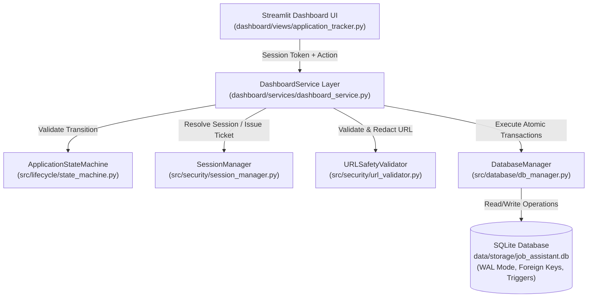

### Component Audit Matrix:

| Subsystem | Existing Implementation & Status | Source Files | Tracker Architectural Role |
| :--- | :--- | :--- | :--- |
| **Streamlit Framework** | Python 3.11/3.13 Streamlit multipage application utilizing `st.navigation`, `st.Page`, custom CSS, and session state (`st.session_state`). | `dashboard/app.py`<br>`dashboard/views/` | Hosts the Candidate Application Tracker page (`render_application_tracker`), rendering reactive UI components, metrics, tables, cards, and modal forms. |
| **Application Tracker View** | Legacy catalog job tracker from Phase 2/6 querying `service.get_all_jobs_df()` from the public scraper `jobs` table. Does not query multi-user `applications`. | `dashboard/views/application_tracker.py` | **Must be completely rewritten in Phase 7.3.2** to interface with candidate-scoped `DashboardService` application lifecycle methods. |
| **Application State Machine** | Formal 12-status state machine (`ApplicationStateMachine`) enforcing the canonical transition matrix, gate protection, terminal states, legacy alias normalization, and pairwise audit event typing. | `src/lifecycle/state_machine.py` | Dictates valid next states, prevents illegal transitions, forbids generic bypasses of gate-protected states (`APPROVED`, `SUBMITTED`), and drives dynamic UI action buttons. |
| **Service Layer** | `DashboardService` acts as the authoritative application controller. Contains hardened methods for session resolution, application CRUD, state transitions, timeline retrieval, manual submission confirmation, and external URL logging. | `dashboard/services/dashboard_service.py` | Serves as the sole interface for the tracker UI. All data fetching, filtering, action ticket verification, and status mutations flow through this layer. |
| **Session & Cryptography** | `SessionManager` manages PBKDF2 authentication, 256-bit entropy sessions, HMAC-SHA256 single-use action tickets (`MANUAL_SUBMISSION`, `PACKET_APPROVAL`), key rotation, and replay prevention registries. | `src/security/session_manager.py` | Validates candidate identity on every UI request and issues/consumes single-use cryptographic tickets for gate-protected actions. |
| **Database & Persistence** | `DatabaseManager` backed by SQLite in WAL mode with foreign key enforcement (`PRAGMA foreign_keys = ON`), immediate write transactions (`immediate_transaction`), and append-only database triggers. | `src/database/db_manager.py`<br>`src/database/schema.sql`<br>`src/database/models.py` | Houses the fully normalized relational schema: `applications`, `application_events`, `submission_confirmations`, `application_follow_ups`, `prepared_packets`, and `application_approvals`. |
| **URL Security** | `URLSafetyValidator` defends against SSRF, cloud metadata exfiltration, loopback/private IP scanning, and invalid URI schemes with injectable DNS resolvers. | `src/security/url_validator.py` | Validates employer application links before presentation or logging, while `_redact_sensitive_url()` scrubs tokens and fragments from audit logs. |

---

## 3. Lifecycle State & Transition Matrix

The platform strictly enforces 12 canonical universal statuses. Arbitrary string literals or unvalidated status mutations are rejected by `ApplicationStateMachine.validate_transition()`.

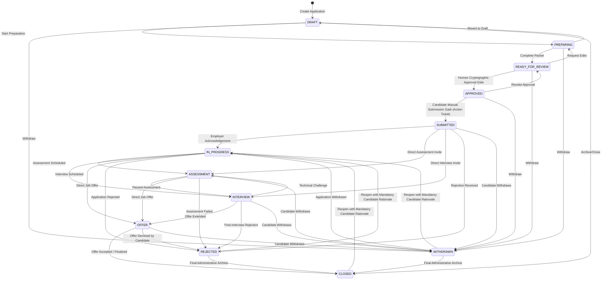

### Detailed Lifecycle State Specifications:

| Status Enum | Display Label | Phase Category | Semantics & Entry Conditions | Permitted Next Transitions | Gate Protection Level |
| :--- | :--- | :--- | :--- | :--- | :--- |
| `DRAFT` | Draft | In Preparation | Application workspace initialized; basic company and title captured; materials not yet generated. | `PREPARING`, `WITHDRAWN`, `CLOSED` | Standard (Candidate) |
| `PREPARING` | Preparing | In Preparation | Tailored resume, cover letter, and screening question responses are being drafted or edited. | `READY_FOR_REVIEW`, `DRAFT`, `WITHDRAWN` | Standard (Candidate) |
| `READY_FOR_REVIEW` | Ready for Review | In Review | Consolidated application packet generated and ready for candidate human inspection and sign-off. | `APPROVED`, `PREPARING`, `WITHDRAWN` | Standard (Candidate) |
| `APPROVED` | Approved | In Review | Application packet verified and cryptographically signed by candidate via `HumanApprovalGate`. | `SUBMITTED`, `READY_FOR_REVIEW`, `WITHDRAWN` | **Gate Protected:** Requires `HumanApprovalGate.authorize_universal_packet()` |
| `SUBMITTED` | Submitted | Applied / Active | Candidate has externally submitted on employer portal and recorded confirmation details. | `IN_PROGRESS`, `ASSESSMENT`, `INTERVIEW`, `REJECTED`, `WITHDRAWN` | **Gate Protected:** Requires `record_candidate_manual_submission()` with action ticket |
| `IN_PROGRESS` | In Progress | Active Pipeline | Employer acknowledged application; under recruiter review; or reopened from terminal status. | `ASSESSMENT`, `INTERVIEW`, `OFFER`, `REJECTED`, `WITHDRAWN` | Standard (Candidate) |
| `ASSESSMENT` | Assessment | Active Pipeline | Candidate invited to complete online test, take-home project, or technical coding assessment. | `INTERVIEW`, `OFFER`, `REJECTED`, `WITHDRAWN` | Standard (Candidate) |
| `INTERVIEW` | Interviewing | Active Pipeline | One or more interview rounds scheduled (recruiter screen, technical, behavioral, executive). | `ASSESSMENT`, `OFFER`, `REJECTED`, `WITHDRAWN` | Standard (Candidate) |
| `OFFER` | Offer Received | Active Pipeline | Formal employment offer received from employer; under review or negotiation. | `CLOSED`, `REJECTED`, `WITHDRAWN` | Standard (Candidate) |
| `REJECTED` | Rejected | Concluded | Formal rejection notice received from employer, or candidate not selected. | `CLOSED`, `IN_PROGRESS` *(Reopen requires rationale)* | Terminal Status |
| `WITHDRAWN` | Withdrawn | Concluded | Candidate voluntarily retracted application from consideration. | `CLOSED`, `IN_PROGRESS` *(Reopen requires rationale)* | Terminal Status |
| `CLOSED` | Closed / Archived | Concluded | Application lifecycle completed, position filled, offer accepted, or administratively archived. | `IN_PROGRESS` *(Reopen requires rationale)* | Terminal Status |

### Cryptographic & Procedural Gate Invariants:

1. **Approval Gate Boundary:**
   - Transitioning an application to `APPROVED` can **never** be accomplished through a generic status dropdown or standard transition method.
   - It strictly requires `HumanApprovalGate.authorize_universal_packet()`, which verifies active login session ownership, recomputes RFC 8785 canonical packet hash integrity, and consumes a single-use HMAC action ticket inside an atomic transaction.
2. **Submission Gate Boundary:**
   - Transitioning an application to `SUBMITTED` can **never** be accomplished through a generic status dropdown or standard transition method.
   - It strictly requires `DashboardService.record_candidate_manual_submission()`, enforcing explicit candidate confirmation (`candidate_confirmed=True`), a valid channel from `SubmissionChannel`, and consumption of a single-use `MANUAL_SUBMISSION` action ticket bound to the exact packet hash.
3. **Reopening Rationale Invariant:**
   - Moving an application from a terminal status (`REJECTED`, `WITHDRAWN`, `CLOSED`) back to `IN_PROGRESS` strictly requires a mandatory, non-empty candidate `reopen_rationale`. Generic transition calls without rationale fail with `ValidationError`.

---

## 4. Functional Requirements

The Candidate Application Tracker must deliver the following functional capabilities across 8 core operational areas:

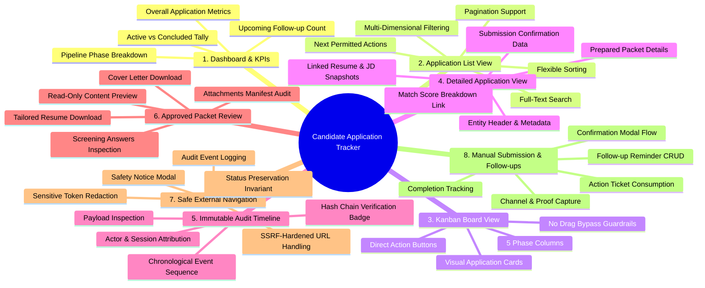

### Functional Area Breakdown:

1. **Candidate Overview Dashboard:**
   - KPI metric chips: Total Tracked, In Preparation (`DRAFT`, `PREPARING`, `READY_FOR_REVIEW`), Approved & Awaiting Submission (`APPROVED`), Active Pipeline (`SUBMITTED`, `IN_PROGRESS`), In Assessment / Interview (`ASSESSMENT`, `INTERVIEW`), Offers Received (`OFFER`), and Concluded (`REJECTED`, `WITHDRAWN`, `CLOSED`).
   - Clean, distinct visual groupings for **Active Applications** vs **Concluded Applications**.
   - Alert card for pending follow-ups due today or overdue.

2. **Application List Interface:**
   - Tabular and card list views displaying company name, target role, normalized status badge, employment type, location, match score, last updated timestamp, and upcoming deadline/follow-up.
   - Dynamic "Next Action" chips derived directly from `ApplicationStateMachine.get_allowed_transitions()`.

3. **Multi-Dimensional Filter & Search Engine:**
   - Filter by status categories: `All`, `Active Pipeline`, `In Preparation`, `Approved`, `In Progress`, `Interviews & Offers`, `Concluded`.
   - Filter by employment type (`Full-time`, `Internship`, `Contract`, `Remote`, `Hybrid`, `On-site`).
   - Text search query across `company_name`, `job_title`, and `notes`.
   - Sorting by `Created Date (Newest/Oldest)`, `Last Updated`, `Deadline (Urgent First)`, and `Company Name (A-Z)`.
   - Server-side / service-layer pagination (`limit=20`, `offset=0`).

4. **Kanban Visual Board:**
   - Five phase columns:
     - **Column 1: Preparation** (`DRAFT`, `PREPARING`)
     - **Column 2: Review & Approval** (`READY_FOR_REVIEW`, `APPROVED`)
     - **Column 3: Submitted & In Progress** (`SUBMITTED`, `IN_PROGRESS`)
     - **Column 4: Assessment & Interview** (`ASSESSMENT`, `INTERVIEW`)
     - **Column 5: Concluded** (`OFFER`, `REJECTED`, `WITHDRAWN`, `CLOSED`)
   - Interactive guardrails: Each card renders permitted action buttons. Drag-and-drop state mutation without gate verification is prohibited.

5. **Comprehensive Application Detail Card:**
   - Expandable view or sub-page showing complete metadata:
     - Core Details: Company, Job Title, Source, Target Role, Location, Salary, Employment Type, Deadline.
     - Linked Records: Job Description (snapshot hash, link to analyzer), Resume (version, file hash, link to resume manager), Match Evaluation (score, tier, factor breakdown).
     - Prepared Packet Snapshot: Revision number, packet version hash, links to download tailored resume and cover letter.
     - Submission Confirmation Details: Channel, candidate-reported timestamp, confirmation reference, uploaded document link.
     - Follow-up Reminders: Due dates, reminder types, notes, complete/delete controls.

6. **Immutable Audit Timeline with Cryptographic Verification:**
   - Chronological list of all events from `application_events` for the selected application.
   - Each event displays event type, sequence number, actor type (`CANDIDATE` / `SYSTEM`), actor identifier, session reference, timestamp (server UTC), and status transition.
   - Interactive expander to inspect the full event payload JSON.
   - Prominent **Cryptographic Hash Chain Verification Badge**:
     - Green Badge: `✓ Audit Chain Verified (Monotonic sequence & SHA-256 hash link intact)`
     - Red Badge: `⚠️ Audit Chain Tampered / Corrupted (Hash link broken or sequence gap detected)` with specific error details from `verify_application_event_chain`.

7. **Approved Packet Read-Only Review Interface:**
   - Dedicated modal or expander to view the active approved packet prior to or after submission:
     - Canonical JSON snapshot version and SHA-256 hash.
     - Tailored resume formatted text preview and download buttons (PDF/DOCX).
     - Tailored cover letter formatted text preview and download buttons (PDF/DOCX).
     - Screening QA responses with category and review state badges (`USER_APPROVED`, `USER_EDITED`, `NEEDS_CANDIDATE_INPUT`).
     - Attachments manifest listing all bundled files with sizes and SHA-256 hashes.
     - Real-time packet integrity check button invoking `DashboardService.verify_prepared_packet_integrity()`.

8. **Safe External Navigation & Disclaimer Card:**
   - External application button with URL safety validation (`URLSafetyValidator`).
   - Automated redaction of sensitive query parameters (tokens, keys, auth codes) and fragments.
   - Audit event emission (`EXTERNAL_APPLICATION_URL_OPENED`).
   - **Critical Safety Invariant:** Status is preserved; navigating externally **never** changes status to `SUBMITTED`.
   - Clear educational disclaimer informing candidate that Antigravity never auto-submits and manual confirmation is required.

9. **Manual Submission Confirmation Workflow:**
   - Dedicated modal/form for applications in `APPROVED` status:
     - Mandatory confirmation checkbox: *"I confirm that I have personally completed and submitted this job application on the employer platform."*
     - Submission channel selection dropdown (`COMPANY_PORTAL`, `LINKEDIN`, `INDEED`, `EMAIL`, `RECRUITER`, `REFERRAL`, `OTHER`).
     - Candidate-reported submission timestamp (defaults to current local time, editable for retroactive entry).
     - Optional confirmation reference / application ID received from employer.
     - Optional confirmation screenshot / confirmation PDF document upload.
     - Optional candidate notes.
     - Cryptographic execution: Requests a single-use `MANUAL_SUBMISSION` action ticket, consumes it, atomically updates application status to `SUBMITTED`, marks approval consumed, inserts submission confirmation record, and emits `SUBMISSION_CONFIRMED` event.

10. **Candidate Follow-up Reminder Management:**
    - Create reminder: Select date, reminder type (`STATUS_INQUIRY`, `THANK_YOU_NOTE`, `PORTFOLIO_UPDATE`, `RECRUITER_CHECKIN`, `PHONE_CALL`, `OTHER`), and description.
    - View active and completed reminders sorted by due date.
    - Mark reminder completed with optional outcome notes.
    - Delete reminder.

---

## 5. Candidate Application Dashboard Architecture

The dashboard serves as the candidate's operational command center. It computes real-time metrics strictly from candidate-scoped database queries, ensuring complete multi-user isolation.

```
+---------------------------------------------------------------------------------------------------+
| 📋 CANDIDATE APPLICATION TRACKER                                      [+ Add New Application]     |
| Track application lifecycles with strict human-in-the-loop verification and cryptographic audit trail     |
+---------------------------------------------------------------------------------------------------+
|  [ 14 ]            [ 3 ]              [ 2 ]            [ 4 ]            [ 3 ]          [ 2 ]      |
|  Total Tracked     In Preparation     Approved         In Progress      Interviews     Offers     |
+---------------------------------------------------------------------------------------------------+
| 🔔 REMINDERS (2 Pending)                                                                          |
| • 2026-11-05: Send Thank You Note to Anthropic (Interview completed 2026-11-04)   [Mark Complete] |
| • 2026-11-08: Status Inquiry for DeepMind (Submitted 2026-10-25)                 [Mark Complete] |
+---------------------------------------------------------------------------------------------------+
|  VIEW MODE:  (•) List View    ( ) Kanban Board                                                    |
|  STATUS: [ All Statuses  v ]  SEARCH: [ Search company, title...    ]  SORT: [ Last Updated v ]   |
+---------------------------------------------------------------------------------------------------+
| [ACTIVE PIPELINE (8 APPLICATIONS)]                                                                |
| ------------------------------------------------------------------------------------------------- |
| [INTERVIEW] Senior ML Engineer at DeepMind                                                        |
| Remote | Full-time | Match: 94.0 (Excellent) | Packet v2 (Approved) | Next: Assessment / Offer    |
| [View Details] [Open Job Link] [Manage Follow-ups] [Advance Status]                               |
| ------------------------------------------------------------------------------------------------- |
| [APPROVED] Staff AI Researcher at Anthropic                                                       |
| San Francisco, CA | Full-time | Match: 91.5 (Excellent) | Packet v1 (Approved) | Ready to Submit  |
| [View Details] [Review Approved Packet] [Open Portal Link] [🚀 Confirm Manual Submission]        |
+---------------------------------------------------------------------------------------------------+
| [CONCLUDED (6 APPLICATIONS)]                                                                      |
| ------------------------------------------------------------------------------------------------- |
| [REJECTED] Junior ML Engineer at OldTech Corp                                                     |
| Closed on 2026-10-20 | Reason: Position filled | [View Audit Timeline] [Reopen Application]       |
+---------------------------------------------------------------------------------------------------+
```

### Metrics Computation Architecture:

All metrics are aggregated dynamically by `DashboardService` querying candidate applications where `user_id = :session_user_id` and `is_archived = 0`:

```python
def get_candidate_tracker_metrics(self, session_id: str) -> Dict[str, int]:
    """Computes real-time tracker KPIs for the authenticated candidate."""
    user_id, _ = self.resolve_authenticated_candidate(session_id)
    apps = self.db.list_user_applications(user_id=user_id)
    
    counts = {
        "total": len(apps),
        "in_preparation": 0,    # DRAFT, PREPARING, READY_FOR_REVIEW
        "approved": 0,          # APPROVED
        "submitted": 0,         # SUBMITTED
        "active_pipeline": 0,   # SUBMITTED, IN_PROGRESS, ASSESSMENT, INTERVIEW, OFFER
        "interviewing": 0,      # ASSESSMENT, INTERVIEW
        "offers": 0,            # OFFER
        "concluded": 0,         # REJECTED, WITHDRAWN, CLOSED
        "follow_ups_due": 0,
    }
    for app in apps:
        stat = ApplicationStateMachine.normalize_status(app.status)
        if stat in (ApplicationStatus.DRAFT, ApplicationStatus.PREPARING, ApplicationStatus.READY_FOR_REVIEW):
            counts["in_preparation"] += 1
        elif stat == ApplicationStatus.APPROVED:
            counts["approved"] += 1
        elif stat in (ApplicationStatus.SUBMITTED, ApplicationStatus.IN_PROGRESS):
            counts["submitted"] += 1
            counts["active_pipeline"] += 1
        elif stat in (ApplicationStatus.ASSESSMENT, ApplicationStatus.INTERVIEW):
            counts["interviewing"] += 1
            counts["active_pipeline"] += 1
        elif stat == ApplicationStatus.OFFER:
            counts["offers"] += 1
            counts["active_pipeline"] += 1
        elif stat in (ApplicationStatus.REJECTED, ApplicationStatus.WITHDRAWN, ApplicationStatus.CLOSED):
            counts["concluded"] += 1

    # Follow-ups due
    follow_ups = self.db.list_application_follow_ups(user_id=user_id, is_completed=0)
    today_str = datetime.now(timezone.utc).strftime("%Y-%m-%d")
    counts["follow_ups_due"] = sum(1 for f in follow_ups if f.follow_up_date <= today_str)

    return counts
```

---

## 6. Application List Architecture

The Application List provides dense, high-efficiency inspection and management of applications with multi-dimensional filtering, searching, and pagination.

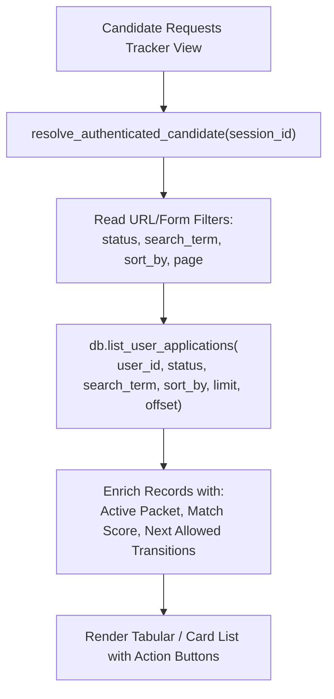

### Filtering & Search Dimensions:

1. **Status Group Filter:**
   - `All Applications` (no status filter)
   - `Active Pipeline` (`SUBMITTED`, `IN_PROGRESS`, `ASSESSMENT`, `INTERVIEW`, `OFFER`)
   - `In Preparation` (`DRAFT`, `PREPARING`, `READY_FOR_REVIEW`)
   - `Approved (Awaiting Submission)` (`APPROVED`)
   - `Interviews & Assessments` (`ASSESSMENT`, `INTERVIEW`)
   - `Offers Received` (`OFFER`)
   - `Concluded` (`REJECTED`, `WITHDRAWN`, `CLOSED`)

2. **Full-Text Search:**
   - Ingests candidate search string.
   - Matches case-insensitively against `applications.company_name`, `applications.job_title`, and `applications.notes`.

3. **Sorting Options:**
   - `Last Updated (Newest First)` (Default: `updated_at DESC`)
   - `Date Created (Newest First)` (`created_at DESC`)
   - `Date Created (Oldest First)` (`created_at ASC`)
   - `Application Deadline (Urgent First)` (`application_deadline ASC NULLS LAST`)
   - `Company Name (A to Z)` (`company_name ASC`)

4. **Dynamic Action Derivation:**
   - For every rendered application, the list view invokes `ApplicationStateMachine.get_allowed_transitions(app.status, include_gate_protected=True)`.
   - The UI surfaces contextual action chips:
     - If current status is `DRAFT`: Show `[Continue Preparation]`.
     - If current status is `READY_FOR_REVIEW`: Show `[Review & Authorize Packet]`.
     - If current status is `APPROVED`: Show `[🚀 Confirm Manual Submission]`, `[Review Packet]`, and `[Open Job Link]`.
     - If current status is `SUBMITTED`: Show `[Acknowledge Recruiter]`, `[Log Interview]`, `[Log Assessment]`.
     - If current status is `INTERVIEW`: Show `[Log Assessment]`, `[Record Offer]`, `[Record Rejection]`.
     - If current status is terminal (`REJECTED`, `WITHDRAWN`, `CLOSED`): Show `[Reopen Application]`.

---

## 7. Kanban View Evaluation & Interactive Guardrails

The Kanban View provides an alternative visual representation of application progress across lifecycle stages.

```
+-----------------------------------------------------------------------------------------------------------------------+
| PREPARATION (3)     | REVIEW & APPROVED (2) | APPLIED / ACTIVE (4)  | INTERVIEWS / OFFERS (3) | CONCLUDED (2)         |
+---------------------+-----------------------+-----------------------+-------------------------+-----------------------+
| [DRAFT]             | [READY_FOR_REVIEW]    | [SUBMITTED]           | [INTERVIEW]             | [REJECTED]            |
| Senior AI Dev       | Staff ML Engineer     | Lead Data Scientist   | Senior Research Eng     | Junior ML Intern      |
| Acme Corp           | Anthropic             | Cohere                | DeepMind                | OldTech Inc           |
| Match: 78.0         | Match: 92.5           | Match: 88.0           | Match: 95.0             | Closed: 2026-10-15    |
| [Continue Prep ->]  | [Review Packet ->]    | [Log Milestone ->]    | [Schedule Follow-up]    | [Reopen with Rationale]
|                     |                       |                       | [Log Offer / Rejection] |                       |
| [PREPARING]         | [APPROVED]            | [IN_PROGRESS]         |                         | [WITHDRAWN]           |
| NLP Specialist      | AI Platform Architect | Senior CV Engineer    | [OFFER]                 | Data Analyst          |
| Mistral             | OpenAI                | Scale AI              | Principal Scientist     | Legacy Corp           |
| Match: 84.0         | Match: 96.0           | Match: 82.0           | Waymo                   | Closed: 2026-10-10    |
| [Edit Packet ->]    | [🚀 Confirm Submit]   | [Log Interview ->]    | Match: 98.0             | [Reopen with Rationale]
|                     | [Open Portal Link]    |                       | [Review Offer]          |                       |
+-----------------------------------------------------------------------------------------------------------------------+
```

### Architectural Evaluation: Kanban in Streamlit:

1. **Streamlit Execution Characteristics:**
   - Streamlit operates via script re-execution on user events.
   - Native drag-and-drop between columns (such as third-party React component wrappers) introduces significant security vulnerabilities unless every drop event is authenticated on the backend.

2. **Strict Interactive Guardrails (Prohibition of Drag-and-Drop Mutation):**
   - **Critical Security Invariant:** In our state machine, transitions to `APPROVED` and `SUBMITTED` require cryptographic action tickets and candidate confirmation evidence.
   - **Arbitrary drag-and-drop state mutation is strictly prohibited.** A user dragging a card from `READY_FOR_REVIEW` into `APPROVED` would bypass `HumanApprovalGate`! A user dragging a card from `APPROVED` into `SUBMITTED` would bypass manual submission confirmation!
   - Therefore, Kanban cards in this architecture are **strictly action-driven**:
     - Cards visually inhabit columns according to their authoritative status in the database.
     - State progression occurs exclusively when the candidate clicks explicit action buttons on the card (e.g. `[🚀 Confirm Submission]`, `[Log Interview]`), triggering the proper gate workflows and modal dialogs.
     - Any attempt to bypass gates via client manipulation fails on backend state machine validation.

---

## 8. Application Detail Architecture

The Application Detail view provides an exhaustive card layout aggregating all associated records for an application.

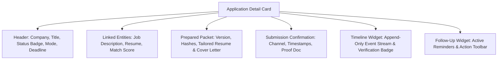

### Card Layout Sections:

1. **Header & Core Metadata:**
   - Target Company and Role Title.
   - Normalized Status Badge (with color coding: Grey for Draft, Blue for In Review, Green for Approved/Submitted, Amber for Interview/Assessment, Emerald for Offer, Red for Rejected, Slate for Withdrawn/Closed).
   - Employment Type, Work Location, Work Arrangement (`Remote`, `Hybrid`, `On-site`), Salary Range.
   - Target Application Deadline with urgency indicator.
   - Candidate Notes editor.

2. **Linked Records & Provenance:**
   - **Job Description:** Linked `job_description_id`, snapshot SHA-256 hash, and one-click navigation to inspect parsed requirements in the Job Analyzer.
   - **Resume Used:** Linked `resume_id`, resume version number, resume file hash, and link to view in Resume Manager.
   - **Match Evaluation:** Overall match score (e.g. `92.5 / 100`), classification tier (`Excellent Match`), and expandable breakdown across 6 scoring dimensions (Domain, Skills, Education, Experience, Location, Duration).

3. **Active Prepared Packet Summary:**
   - Active revision version number (e.g. `Revision 2`).
   - Packet version SHA-256 hash.
   - Tailored Resume: File path, SHA-256 hash, and download buttons (`.pdf`, `.docx`).
   - Tailored Cover Letter: File path, SHA-256 hash, and download buttons (`.pdf`, `.docx`).
   - Screening Questions: Total answered count and breakdown of review states.
   - Attachments Manifest: Bundled documents count.
   - Button: `[Review Prepared Packet]` (opens read-only preview modal).

4. **Submission Confirmation Data (Active when `status >= SUBMITTED`):**
   - Authoritative Submission Channel (`COMPANY_PORTAL`, `LINKEDIN`, etc.).
   - Candidate-Reported Submission Timestamp.
   - Server-Recorded Audit Timestamp (UTC).
   - Confirmation Reference / Application Number.
   - Confirmation Document / Screenshot link and SHA-256 hash.
   - Candidate Submission Notes.
   - Button: `[Edit Submission Confirmation]` (invokes `DashboardService.correct_submission_confirmation()`).

5. **Follow-Up Reminders Section:**
   - List of all follow-ups for this application from `application_follow_ups`.
   - Add new reminder form (date picker, reminder type, description).
   - Toggle completion with outcome notes.

---

## 9. Application Lifecycle Timeline Architecture

The Application Lifecycle Timeline renders the authoritative history of the application, derived from `application_events`.

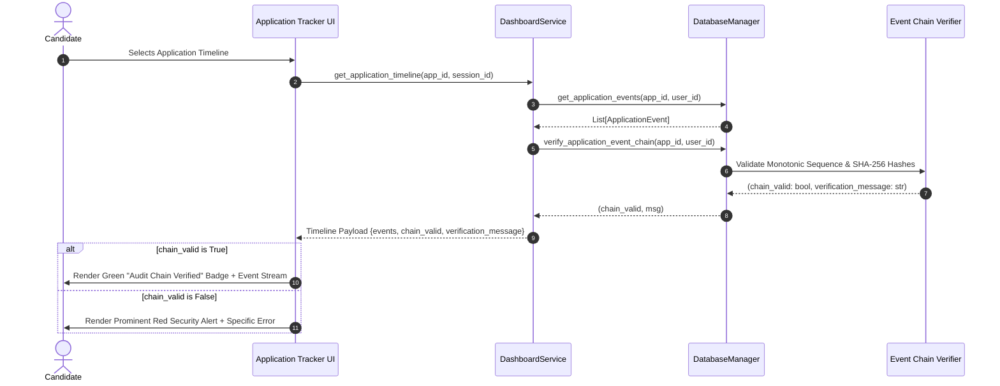

### Visual Event Card Styling:

| Event Type | Icon | Title / Description | Key Metadata Displayed |
| :--- | :---: | :--- | :--- |
| `APPLICATION_PREPARATION_STARTED` | 📝 | Preparation Started | Transition from `DRAFT` to `PREPARING`. |
| `APPLICATION_READY_FOR_REVIEW` | 📋 | Application Ready for Review | Generated packet revision ready for candidate inspection. |
| `PACKET_HUMAN_APPROVED` | 🛡️ | Cryptographic Human Approval | Single-use approval ticket nonce, packet version hash, approver name. |
| `EXTERNAL_APPLICATION_URL_OPENED` | 🌐 | External Employer Portal Visited | Sanitized employer URL (sensitive tokens redacted). Status preserved! |
| `SUBMISSION_CONFIRMED` | 🚀 | Manual Submission Confirmed | Submission channel, candidate-reported timestamp, confirmation doc. |
| `SUBMISSION_CONFIRMATION_UPDATED` | ✏️ | Submission Confirmation Corrected | Corrected channel, reference, or timestamp with correction rationale. |
| `INTERVIEW_MILESTONE_LOGGED` | 👥 | Interview Milestone | Interview round, date, interviewer notes. |
| `ASSESSMENT_MILESTONE_LOGGED` | 💻 | Technical Assessment Logged | Assessment platform, deadline, completion status. |
| `OFFER_RECEIVED` | 🎉 | Employment Offer Received | Offer details, compensation, decision deadline. |
| `REJECTION_RECORDED` | 🛑 | Rejection Recorded | Employer notice date, feedback. |
| `APPLICATION_WITHDRAWN` | ↩️ | Application Withdrawn | Voluntary withdrawal reason. |
| `APPLICATION_REOPENED` | 🔄 | Application Reopened | **Mandatory Candidate Rationale:** Displayed prominently. |
| `APPLICATION_CLOSED` | 📁 | Application Closed | Final administrative archiving. |

### Cryptographic Hash Chain Validation Indicator:

Every render of the timeline executes `DatabaseManager.verify_application_event_chain(application_id, user_id)`:
- Verifies `sequence_no` starts at 1 and increments by exactly 1 with no gaps.
- Verifies `previous_event_hash` of event 1 is `"GENESIS"`.
- Verifies `previous_event_hash` of event $i$ matches `event_hash` of event $i-1$.
- Recomputes SHA-256 over canonical JSON of event fields and asserts equality with stored `event_hash`.
- **UI Presentation:**
  - **Verified State:**
    ```
    ✅ Audit Chain Verified: 8 events cryptographically verified. No tampering detected.
    ```
  - **Compromised / Broken State:**
    ```
    🚨 CRITICAL SECURITY ALERT: Timeline Event Integrity Compromised!
    Hash mismatch detected at sequence #4. Expected hash: 'a1b2...', Found: 'c3d4...'.
    This event sequence may have been altered outside sanctioned database transactions.
    ```

---

## 10. Approved Packet Review Interface

Before submitting or when reviewing historical submissions, candidates must be able to inspect the exact materials that were approved.

```
+---------------------------------------------------------------------------------------------------+
| 📄 APPROVED APPLICATION PACKET — REVISION 2                                            [Close (X)] |
| Application: Senior ML Engineer at DeepMind | Approved on: 2026-11-03 14:22:10 UTC                |
| Packet Version SHA-256: 7f83b1657ff1fc53b92dc18148a1d65dfc2d4b1fa3d677284addd200126d9069           |
| Status: [✓ Cryptographically Valid]                     [Verify Integrity Now]                    |
+---------------------------------------------------------------------------------------------------+
|  [📄 Tailored Resume]    [✉️ Cover Letter]    [❓ Screening QA]    [📎 Attachments Manifest]      |
+---------------------------------------------------------------------------------------------------+
|  TAILORED RESUME PREVIEW                                        [Download PDF]  [Download DOCX]   |
|  ------------------------------------------------------------------------------------------------ |
|  Pranay Agrawal — Senior AI & Mobile Engineer                                                     |
|  Summary: Results-oriented software engineer with verified experience in Python, PyTorch, and...   |
|  Experience:                                                                                      |
|  • Project Manager | Mobile App Development — Sarita Infotech Pvt. Ltd. (Confirmed)              |
|  • Designed and deployed offline-first ABDM compliant healthcare modules...                       |
|  Skills: Python, Machine Learning, Deep Learning, Flutter, SQLite, Git                            |
+---------------------------------------------------------------------------------------------------+
```

### Review Capabilities:

1. **Read-Only Guarantees:**
   - The Approved Packet Review view is strictly read-only.
   - It renders the canonical contents persisted in `prepared_packets.canonical_snapshot_json`.
   - Modifying approved content is prohibited; any changes require generating a new packet revision in the Application Preparer.
2. **Document Downloads:**
   - Direct download links for the exact compiled PDF and DOCX documents generated during packet creation.
   - Verification that file hashes on disk match `tailored_resume_hash` and `cover_letter_hash`.
3. **Screening QA Inspection:**
   - Table of all answered screening questions, showing the question text, candidate's answer, category, and review state (`USER_APPROVED`, `USER_EDITED`).
4. **Real-Time Packet Integrity Re-Verification:**
   - Includes a button to invoke `DashboardService.verify_prepared_packet_integrity()`.
   - Computes SHA-256 over `canonical_snapshot_json` and confirms match with `packet_version_hash`.

---

## 11. Safe External Navigation Architecture

The platform assists candidates in preparing applications, but external submission must be executed personally by the candidate on the employer portal.

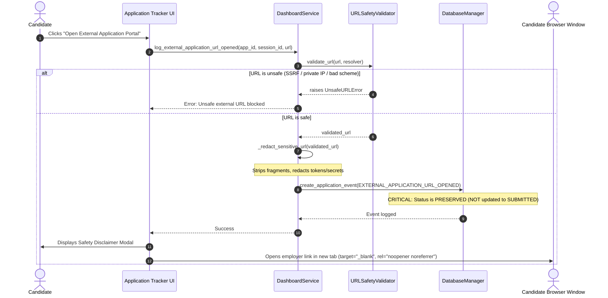

### Safety Rules & URL Redaction:

1. **SSRF Defense via `URLSafetyValidator`:**
   - Blocks private IPv4/IPv6 ranges (`10.0.0.0/8`, `172.16.0.0/12`, `192.168.0.0/16`, `127.0.0.0/8`, `::1`).
   - Blocks cloud metadata endpoints (`169.254.169.254`, `metadata.google.internal`).
   - Blocks unsafe URI schemes (only `http://` and `https://` permitted; rejects `javascript:`, `file:`, `data:`).
   - Rejects URLs containing embedded user credentials (`user:password@host`).
2. **Sensitive Token Scrubbing via `_redact_sensitive_url()`:**
   - Strips URL fragments completely (`#...`) to prevent client-side OAuth access tokens from entering audit logs.
   - Redacts query parameter values case-insensitively if the key matches sensitive terms (`token`, `secret`, `auth`, `key`, `password`, `session`, `jwt`, `code`, `sig`, `bearer`).
3. **Status Preservation Invariant:**
   - Opening an external URL **never** transitions the application to `SUBMITTED`. The application remains in its current status (`APPROVED`).
4. **Candidate Educational Disclaimer Card:**
   - Whenever an external link is clicked, the UI presents an explicit educational notice:
     > **⚠️ External Employer Portal Navigation**  
     > You are opening the employer's official job application portal in a new browser tab.  
     > **Antigravity never submits applications automatically.** Please review your prep packet, fill out the employer's form, attach your tailored resume, and submit manually on their portal. Once submitted, return here and click **"Confirm Manual Submission"** to record your confirmation.

---

## 12. Manual Submission Confirmation Workflow

The Manual Submission Confirmation workflow is the definitive human-in-the-loop bridge between offline preparation and external submission.

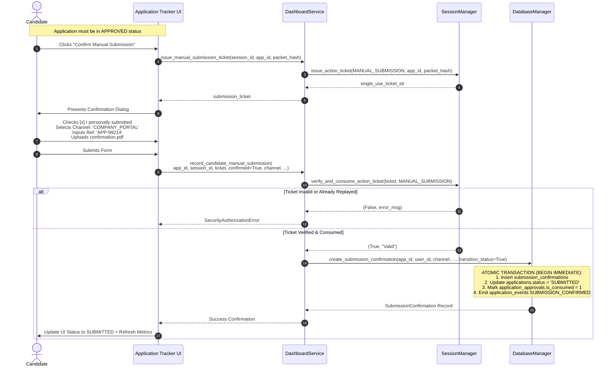

### The Strict 16-Step Verification Protocol:

1. **Resolve Candidate Identity:** Derive `user_id` strictly from active session; reject client-supplied overrides.
2. **Retrieve Application:** Query `applications` scoped to `user_id` (`ApplicationNotFoundError` if missing).
3. **Verify Pre-Submission Status:** Assert `app.status == APPROVED` (reject if `DRAFT`, `PREPARING`, `SUBMITTED`, etc.).
4. **Retrieve Active Prepared Packet:** Query active revision from `prepared_packets`.
5. **Verify Packet Ownership:** Assert `packet.user_id == user_id` and `packet.application_id == app_id`.
6. **Verify Active Revision Status:** Assert `packet.is_active_revision == 1`.
7. **Verify Packet Hash Integrity:** Recompute canonical JSON SHA-256 hash and assert equality with `packet_version_hash`.
8. **Retrieve Human Approval Record:** Query `application_approvals` for `packet_id` and `user_id`.
9. **Confirm Approval Hash Match:** Assert approval record's `packet_version_hash` matches current packet hash.
10. **Confirm Approval Unconsumed:** Assert `approval.is_consumed == 0` (`TicketAlreadyConsumedError` if already consumed).
11. **Require Explicit Candidate Confirmation:** Assert `candidate_confirmed == True` (`UnconfirmedSubmissionError` if unchecked).
12. **Validate Submission Channel:** Assert `submission_channel in SubmissionChannel.list()`.
13. **Verify & Consume Action Ticket:** Validate HMAC-SHA256 signature, expiry, and single-use consumption in `consumed_action_nonces`.
14. **Record Proof Document (Optional):** Validate file format and compute SHA-256 hash if candidate uploaded proof.
15. **Execute Atomic Database Transaction (`immediate_transaction`):**
    - Insert active record into `submission_confirmations`.
    - Atomically update `applications.status = 'SUBMITTED'` and `applications.date_submitted = CURRENT_TIMESTAMP`.
    - Atomically mark `application_approvals.is_consumed = 1` and `consumed_at = CURRENT_TIMESTAMP`.
    - Atomically insert `SUBMISSION_CONFIRMED` event into `application_events` with previous/current hash linkage.
16. **Return Confirmation:** Return persisted `SubmissionConfirmation` model to the client.

---

## 13. Proposed Service / API Specification

Although the frontend is built in Streamlit, all capabilities are defined as clean, decoupled service methods on `DashboardService` that map directly to standard RESTful API endpoints. This guarantees full modularity, automated testability, and future extensibility.

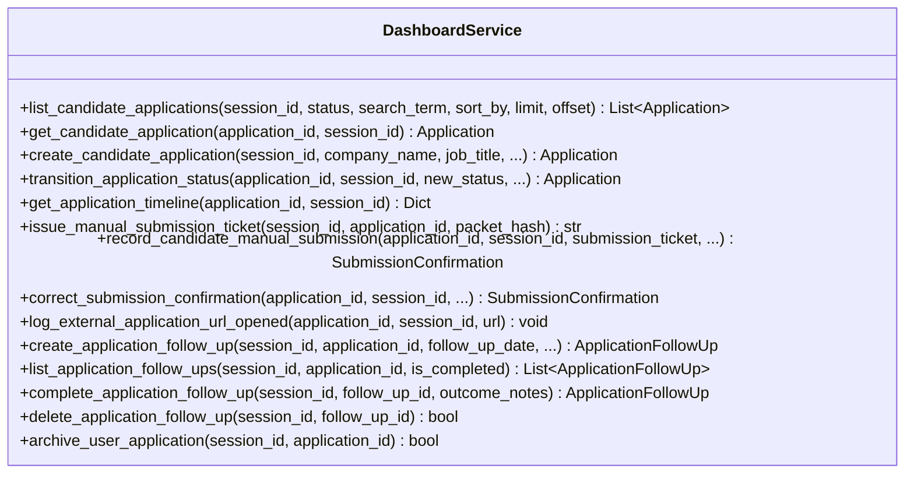

### Detailed Service Method Contracts & REST Mappings:

#### 1. List Candidate Applications
- **HTTP Mapping:** `GET /api/v1/applications`
- **Method:** `DashboardService.list_candidate_applications(session_id, status=None, search_term=None, sort_by=None, limit=20, offset=0)`
- **Inputs:**
  - `session_id` (str, Required): Active candidate session token.
  - `status` (str, Optional): Filter by specific status or category.
  - `search_term` (str, Optional): Case-insensitive search string.
  - `sort_by` (str, Optional): Sort key (`created_at_desc`, `updated_at_desc`, `deadline_asc`, `company_asc`).
  - `limit` (int, Optional): Pagination size (default: 20).
  - `offset` (int, Optional): Pagination offset (default: 0).
- **Outputs:** `List[Application]`
- **Errors:** `InvalidSessionError` (401), `SessionExpiredError` (401).

#### 2. Get Candidate Application Detail
- **HTTP Mapping:** `GET /api/v1/applications/{application_id}`
- **Method:** `DashboardService.get_candidate_application(application_id, session_id)`
- **Inputs:**
  - `application_id` (int, Required): Application ID.
  - `session_id` (str, Required): Active candidate session token.
- **Outputs:** `Application` model.
- **Errors:** `InvalidSessionError` (401), `ApplicationNotFoundError` (404), `CrossUserAccessError` (403).

#### 3. Transition Application Status
- **HTTP Mapping:** `POST /api/v1/applications/{application_id}/transition`
- **Method:** `DashboardService.transition_application_status(application_id, session_id, new_status, expected_current_status=None, transition_metadata=None, reopen_rationale=None)`
- **Inputs:**
  - `application_id` (int, Required): Application ID.
  - `session_id` (str, Required): Active candidate session token.
  - `new_status` (str, Required): Desired target status.
  - `expected_current_status` (str, Optional): Concurrency sanity check.
  - `transition_metadata` (dict, Optional): Context metadata for event payload.
  - `reopen_rationale` (str, Optional): Mandatory if reopening from terminal status.
- **Outputs:** Updated `Application` model.
- **Errors:** `InvalidStatusTransitionError` (400), `SecurityAuthorizationError` (403 - if attempting transition to `APPROVED` or `SUBMITTED`), `ValidationError` (422 - if reopen rationale missing).

#### 4. Issue Manual Submission Ticket
- **HTTP Mapping:** `POST /api/v1/applications/{application_id}/submission-ticket`
- **Method:** `DashboardService.issue_manual_submission_ticket(session_id, application_id, packet_hash)`
- **Inputs:**
  - `session_id` (str, Required): Active candidate session token.
  - `application_id` (int, Required): Application ID.
  - `packet_hash` (str, Required): Active prepared packet SHA-256 hash.
- **Outputs:** `str` (Single-use action ticket `TKT-MANUAL_SUBMISSION-...`).
- **Errors:** `SecurityAuthorizationError` (403 - if status is not `APPROVED` or hash mismatch).

#### 5. Confirm Manual Submission
- **HTTP Mapping:** `POST /api/v1/applications/{application_id}/confirm-submission`
- **Method:** `DashboardService.record_candidate_manual_submission(application_id, session_id, submission_ticket, candidate_confirmed, submission_channel, submission_timestamp=None, confirmation_reference=None, confirmation_doc_path=None, confirmation_doc_hash=None, candidate_notes=None)`
- **Inputs:**
  - `application_id` (int, Required): Application ID.
  - `session_id` (str, Required): Active candidate session token.
  - `submission_ticket` (str, Required): Single-use HMAC action ticket.
  - `candidate_confirmed` (bool, Required): Must be `True`.
  - `submission_channel` (str, Required): Must be member of `SubmissionChannel`.
  - `submission_timestamp` (str, Optional): Candidate-reported local timestamp.
  - `confirmation_reference` (str, Optional): Employer confirmation ID.
  - `confirmation_doc_path` (str, Optional): Path to uploaded proof.
  - `confirmation_doc_hash` (str, Optional): SHA-256 of uploaded proof.
  - `candidate_notes` (str, Optional): Notes.
- **Outputs:** `SubmissionConfirmation` model.
- **Errors:** `UnconfirmedSubmissionError` (400), `ValidationError` (422), `SecurityAuthorizationError` (403), `TicketAlreadyConsumedError` (409).

#### 6. Log External Application URL Opened
- **HTTP Mapping:** `POST /api/v1/applications/{application_id}/open-external-url`
- **Method:** `DashboardService.log_external_application_url_opened(application_id, session_id, url)`
- **Inputs:**
  - `application_id` (int, Required): Application ID.
  - `session_id` (str, Required): Active candidate session token.
  - `url` (str, Required): Target employer application URL.
- **Outputs:** `None`
- **Errors:** `UnsafeURLError` (400), `ApplicationNotFoundError` (404).

#### 7. Retrieve Application Timeline
- **HTTP Mapping:** `GET /api/v1/applications/{application_id}/timeline`
- **Method:** `DashboardService.get_application_timeline(application_id, session_id)`
- **Outputs:** `Dict[str, Any]` containing `application_id`, `user_id`, `events`, `chain_valid`, `verification_message`.

#### 8. Follow-Up Reminders Management
- **Create Reminder:** `POST /api/v1/applications/{application_id}/follow-ups` -> `create_application_follow_up(session_id, application_id, follow_up_date, follow_up_type, description)`
- **List Reminders:** `GET /api/v1/applications/{application_id}/follow-ups` -> `list_application_follow_ups(session_id, application_id=None, is_completed=None)`
- **Complete Reminder:** `POST /api/v1/applications/follow-ups/{follow_up_id}/complete` -> `complete_application_follow_up(session_id, follow_up_id, outcome_notes=None)`
- **Delete Reminder:** `DELETE /api/v1/applications/follow-ups/{follow_up_id}` -> `delete_application_follow_up(session_id, follow_up_id)`

---

## 14. Database Schema Gap Analysis

A rigorous audit of `src/database/schema.sql` was conducted to evaluate whether any database migrations or schema adjustments are required for Phase 7.3.2.

### Table Evaluation Audit:

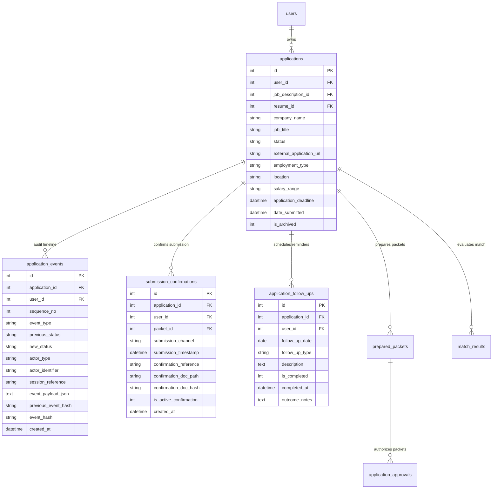

### Table-by-Table Verification:

1. **`applications` Table (Section 8 of `schema.sql`):**
   - Stores `id`, `user_id`, `job_description_id`, `job_id`, `resume_id`, `company_name`, `job_title`, `status`, `application_source`, `external_application_url`, `target_role`, `employment_type`, `location`, `salary_range`, `application_deadline`, `date_prepared`, `date_submitted`, `resume_used`, `cover_letter_reference`, `notes`, `is_archived`, `created_at`, `updated_at`.
   - Has `UNIQUE(id, user_id)` and status CHECK constraint covering all 12 canonical statuses and legacy aliases.
   - **Verdict:** Fully complete. Supports 100% of tracker requirements.

2. **`application_events` Table (Section 8.1 of `schema.sql`):**
   - Append-only schema with monotonic `sequence_no`, `event_type`, `previous_status`, `new_status`, `actor_type`, `actor_identifier`, `session_reference`, `event_payload_json`, `previous_event_hash`, `event_hash`, and `created_at`.
   - Immutable triggers: `trg_prevent_application_events_update` and `trg_prevent_application_events_delete`.
   - **Verdict:** Fully complete.

3. **`submission_confirmations` Table (Section 8.2 of `schema.sql`):**
   - Supports `application_id`, `user_id`, `packet_id`, `packet_version_hash`, `submission_timestamp`, `submission_channel`, `confirmation_reference`, `confirmation_doc_path`, `confirmation_doc_hash`, `candidate_notes`, `is_active_confirmation`, `created_at`.
   - Unique partial index `idx_sub_conf_active_app` ensures only one active confirmation per application.
   - **Verdict:** Fully complete.

4. **`application_follow_ups` Table (Section 8.3 of `schema.sql`):**
   - Supports `application_id`, `user_id`, `follow_up_date`, `follow_up_type`, `description`, `is_completed`, `completed_at`, `outcome_notes`.
   - Foreign key constraint: `FOREIGN KEY (application_id, user_id) REFERENCES applications(id, user_id) ON DELETE CASCADE`.
   - **Verdict:** Fully complete.

5. **`prepared_packets` & `application_approvals` Tables (Sections 9 & 10 of `schema.sql`):**
   - Canonical JSON snapshots, packet hashes, document links, revision tracking, and single-use approval nonces are fully modeled.
   - **Verdict:** Fully complete.

### Schema Gap Conclusion:
**ZERO DATABASE SCHEMA MIGRATIONS REQUIRED FOR PHASE 7.3.2.**  
All required columns, constraints, foreign keys, triggers, and indices were designed and implemented in Phase 7.1 and Phase 7.2.

---

## 15. Multi-User Security & IDOR Threat Model

The Candidate Application Tracker is a primary multi-user interface. It must resist malicious input, authorization bypasses, and cross-user data tampering.

### Threat Modeling & Defense Matrix:

| Threat ID | Threat Vector | Attacker Action / Scenario | Architectural Defense & Mitigation |
| :--- | :--- | :--- | :--- |
| **THREAT-1** | **Insecure Direct Object Reference (IDOR)** | Candidate A modifies the `application_id` parameter to view or mutate Candidate B's application or timeline. | `DashboardService.resolve_authenticated_candidate()` validates session token and extracts verified `user_id`. Every DB query enforces `WHERE id = :app_id AND user_id = :session_user_id`. Cross-user access raises `ApplicationNotFoundError` or `CrossUserAccessError`. |
| **THREAT-2** | **Session User ID Spoofing** | Attacker injects `client_user_id=2` in a form parameter or query string while logged in as User 1. | `resolve_authenticated_candidate` strictly checks `if client_user_id is not None and client_user_id != session_uid: raise CrossUserAccessError`. Client parameters are never trusted. |
| **THREAT-3** | **State Machine Gate Bypass** | Attacker calls status transition with `new_status='APPROVED'` or `'SUBMITTED'` to skip approval or confirmation workflows. | `ApplicationStateMachine.validate_transition` strictly forbids generic transitions to `GATE_PROTECTED_TARGETS`. Caller-supplied booleans are rejected. Calls fail with `SecurityAuthorizationError`. |
| **THREAT-4** | **Submission Action Ticket Replay** | Attacker intercepts a `MANUAL_SUBMISSION` ticket and attempts to reuse it to submit multiple applications or re-submit an existing application. | `SessionManager.verify_and_consume_action_ticket` records consumed tickets in `consumed_action_nonces` and in-memory sets under a process lock. Replays fail immediately with `TicketAlreadyConsumedError`. |
| **THREAT-5** | **Packet Hash Mismatch / Tampering** | Attacker modifies the prepared packet content or points the submission to an outdated or tampered packet revision. | `record_candidate_manual_submission` re-verifies packet integrity via `verify_prepared_packet_integrity` and asserts `packet.is_active_revision == 1` and `packet.packet_version_hash == ticket.packet_hash`. |
| **THREAT-6** | **SSRF & Malicious External Links** | Candidate enters a malicious job URL pointing to internal AWS metadata (`http://169.254.169.254/`) or localhost services. | `URLSafetyValidator.validate_url` performs strict IP resolution, blocking private/loopback/cloud metadata ranges, rejecting credentials and unsupported URI schemes. |
| **THREAT-7** | **Credential & Token Leakage in Audit Logs** | An employer URL contains an OAuth bearer token or session cookie in query parameters or URL fragment (`#access_token=...`). | `_redact_sensitive_url()` completely strips fragments (`#...`) and redacts sensitive query parameters before any event is written to `application_events`. |
| **THREAT-8** | **Audit Timeline Tampering** | An attacker directly alters an event in `application_events` in the SQLite file. | SQLite database triggers reject all `UPDATE` and unauthorized `DELETE` operations. On read, `verify_application_event_chain` validates the SHA-256 hash chain and displays a red tampering alert if the chain is broken. |
| **THREAT-9** | **Silent Terminal State Reopening** | A user or automated script attempts to silently reopen a rejected or withdrawn application without justification. | `ApplicationStateMachine.is_reopening_transition()` mandates a non-empty `reopen_rationale`. Absence of rationale fails validation with `ValidationError`. |

---

## 16. UI/UX Design Blueprint

The Candidate Application Tracker will be implemented in `dashboard/views/application_tracker.py` using Streamlit's native component library, enhanced with structured containers, metrics, and modals.

### Wireframe Specifications:

#### View 1: Header, Metric Chips & Follow-Up Alert Bar
```
+---------------------------------------------------------------------------------------------------+
| 📋 Candidate Application Tracker                                       [+ Ingest New Job / Apply] |
| Monitor and manage your application lifecycles with strict human-in-the-loop safeguards.           |
+---------------------------------------------------------------------------------------------------+
|  [ 12 ]            [ 2 ]              [ 1 ]            [ 4 ]            [ 3 ]          [ 2 ]      |
|  Total Tracked     In Preparation     Approved         In Progress      Interviews     Offers     |
+---------------------------------------------------------------------------------------------------+
| 🔔 PENDING FOLLOW-UP REMINDERS (1 Due Today)                                                      |
| ⚠️ Today: Send Thank You Note to Anthropic (Recruiter: Sarah Jenkins)             [✓ Mark Done]   |
+---------------------------------------------------------------------------------------------------+
```

#### View 2: Controls, View Switcher & Filter Toolbar
```
+---------------------------------------------------------------------------------------------------+
| View: (•) List View   ( ) Kanban Board     |   [🔄 Refresh Data]   [📥 Export Tracker CSV]         |
| ------------------------------------------------------------------------------------------------- |
| Status Category: [ Active Pipeline (7)  v ]  Search: [ DeepMind...      ]  Sort: [ Last Updated v ] |
+---------------------------------------------------------------------------------------------------+
```

#### View 3: Expandable Application Detail Card (List View)
```
+---------------------------------------------------------------------------------------------------+
| ▼ [INTERVIEW] Senior ML Engineer at DeepMind                                (Match: 94.0 - Excellent)
+---------------------------------------------------------------------------------------------------+
| Location: London, UK (Hybrid) | Type: Full-time | Salary: £120k - £140k | Deadline: 2026-11-30     |
| Source: JOB_DESCRIPTION (#14) | Resume: Pranay_AI_2026.pdf (v2) | Packet: Revision 1 (Approved)     |
| ------------------------------------------------------------------------------------------------- |
| [ 🌐 Open Employer Portal ]   [ 📄 Review Approved Packet ]   [ 👥 Log Interview Milestone ]      |
| ------------------------------------------------------------------------------------------------- |
| ► Submission Confirmation Details (Submitted via COMPANY_PORTAL on 2026-10-25 10:14 UTC)          |
| ▼ Application Lifecycle Audit Timeline                                                            |
|    ✅ Audit Chain Verified: 6 events cryptographically linked.                                    |
|    • [2026-10-24 16:30] APPLICATION_PREPARATION_STARTED (Candidate user_1)                         |
|    • [2026-10-24 17:15] PACKET_HUMAN_APPROVED (Nonce: a9f8... Packet Hash: 7f83...)               |
|    • [2026-10-25 09:45] EXTERNAL_APPLICATION_URL_OPENED (URL: https://deepmind.google/careers)    |
|    • [2026-10-25 10:14] SUBMISSION_CONFIRMED (Channel: COMPANY_PORTAL, Ref: DM-98124)             |
|    • [2026-10-28 14:00] INTERVIEW_MILESTONE_LOGGED (Round 1: Technical Systems Interview)        |
| ------------------------------------------------------------------------------------------------- |
| ► Follow-Up Reminders (1 active reminder scheduled for 2026-11-05)                                |
| ------------------------------------------------------------------------------------------------- |
| Next Allowed Transitions: [ Log Assessment ]  [ Record Offer ]  [ Record Rejection ] [ Withdraw ]  |
+---------------------------------------------------------------------------------------------------+
```

#### View 4: Manual Submission Confirmation Modal Dialog (`@st.dialog`)
```
+---------------------------------------------------------------------------------------------------+
| 🚀 CONFIRM MANUAL JOB SUBMISSION                                                                   |
| Application: Staff AI Researcher at Anthropic                                                     |
| Approved Packet Hash: 7f83b1657ff1fc53b92dc18148a1d65dfc2d4b1fa3d677284addd200126d9069           |
+---------------------------------------------------------------------------------------------------+
| ⚠️ Anti-Automation Safety Notice:                                                                 |
| Antigravity never submits applications automatically. Please confirm that you have personally     |
| completed and submitted your application on the employer's official website.                      |
|                                                                                                   |
| [X] I confirm that I have personally completed and submitted this application on the portal.     |
|                                                                                                   |
| Submission Channel:                                                                               |
| [ COMPANY_PORTAL                                                v ]                               |
|                                                                                                   |
| Submission Date & Time:                                                                           |
| [ 2026-11-04 12:30:00                                             ]                               |
|                                                                                                   |
| Confirmation Reference / Application ID (Optional):                                               |
| [ ANTH-2026-88124                                                 ]                               |
|                                                                                                   |
| Upload Confirmation Proof / Screenshot (Optional):                                                |
| [ Browse Files... (PDF, PNG, JPG)                                 ]                               |
|                                                                                                   |
| Candidate Notes (Optional):                                                                       |
| [ Submitted through Greenhouse portal with tailored resume v1.    ]                               |
|                                                                                                   |
| [ Cancel ]                                         [ Confirm Submission & Update Status ]         |
+---------------------------------------------------------------------------------------------------+
```

#### View 5: Terminal State Reopen Modal Dialog (`@st.dialog`)
```
+---------------------------------------------------------------------------------------------------+
| 🔄 REOPEN APPLICATION                                                                              |
| Application: Junior ML Engineer at OldTech Corp (Current Status: REJECTED)                        |
+---------------------------------------------------------------------------------------------------+
| Reopening an application from a terminal status (Rejected, Withdrawn, Closed) resets its status   |
| to IN_PROGRESS and records an immutable audit event.                                              |
|                                                                                                   |
| Mandatory Reopening Rationale:                                                                    |
| [ Recruiter Sarah emailed on Nov 4 stating the position reopened under an expanded team budget.  ] |
|                                                                                                   |
| [ Cancel ]                                                    [ Reopen Application to IN_PROGRESS ] |
+---------------------------------------------------------------------------------------------------+
```

---

## 17. Error Handling & Edge Cases

The Candidate Application Tracker must fail gracefully and securely across all potential edge cases:

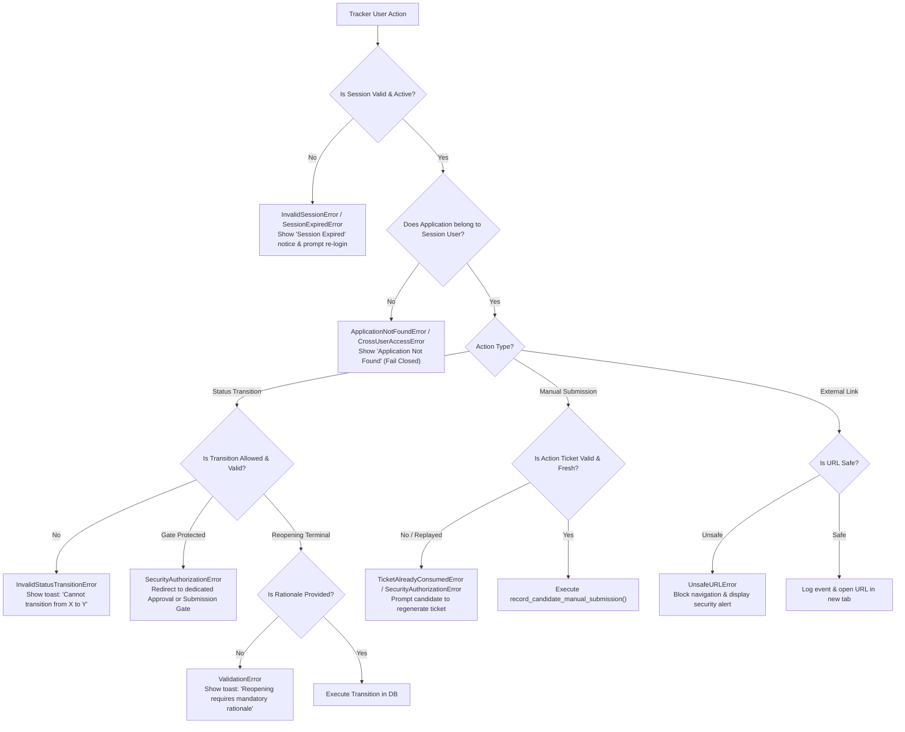

### Edge Case Handling Protocol:

1. **Session Timeout During Form Fill:**
   - If a candidate opens the submission modal and takes longer than 3600s, the ticket expires.
   - The UI intercepts `SessionExpiredError`, preserves form values in `st.session_state["pending_submission_form"]`, prompts the candidate to re-authenticate, and restores form state upon re-login.
2. **Concurrent State Mutation:**
   - If the application status changes in another session (e.g. from `APPROVED` to `READY_FOR_REVIEW`), the submission call passes `expected_current_status='APPROVED'`.
   - The database check fails cleanly with `InvalidStatusTransitionError`, preventing inconsistent transitions.
3. **Audit Chain Disruption Detection:**
   - If `verify_application_event_chain` detects an altered row, missing sequence number, or invalid hash, the timeline disables action buttons and renders an audit warning banner, preserving audit transparency without crashing the UI.
4. **Offline / Network Interruption During External Link Opening:**
   - If DNS resolution or URL validation encounters a network timeout, `URLSafetyValidator` fails closed, preventing blind redirection to unvalidated network endpoints.

---

## 18. Phase 7.3.2 Test Plan

To ensure 100% regression-free implementation, Phase 7.3.2 will deliver dedicated automated test suites targeting every layer of the tracker.

### Test Matrix Breakdown:

```
+---------------------------------------------------------------------------------------------------+
| TEST SUITE                                       | COVERAGE TARGETS                               |
+---------------------------------------------------------------------------------------------------+
| tests/test_candidate_tracker_service.py          | • list_candidate_applications filtering/sorting|
|                                                   | • get_candidate_application ownership isolation|
|                                                   | • transition_application_status guardrails     |
|                                                   | • reopen_rationale mandatory enforcement       |
|                                                   | • get_candidate_tracker_metrics aggregation    |
+---------------------------------------------------------------------------------------------------+
| tests/test_candidate_tracker_submission_flow.py  | • End-to-end manual submission confirmation    |
|                                                   | • issue_manual_submission_ticket binding       |
|                                                   | • Ticket consumption & replay prevention       |
|                                                   | • Submission timestamp vs created_at audit     |
|                                                   | • Proof document upload & SHA-256 hash verify  |
+---------------------------------------------------------------------------------------------------+
| tests/test_candidate_tracker_timeline_chain.py   | • Event timeline retrieval & display order     |
|                                                   | • Hash chain verification indicator            |
|                                                   | • Failure injection: broken sequence gap       |
|                                                   | • Failure injection: tampered event payload    |
|                                                   | • Failure injection: corrupted previous_hash   |
+---------------------------------------------------------------------------------------------------+
| tests/test_candidate_tracker_external_nav.py     | • log_external_application_url_opened flow     |
|                                                   | • Status preservation assertion (NOT SUBMITTED)|
|                                                   | • Sensitive query & fragment stripping         |
|                                                   | • Unsafe URL rejection (SSRF, metadata, file:) |
+---------------------------------------------------------------------------------------------------+
| tests/test_candidate_tracker_follow_ups.py       | • Follow-up CRUD lifecycle                     |
|                                                   | • User ownership isolation on follow-ups       |
|                                                   | • Completion marking with outcome notes        |
|                                                   | • Due date filtering and metric calculation    |
+---------------------------------------------------------------------------------------------------+
| tests/test_candidate_tracker_security_idor.py     | • Cross-user application access attempts       |
|                                                   | • Client user ID spoofing rejection            |
|                                                   | • Direct transition attempt to APPROVED/SUBMIT |
|                                                   | • Expired session rejection                    |
+---------------------------------------------------------------------------------------------------+
```

### Regression Safety Invariant:
All 690 pre-existing automated unit and integration tests across Phase 1 through Phase 7.2.2.4 **must remain 100% passing** with zero regressions.

---

## 19. Implementation Subphase Breakdown

Phase 7.3.2 will be executed in 5 disciplined, sequential subphases:

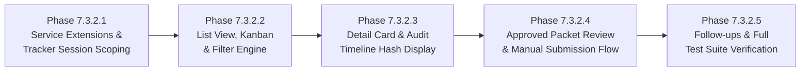

### Detailed Subphase Breakdown:

1. **Phase 7.3.2.1: Service Layer Extensions & Tracker Foundation**
   - Add `get_candidate_tracker_metrics()` to `DashboardService`.
   - Add helper methods for application enrichment (attaching active packet summary and next allowed transitions).
   - Verify multi-user session scoping across all tracker queries.
   - Unit test service methods in isolation.

2. **Phase 7.3.2.2: List View, Kanban Board & Filter Engine**
   - Refactor `dashboard/views/application_tracker.py` to eliminate legacy catalog jobs DataFrame.
   - Implement header KPI metric chips and active vs concluded application separation.
   - Build multi-dimensional filter bar (status group, employment type, full-text search, sort order).
   - Implement responsive List View and 5-column Kanban Board View with action-driven cards.

3. **Phase 7.3.2.3: Detailed Application Card & Immutable Timeline Display**
   - Implement expandable application detail card layout.
   - Integrate linked Job Description, Resume, and Match Score views.
   - Build chronological audit timeline display with visual event icons and payload inspection.
   - Implement real-time Cryptographic Hash Chain Verification Badge (green verified vs red alert).

4. **Phase 7.3.2.4: Approved Packet Review, Safe Navigation & Submission Confirmation**
   - Build read-only Approved Packet Review modal dialog (`@st.dialog`).
   - Implement safe external employer navigation with safety disclaimer and status preservation invariant.
   - Implement the 16-step Manual Submission Confirmation modal dialog with single-use action ticket consumption.
   - Implement terminal status reopening modal requiring mandatory candidate rationale.

5. **Phase 7.3.2.5: Follow-Up Reminder Management & Verification Test Suite**
   - Build Follow-Up Reminder CRUD UI (list, create, mark complete, delete).
   - Author comprehensive automated test suites covering all tracker functionality.
   - Run full regression suite (all 690+ tests passing, 0 lint/type errors).
   - Verify end-to-end interactive workflow in Streamlit via Playwright MCP.

---

## 20. Risks, Constraints & In-Memory Limitations

### 1. Single-Process Execution & Session Memory Bounds
- **Risk:** `SessionManager` maintains active and consumed ticket registries in memory (`_active_tickets`, `_consumed_grants`, `_consumed_tickets`), backed by database table `consumed_action_nonces`.
- **Constraint:** In multi-worker deployments (e.g. multiple Streamlit worker processes or Gunicorn instances), memory caches do not share state unless sticky sessions or a shared Redis/database store is used.
- **Mitigation:** The architecture enforces database-level persistence for replay prevention (`consumed_action_nonces`) and locks database rows via `immediate_transaction()`. This guarantees that even across separate processes, duplicate ticket consumption fails at the database boundary.

### 2. Streamlit Re-Execution & State Persistence
- **Risk:** Streamlit re-executes the entire script on every user interaction. If state is not carefully managed in `st.session_state`, active dialogs, pagination offsets, and search filters can reset unexpectedly.
- **Mitigation:** All tracker filter selections, search terms, active application IDs, and pagination cursors are keyed and persisted in `st.session_state`.

### 3. Concurrency & SQLite Write Lock Contention
- **Risk:** High-frequency simultaneous transitions could cause `sqlite3.OperationalError: database is locked`.
- **Mitigation:** `DatabaseManager` runs in WAL mode with a 30-second busy timeout (`timeout=30.0`) and uses `immediate_transaction()` to cleanly acquire the write lock upfront or retry safely.

---

## 21. Phase 7.3.2 Acceptance Criteria

Phase 7.3.2 will be deemed complete when all the following criteria are empirically verified:

- [ ] **AC-1 (Multi-User Isolation):** The tracker displays only applications, timeline events, prepared packets, and follow-ups belonging to the authenticated candidate. Unauthenticated sessions fail closed.
- [ ] **AC-2 (Metrics Accuracy):** The dashboard accurately aggregates KPI metrics (Total, In Preparation, Approved, Active, Interviews, Offers, Concluded, Due Follow-ups) from live database records.
- [ ] **AC-3 (List & Filter Performance):** Candidates can filter by status group, search by text, sort by multiple criteria, and paginate through applications without UI errors.
- [ ] **AC-4 (Kanban Guardrails):** The Kanban board organizes applications into 5 phase columns with action buttons. Arbitrary drag-and-drop state mutation without gate verification is completely prohibited.
- [ ] **AC-5 (Detail Card Completeness):** The detail card displays core metadata, linked JD snapshot, linked resume version, match score breakdown, and prepared packet summary.
- [ ] **AC-6 (Audit Timeline & Hash Verification):** The timeline displays all chronological events with actor attribution. The green hash verification badge displays when intact; failure injection displays a prominent red tampering alert.
- [ ] **AC-7 (Read-Only Packet Review):** Candidates can inspect approved packets (tailored resume, cover letter, screening answers, attachments manifest) and download compiled PDF/DOCX files.
- [ ] **AC-8 (External Link Safety & Status Preservation):** Opening an employer URL validates the link via `URLSafetyValidator`, scrubs tokens/fragments, logs `EXTERNAL_APPLICATION_URL_OPENED`, and **strictly preserves existing status** without updating to `SUBMITTED`.
- [ ] **AC-9 (Manual Submission Workflow):** For `APPROVED` applications, the candidate can confirm submission by selecting a valid channel, checking the confirmation box, and consuming a single-use action ticket, atomically updating status to `SUBMITTED`.
- [ ] **AC-10 (Terminal Reopen Rationale):** Reopening a `REJECTED`, `WITHDRAWN`, or `CLOSED` application back to `IN_PROGRESS` strictly enforces a non-empty candidate rationale.
- [ ] **AC-11 (Follow-up Reminder Management):** Candidates can create, view, complete, and delete follow-up reminders linked to applications.
- [ ] **AC-12 (Zero Regressions & 100% Test Pass Rate):** All new automated test suites pass, all 690 pre-existing project tests pass (100% pass rate), 0 pyflakes errors, and 0 ruff errors.
- [ ] **AC-13 (Zero Database Migrations):** Phase 7.3.2 executes without altering the database schema or requiring table migrations.

---

## 22. Phase Status & Next Actions

- **PHASE 7.3.1 STATUS:** COMPLETE.
- **PHASE 7.3.2 IMPLEMENTATION:** NOT STARTED.
- **USER ARCHITECTURE APPROVAL:** REQUIRED BEFORE PHASE 7.3.2.
