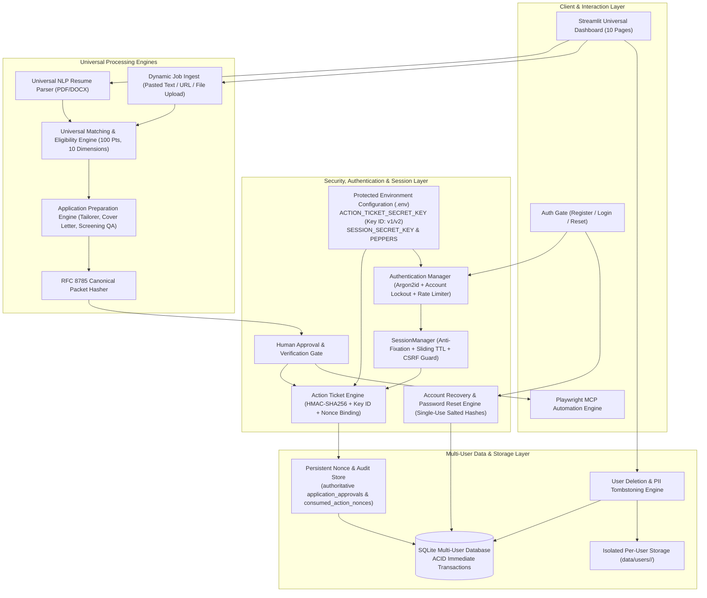
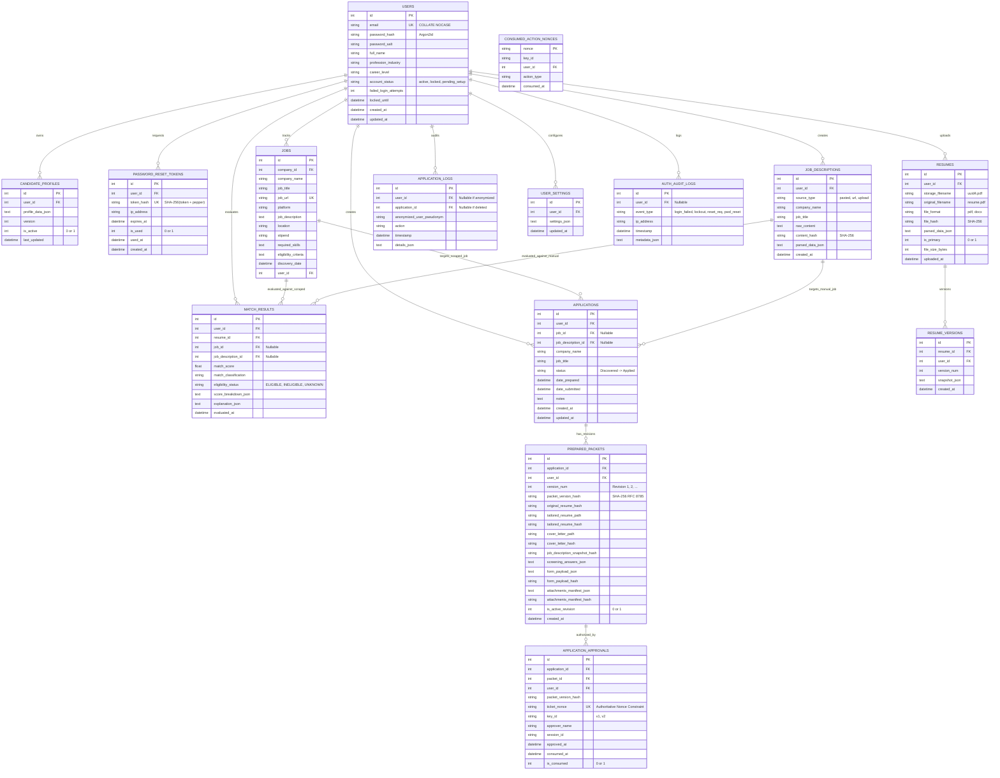
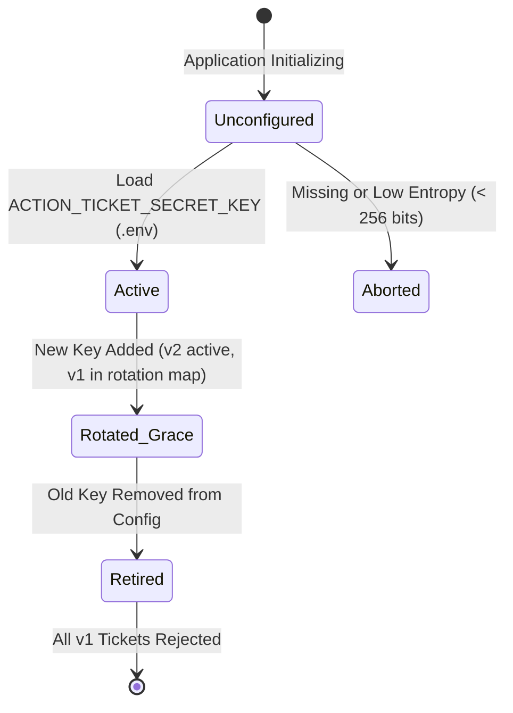
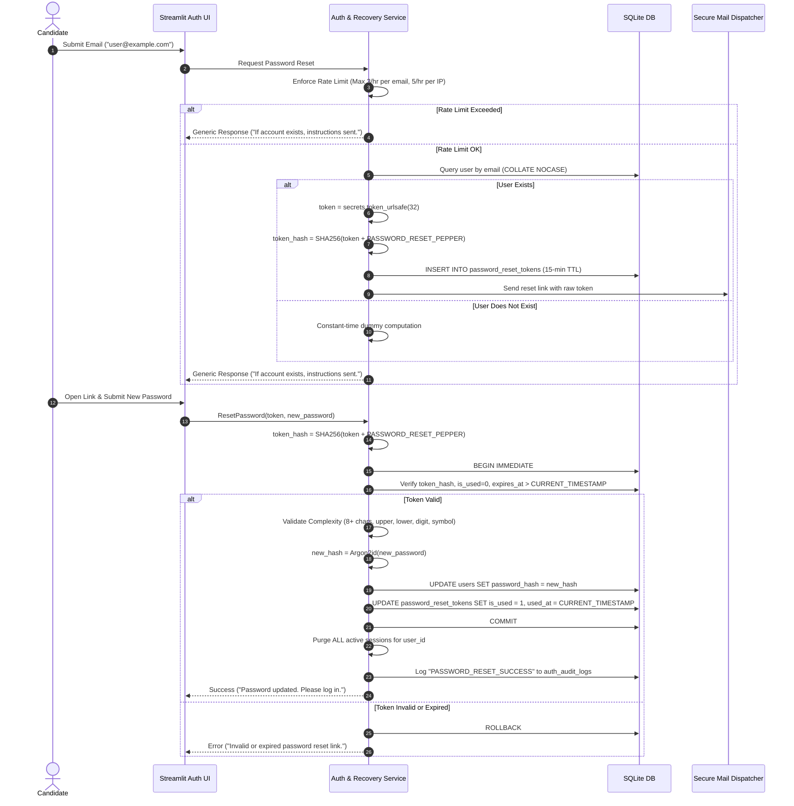
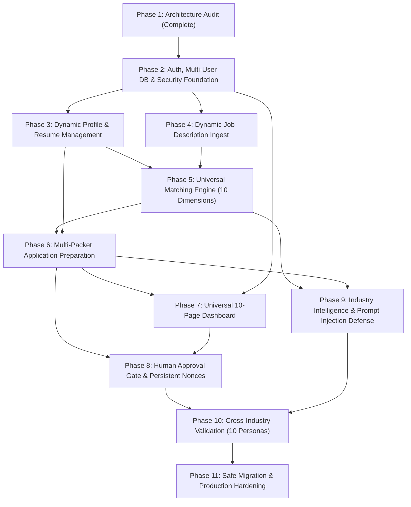

# Universal AI Job Application Assistant — Architecture Specification v2.1.0
## Multi-User, Multi-Industry Platform Specification & Implementation Blueprint

**Document Version:** 2.1.0 (Final Approved Specification)  
**Status:** Architecture Blueprint (Ready for Phase 2 Implementation)  
**Date:** November 2, 2026  
**Audience:** System Architects, Security Engineers, AI Agents & Contributors  

---

## Executive Summary & Architecture Principles

The **Universal AI Job Application Assistant** is a privacy-first, multi-tenant platform engineered to support job seekers across **any profession, industry, career stage, or educational background** (including healthcare, finance, legal, sales, engineering, creative arts, and software).

The v2.1.0 specification finalizes all core architectural corrections approved in principle:
1. **HMAC Secret Management:** Replaces ephemeral server secrets with environment-loaded, 256-bit server-side keys supporting deliberate operator rotation, zero client/log exposure, and instant invalidation of tickets signed with retired keys.
2. **Complete Application Packet Integrity:** Expands `packet_version_hash` across all 11 application materials using deterministic RFC 8785 Canonical JSON serialization. Any post-approval change invalidates the approval automatically.
3. **Persistent Nonce and Approval Tracking:** Establishes transactional SQLite database records as the authoritative source of truth for consumed nonces (`UNIQUE` constraint on `ticket_nonce`), with atomic `BEGIN IMMEDIATE` consumption preventing concurrency race conditions, replays, and cross-user reuse.
4. **Password Reset and Account Recovery:** Defines verified email ownership, single-use tokens stored as salted SHA-256 hashes, 15-minute TTL, strict rate limiting, total session invalidation, and anti-enumeration generic responses.
5. **Safe Candidate Migration:** Isolates legacy profile data into an offline test fixture (`tests/fixtures/candidate_profile_fixture.json`). Zero public default accounts or shared passwords exist in runtime databases.
6. **Data Retention and User-Controlled Deletion:** Implements granular user-controlled deletion across all uploaded and generated assets, paired with an anonymized cryptographic audit tombstone that preserves regulatory human-in-the-loop proof without retaining candidate PII.
7. **Multiple Applications and Versions:** Removes schema bottlenecks to allow multiple applications per role and multiple versioned packets (`prepared_packets`) with immutable historical hashes and distinct approval records.

---

## 1. System Architecture Overview



---

## 2. Multi-User Entity-Relationship (ER) Model

The database schema guarantees strict referential integrity, user ownership, cascading cleanup, and support for independent manually entered job descriptions.



### Detailed Entity Relationship Explanations

1. **`USERS` to `CANDIDATE_PROFILES` (1:N):** A user owns one active structured candidate profile and historical profile snapshots. Profile data is stored in flexible JSON accommodating diverse profession schemas (medical licenses, bar admissions, engineering certifications, tech skills).
2. **`USERS` to `PASSWORD_RESET_TOKENS` (1:N):** A user can initiate password recovery requests. Each token is single-use, expires in 15 minutes, and is stored strictly as a salted SHA-256 hash.
3. **`USERS` to `RESUMES` (1:N) & `RESUME_VERSIONS` (1:N):** A user can upload multiple resumes (e.g., Clinical vs Research, Executive vs Technical) with one designated primary resume (`idx_user_primary_resume`). Each resume maintains an immutable audit log of edits and parses.
4. **`USERS` to `JOB_DESCRIPTIONS` (1:N):** Users can paste or upload arbitrary job descriptions without scraping dependencies. These records exist independently and can directly power match results and application preparation.
5. **`USERS` to `JOBS` (1:N):** Scraped or catalog jobs discovered via platform adapters. Can be associated with specific user searches or shared across platform discovery.
6. **`JOBS` / `JOB_DESCRIPTIONS` to `MATCH_RESULTS` (1:N):** A match evaluation references **either** a discovered `job_id` or a manual `job_description_id`. This allows candidates to evaluate pasted postings instantly without needing a scraped job entity.
7. **`JOBS` / `JOB_DESCRIPTIONS` to `APPLICATIONS` (1:N):** An application references either a discovered `job_id` or a manual `job_description_id`. Crucially, **no unique constraint prevents multiple applications for the same job**, allowing multiple tailored applications for different requisitions or distinct approaches.
8. **`APPLICATIONS` to `PREPARED_PACKETS` (1:N):** Each application contains one or more prepared packet revisions ($v_1, v_2, \dots$). Each packet contains its own tailored resume, cover letter, screening answers, and immutable RFC 8785 version hash.
9. **`PREPARED_PACKETS` to `APPLICATION_APPROVALS` (1:N):** Explicit human approvals bind directly to a specific packet revision's immutable version hash and unique ticket nonce. Authorizing revision $v_1$ does not authorize revision $v_2$.
10. **`APPLICATION_APPROVALS` & `CONSUMED_ACTION_NONCES`:** The database enforces uniqueness on `ticket_nonce`. Once consumed, a nonce can never be reused, preventing replay attacks across all nodes.
11. **`APPLICATIONS` to `APPLICATION_LOGS` (1:N):** Comprehensive audit trail. Supports cryptographic pseudonymization (`anonymized_user_pseudonym`) upon user deletion requests, preserving compliance logs without retaining candidate PII.

---

## 3. Database Schema & Integrity Specifications

```sql
PRAGMA foreign_keys = ON;

-- ---------------------------------------------------------------------
-- 1. USERS TABLE
-- ---------------------------------------------------------------------
CREATE TABLE IF NOT EXISTS users (
    id INTEGER PRIMARY KEY AUTOINCREMENT,
    email TEXT NOT NULL UNIQUE COLLATE NOCASE,
    password_hash TEXT NOT NULL,
    password_salt TEXT NOT NULL,
    full_name TEXT NOT NULL,
    profession_industry TEXT,
    career_level TEXT,
    account_status TEXT NOT NULL DEFAULT 'active' CHECK(account_status IN ('active', 'locked', 'pending_setup')),
    failed_login_attempts INTEGER DEFAULT 0,
    locked_until DATETIME,
    created_at DATETIME DEFAULT CURRENT_TIMESTAMP,
    updated_at DATETIME DEFAULT CURRENT_TIMESTAMP
);

-- ---------------------------------------------------------------------
-- 2. PASSWORD RESET TOKENS (Single-Use, Salted Hash, Anti-Enumeration)
-- ---------------------------------------------------------------------
CREATE TABLE IF NOT EXISTS password_reset_tokens (
    id INTEGER PRIMARY KEY AUTOINCREMENT,
    user_id INTEGER NOT NULL REFERENCES users(id) ON DELETE CASCADE,
    token_hash TEXT NOT NULL UNIQUE,
    ip_address TEXT,
    expires_at DATETIME NOT NULL,
    is_used INTEGER DEFAULT 0 CHECK(is_used IN (0, 1)),
    used_at DATETIME,
    created_at DATETIME DEFAULT CURRENT_TIMESTAMP
);

-- ---------------------------------------------------------------------
-- 3. CANDIDATE PROFILES
-- ---------------------------------------------------------------------
CREATE TABLE IF NOT EXISTS candidate_profiles (
    id INTEGER PRIMARY KEY AUTOINCREMENT,
    user_id INTEGER NOT NULL REFERENCES users(id) ON DELETE CASCADE,
    profile_data TEXT NOT NULL,
    version INTEGER DEFAULT 1,
    is_active INTEGER DEFAULT 1 CHECK(is_active IN (0, 1)),
    last_updated DATETIME DEFAULT CURRENT_TIMESTAMP
);

-- ---------------------------------------------------------------------
-- 4. RESUMES & VERSION HISTORY
-- ---------------------------------------------------------------------
CREATE TABLE IF NOT EXISTS resumes (
    id INTEGER PRIMARY KEY AUTOINCREMENT,
    user_id INTEGER NOT NULL REFERENCES users(id) ON DELETE CASCADE,
    storage_filename TEXT NOT NULL,
    original_filename TEXT NOT NULL,
    file_format TEXT NOT NULL CHECK(file_format IN ('pdf', 'docx')),
    file_hash TEXT NOT NULL,
    parsed_data TEXT,
    is_primary INTEGER DEFAULT 0 CHECK(is_primary IN (0, 1)),
    file_size_bytes INTEGER NOT NULL,
    uploaded_at DATETIME DEFAULT CURRENT_TIMESTAMP
);

CREATE UNIQUE INDEX IF NOT EXISTS idx_user_primary_resume ON resumes(user_id) WHERE is_primary = 1;

CREATE TABLE IF NOT EXISTS resume_versions (
    id INTEGER PRIMARY KEY AUTOINCREMENT,
    resume_id INTEGER NOT NULL REFERENCES resumes(id) ON DELETE CASCADE,
    user_id INTEGER NOT NULL REFERENCES users(id) ON DELETE CASCADE,
    version_num INTEGER NOT NULL,
    snapshot_json TEXT NOT NULL,
    created_at DATETIME DEFAULT CURRENT_TIMESTAMP,
    UNIQUE(resume_id, version_num)
);

-- ---------------------------------------------------------------------
-- 5. JOB DESCRIPTIONS (User Provided: Pasted, URL, Upload)
-- ---------------------------------------------------------------------
CREATE TABLE IF NOT EXISTS job_descriptions (
    id INTEGER PRIMARY KEY AUTOINCREMENT,
    user_id INTEGER NOT NULL REFERENCES users(id) ON DELETE CASCADE,
    source_type TEXT NOT NULL CHECK(source_type IN ('pasted', 'url', 'upload')),
    company_name TEXT NOT NULL,
    job_title TEXT NOT NULL,
    raw_content TEXT NOT NULL,
    content_hash TEXT NOT NULL,
    parsed_data TEXT,
    created_at DATETIME DEFAULT CURRENT_TIMESTAMP
);

-- ---------------------------------------------------------------------
-- 6. DISCOVERED JOBS (Scraped or Platform Catalog)
-- ---------------------------------------------------------------------
CREATE TABLE IF NOT EXISTS jobs (
    id INTEGER PRIMARY KEY AUTOINCREMENT,
    company_id INTEGER REFERENCES companies(id) ON DELETE SET NULL,
    company_name TEXT NOT NULL,
    job_title TEXT NOT NULL,
    job_description TEXT,
    job_url TEXT NOT NULL UNIQUE,
    location TEXT,
    stipend TEXT,
    required_skills TEXT,
    eligibility_criteria TEXT,
    application_deadline TEXT,
    match_score REAL DEFAULT 0.0,
    match_classification TEXT,
    is_eligible INTEGER DEFAULT 1,
    score_breakdown TEXT,
    discovery_date DATETIME DEFAULT CURRENT_TIMESTAMP,
    platform TEXT NOT NULL,
    work_arrangement TEXT,
    publication_date TEXT,
    internship_duration TEXT,
    listing_status TEXT DEFAULT 'ACTIVE',
    last_verified DATETIME DEFAULT CURRENT_TIMESTAMP,
    extraction_confidence REAL DEFAULT 1.0,
    notes TEXT,
    user_id INTEGER REFERENCES users(id) ON DELETE SET NULL,
    created_at DATETIME DEFAULT CURRENT_TIMESTAMP,
    updated_at DATETIME DEFAULT CURRENT_TIMESTAMP
);

-- ---------------------------------------------------------------------
-- 7. MATCH RESULTS (Dual-Reference: Scraped Job or Manual Description)
-- ---------------------------------------------------------------------
CREATE TABLE IF NOT EXISTS match_results (
    id INTEGER PRIMARY KEY AUTOINCREMENT,
    user_id INTEGER NOT NULL REFERENCES users(id) ON DELETE CASCADE,
    resume_id INTEGER REFERENCES resumes(id) ON DELETE CASCADE,
    job_id INTEGER REFERENCES jobs(id) ON DELETE CASCADE,
    job_description_id INTEGER REFERENCES job_descriptions(id) ON DELETE CASCADE,
    match_score REAL NOT NULL,
    match_classification TEXT NOT NULL,
    eligibility_status TEXT NOT NULL CHECK(eligibility_status IN ('ELIGIBLE', 'INELIGIBLE', 'UNKNOWN')),
    score_breakdown TEXT NOT NULL,
    explanation TEXT NOT NULL,
    evaluated_at DATETIME DEFAULT CURRENT_TIMESTAMP,
    CHECK (
        (job_id IS NOT NULL AND job_description_id IS NULL) OR 
        (job_id IS NULL AND job_description_id IS NOT NULL) OR
        (job_id IS NOT NULL AND job_description_id IS NOT NULL)
    )
);

-- ---------------------------------------------------------------------
-- 8. APPLICATIONS (Supports Multiple Applications per Role)
-- ---------------------------------------------------------------------
CREATE TABLE IF NOT EXISTS applications (
    id INTEGER PRIMARY KEY AUTOINCREMENT,
    user_id INTEGER NOT NULL REFERENCES users(id) ON DELETE CASCADE,
    job_id INTEGER REFERENCES jobs(id) ON DELETE CASCADE,
    job_description_id INTEGER REFERENCES job_descriptions(id) ON DELETE CASCADE,
    company_name TEXT NOT NULL,
    job_title TEXT NOT NULL,
    status TEXT NOT NULL DEFAULT 'Discovered' CHECK (status IN (
        'Discovered',
        'Under Review',
        'Shortlisted',
        'Application Prepared',
        'Awaiting Approval',
        'Applied',
        'Interview',
        'Rejected',
        'Withdrawn'
    )),
    date_prepared DATETIME,
    date_submitted DATETIME,
    notes TEXT,
    created_at DATETIME DEFAULT CURRENT_TIMESTAMP,
    updated_at DATETIME DEFAULT CURRENT_TIMESTAMP,
    CHECK (
        (job_id IS NOT NULL AND job_description_id IS NULL) OR 
        (job_id IS NULL AND job_description_id IS NOT NULL) OR
        (job_id IS NOT NULL AND job_description_id IS NOT NULL)
    )
);

-- ---------------------------------------------------------------------
-- 9. PREPARED PACKETS (Revisions & Complete Manifests)
-- ---------------------------------------------------------------------
CREATE TABLE IF NOT EXISTS prepared_packets (
    id INTEGER PRIMARY KEY AUTOINCREMENT,
    application_id INTEGER NOT NULL REFERENCES applications(id) ON DELETE CASCADE,
    user_id INTEGER NOT NULL REFERENCES users(id) ON DELETE CASCADE,
    version_num INTEGER NOT NULL DEFAULT 1,
    packet_version_hash TEXT NOT NULL,
    original_resume_hash TEXT NOT NULL,
    tailored_resume_path TEXT,
    tailored_resume_hash TEXT,
    cover_letter_path TEXT,
    cover_letter_hash TEXT,
    job_description_snapshot_hash TEXT NOT NULL,
    screening_answers_json TEXT NOT NULL,
    form_payload_json TEXT,
    form_payload_hash TEXT,
    attachments_manifest_json TEXT,
    attachments_manifest_hash TEXT,
    is_active_revision INTEGER DEFAULT 1 CHECK(is_active_revision IN (0, 1)),
    created_at DATETIME DEFAULT CURRENT_TIMESTAMP,
    UNIQUE(application_id, version_num)
);

-- ---------------------------------------------------------------------
-- 10. APPLICATION APPROVALS & AUTHORITATIVE NONCES
-- ---------------------------------------------------------------------
CREATE TABLE IF NOT EXISTS application_approvals (
    id INTEGER PRIMARY KEY AUTOINCREMENT,
    application_id INTEGER NOT NULL REFERENCES applications(id) ON DELETE CASCADE,
    packet_id INTEGER NOT NULL REFERENCES prepared_packets(id) ON DELETE CASCADE,
    user_id INTEGER NOT NULL REFERENCES users(id) ON DELETE CASCADE,
    packet_version_hash TEXT NOT NULL,
    ticket_nonce TEXT NOT NULL UNIQUE,
    key_id TEXT NOT NULL,
    approver_name TEXT NOT NULL,
    session_id TEXT NOT NULL,
    approved_at DATETIME DEFAULT CURRENT_TIMESTAMP,
    consumed_at DATETIME,
    is_consumed INTEGER DEFAULT 0 CHECK(is_consumed IN (0, 1))
);

CREATE TABLE IF NOT EXISTS consumed_action_nonces (
    nonce TEXT PRIMARY KEY,
    key_id TEXT NOT NULL,
    user_id INTEGER NOT NULL,
    action_type TEXT NOT NULL,
    consumed_at DATETIME DEFAULT CURRENT_TIMESTAMP
);

-- ---------------------------------------------------------------------
-- 11. APPLICATION LOGS & ANONYMIZED AUDIT TRAIL
-- ---------------------------------------------------------------------
CREATE TABLE IF NOT EXISTS application_logs (
    id INTEGER PRIMARY KEY AUTOINCREMENT,
    user_id INTEGER REFERENCES users(id) ON DELETE SET NULL,
    application_id INTEGER REFERENCES applications(id) ON DELETE SET NULL,
    anonymized_user_pseudonym TEXT,
    action TEXT NOT NULL,
    timestamp DATETIME DEFAULT CURRENT_TIMESTAMP,
    details TEXT
);

-- ---------------------------------------------------------------------
-- 12. USER SETTINGS & AUTH AUDIT LOGS
-- ---------------------------------------------------------------------
CREATE TABLE IF NOT EXISTS user_settings (
    id INTEGER PRIMARY KEY AUTOINCREMENT,
    user_id INTEGER NOT NULL UNIQUE REFERENCES users(id) ON DELETE CASCADE,
    settings_json TEXT NOT NULL,
    updated_at DATETIME DEFAULT CURRENT_TIMESTAMP
);

CREATE TABLE IF NOT EXISTS auth_audit_logs (
    id INTEGER PRIMARY KEY AUTOINCREMENT,
    user_id INTEGER REFERENCES users(id) ON DELETE SET NULL,
    event_type TEXT NOT NULL,
    ip_address TEXT,
    timestamp DATETIME DEFAULT CURRENT_TIMESTAMP,
    metadata_json TEXT
);

-- Indexes for Fast Query Isolation & Concurrency
CREATE INDEX IF NOT EXISTS idx_users_email ON users(email);
CREATE INDEX IF NOT EXISTS idx_candidate_profiles_user ON candidate_profiles(user_id);
CREATE INDEX IF NOT EXISTS idx_resumes_user ON resumes(user_id);
CREATE INDEX IF NOT EXISTS idx_job_descriptions_user ON job_descriptions(user_id);
CREATE INDEX IF NOT EXISTS idx_match_results_user ON match_results(user_id);
CREATE INDEX IF NOT EXISTS idx_applications_user ON applications(user_id);
CREATE INDEX IF NOT EXISTS idx_prepared_packets_app ON prepared_packets(application_id);
CREATE INDEX IF NOT EXISTS idx_prepared_packets_hash ON prepared_packets(packet_version_hash);
CREATE INDEX IF NOT EXISTS idx_approvals_packet ON application_approvals(packet_id);
CREATE INDEX IF NOT EXISTS idx_approvals_nonce ON application_approvals(ticket_nonce);
CREATE INDEX IF NOT EXISTS idx_approvals_user_hash ON application_approvals(user_id, packet_version_hash);
CREATE INDEX IF NOT EXISTS idx_app_logs_user ON application_logs(user_id);
CREATE INDEX IF NOT EXISTS idx_auth_audit_event ON auth_audit_logs(event_type, ip_address);
```

---

## 4. Security Architecture & Invariants

### 4.1 HMAC Secret Management & Rotation

#### Secret Lifecycle State Machine


1. **Environment Configuration Loading:**
   - Loaded from protected `.env` via `python-dotenv` or runtime host environment variables:
     - `ACTION_TICKET_SECRET_KEY`: Active 256-bit hexadecimal key (64 chars).
     - `ACTION_TICKET_ACTIVE_KEY_ID`: Active key ID (e.g., `"v2"`).
     - `ACTION_TICKET_ROTATION_KEYS`: JSON mapping of known key IDs to keys (`{"v1": "...", "v2": "..."}`).
2. **Zero-Exposure Invariant:**
   - Secrets are never serialized to Streamlit session state, HTTP responses, client-side JavaScript, or logs.
   - All log formatters apply automated regex scrubbing over any string matching secret entropy.
3. **Structured Ticket Format:**
   $$\text{Ticket} = \text{TKT}-\langle\text{key\_id}\rangle-\langle\text{nonce}\rangle.\langle\text{timestamp}\rangle.\langle\text{signature}\rangle$$
   *Example:* `TKT-v2-d5a2f8b1c4e9021a.1798934400.9f8e7d6c...`
4. **Deliberate Key Rotation & Invalidation Procedure:**
   - **Step 1 (Provisioning):** Operator generates new key `v3` (`secrets.token_hex(32)`) and adds it to `ACTION_TICKET_ROTATION_KEYS`.
   - **Step 2 (Promotion):** Operator sets `ACTION_TICKET_ACTIVE_KEY_ID=v3`. Newly issued action tickets use `v3`.
   - **Step 3 (Grace Period):** Tickets signed under `v2` verify successfully during their 15-minute TTL window.
   - **Step 4 (Retirement):** Operator removes `v2` from `ACTION_TICKET_ROTATION_KEYS`. Outstanding `v2` tickets fail immediately with:
     `"Authorization rejected: Ticket signed with retired key. Re-authorization required."`

---

### 4.2 Complete Application Packet Integrity (RFC 8785)

#### Full Material Manifest
Every submission-relevant component is serialized deterministically before hashing:

```python
import hashlib
import json
from typing import Any, Dict

def canonical_json_bytes(data: Dict[str, Any]) -> bytes:
    """RFC 8785 JSON Canonicalization Scheme (JCS)."""
    return json.dumps(
        data,
        sort_keys=True,
        separators=(",", ":"),
        ensure_ascii=False,
    ).encode("utf-8")

def compute_packet_version_hash(
    user_id: int,
    application_id: int,
    company_name: str,
    job_title: str,
    job_description_snapshot_hash: str,
    original_resume_file_hash: str,
    tailored_resume_content_hash: str,
    cover_letter_content_hash: str,
    screening_answers: Dict[str, Any],
    form_payload_hash: str,
    attachments_manifest_hash: str,
) -> str:
    manifest = {
        "user_id": user_id,
        "application_id": application_id,
        "company_name": company_name.strip(),
        "job_title": job_title.strip(),
        "job_description_snapshot_hash": job_description_snapshot_hash.strip(),
        "original_resume_file_hash": original_resume_file_hash.strip(),
        "tailored_resume_content_hash": tailored_resume_content_hash.strip(),
        "cover_letter_content_hash": cover_letter_content_hash.strip(),
        "screening_answers": screening_answers,
        "form_payload_hash": form_payload_hash.strip(),
        "attachments_manifest_hash": attachments_manifest_hash.strip(),
    }
    return hashlib.sha256(canonical_json_bytes(manifest)).hexdigest()
```

#### Component Modification Test Matrix
The test suite enforces that any modification to *any* individual component invalidates the hash:

| Component Under Test | Perturbation Tested | Expected Behavior |
|:---|:---|:---|
| `user_id` | Swapped with alternate authenticated `user_id` | Hash mismatch; cross-user ticket swap rejected |
| `application_id` | Target application ID altered | Hash mismatch; ticket bound to wrong application |
| `company_name` | Leading/trailing whitespace or company name edit | Hash mismatch; approval voided |
| `job_title` | Job title modified (e.g. Intern -> Junior Engineer) | Hash mismatch; approval voided |
| `job_description_snapshot_hash` | Job requirements or criteria modified | Hash mismatch; bait-and-switch prevented |
| `original_resume_file_hash` | Candidate uploaded updated base resume | Hash mismatch; tailored resume needs refresh |
| `tailored_resume_content_hash` | Single bullet point or skill altered | Hash mismatch; unreviewed resume blocked |
| `cover_letter_content_hash` | Single word or sentence in cover letter edited | Hash mismatch; prior human approval invalidated |
| `screening_answers` | Answer string modified or new question added | Hash mismatch; unverified answer blocked |
| `form_payload_hash` | Playwright DOM selector or autofill value altered | Hash mismatch; unexpected form tampering blocked |
| `attachments_manifest_hash` | Supplemental PDF or portfolio URL modified | Hash mismatch; approval invalidated |

---

### 4.3 Persistent Nonce & Transactional Concurrency Control

```python
def consume_approval_ticket(
    db_conn,
    user_id: int,
    application_id: int,
    ticket_nonce: str,
    packet_version_hash: str,
) -> None:
    """Atomically consumes ticket nonce using an ACID immediate transaction."""
    cursor = db_conn.cursor()
    cursor.execute("BEGIN IMMEDIATE")
    try:
        # 1. Authoritative persistent nonce check
        cursor.execute("SELECT 1 FROM consumed_action_nonces WHERE nonce = ?", (ticket_nonce,))
        if cursor.fetchone():
            raise TicketAlreadyConsumedError("Replay attack detected: Ticket nonce already consumed.")

        # 2. Atomic state transition with rowcount verification
        cursor.execute(
            """
            UPDATE application_approvals
            SET is_consumed = 1,
                consumed_at = CURRENT_TIMESTAMP
            WHERE ticket_nonce = :nonce
              AND application_id = :app_id
              AND user_id = :user_id
              AND packet_version_hash = :hash
              AND is_consumed = 0
            """,
            {
                "nonce": ticket_nonce,
                "app_id": application_id,
                "user_id": user_id,
                "hash": packet_version_hash,
            }
        )
        if cursor.rowcount == 0:
            cursor.execute("SELECT is_consumed FROM application_approvals WHERE ticket_nonce = ?", (ticket_nonce,))
            row = cursor.fetchone()
            if not row:
                raise InvalidTicketError("Unrecognized ticket nonce or unauthorized user.")
            elif row[0] == 1:
                raise TicketAlreadyConsumedError("Approval ticket has already been consumed.")
            else:
                raise SecurityAuthorizationError("Packet content modified after approval; hash mismatch.")

        # 3. Persistent audit registration
        cursor.execute(
            "INSERT INTO consumed_action_nonces (nonce, key_id, user_id, action_type) VALUES (?, ?, ?, ?)",
            (ticket_nonce, "v2", user_id, "APPLICATION_SUBMISSION")
        )
        db_conn.commit()
    except Exception:
        db_conn.rollback()
        raise
```

---

### 4.4 Password Reset & Account Recovery Architecture



---

### 4.5 Safe Existing Candidate Migration

1. **Local Test Fixture Isolation:**
   - Candidate personal data (`Pranay Anup Agrawal`, MIT-WPU, B.Tech AI&DS) is decoupled from runtime databases and isolated to:
     `tests/fixtures/candidate_profile_fixture.json`
   - Excluded from version control via `.gitignore`.
2. **Zero Default Public Accounts:**
   - SQLite initialization scripts (`init_db`) create schema tables only; no default accounts, admin backdoors, or shared passwords are created.
3. **Explicit Local Developer Seeding:**
   - Developers wishing to populate local test data run an explicit CLI command:
     ```bash
     python scripts/seed_dev_fixture.py --email dev@local.test
     ```
   - Requires setting an interactive password on creation or marks the account `account_status = 'pending_setup'`, enforcing password creation before UI dashboard access.

---

### 4.6 Data Retention & Right to Erasure

#### User-Controlled Deletion Workflows
Candidates manage data retention under the **Settings & Privacy** page:

1. **Delete Resume:** Deletes physical file `data/users/<user_id>/resumes/<uuid4>.pdf`, deletes `resumes` record, and cascades deletion to `resume_versions`.
2. **Delete Job Description:** Removes manual job description and clears unsubmitted draft applications.
3. **Delete Tailored Resume / Cover Letter:** Unlinks physical exports in `data/users/<user_id>/exports/` and `data/users/<user_id>/cover_letters/`.
4. **Delete Application Packet:** Erases draft packet bundle and cached form-filling payloads.

#### Cryptographic Audit Tombstoning (Account Erasure)
When a user deletes their entire account:
1. **PII Eradication:**
   - All physical user files in `data/users/<user_id>/` are recursively deleted.
   - User record in `users` and linked records in `candidate_profiles`, `resumes`, `job_descriptions`, and `match_results` are permanently deleted.
2. **Compliance Proof Preservation:**
   - Legal human-in-the-loop records for submitted applications (`Applied`) are retained as anonymized tombstones:
     $$\text{anonymized\_user\_pseudonym} = \text{HMAC-SHA256}(\text{AUDIT\_LOG\_PEPPER}, \text{user\_id})$$
   - Candidate name, email, phone, and letter text are overwritten with `"[DELETED_BY_USER]"`.
   - Immutable verification records retain `{ anonymized_user_pseudonym, packet_version_hash, timestamp, disposition: "HUMAN_APPROVED_SUBMISSION" }`.
   - Tombstones are purged after a 180-day compliance window.

---

### 4.7 Multiple Applications & Versioned Packets

1. **Cardinality:**
   $$\text{Users} \ (1) \longleftrightarrow (N) \ \text{Applications} \ (1) \longleftrightarrow (N) \ \text{Prepared Packets} \ (1) \longleftrightarrow (N) \ \text{Approvals}$$
2. **Independent Revisions:**
   - Candidate can create Revision 1 (e.g. general role focus) and Revision 2 (specialized role focus) for the same job description.
   - Each revision holds an independent `version_num`, distinct `packet_version_hash`, and separate approval history.
   - Approving Revision 1 does not approve Revision 2.

---

## 5. Implementation Dependency Graph



---

## 6. Revised 11-Phase Implementation Roadmap

| Phase | Title | Key Deliverables & Corrections Incorporated | Dependencies | Exit Verification Criteria |
|:---:|:---|:---|:---|:---|
| **Phase 1** | **Architecture Audit** | Forensic audit of candidate-specific data, tech assumptions, and database isolation requirements. | None | Deliverable accepted. |
| **Phase 2** | **Auth, Multi-User DB & Security Foundation** | 1. `src/security/auth.py`: Argon2id password hashing, failed login lockout (5 attempts -> 15 min), rate limiting, password reset flow (single-use salted hashes, generic anti-enumeration responses).<br>2. `src/security/session_manager.py`: Protected env secrets (`ACTION_TICKET_SECRET_KEY`), structured key rotation, anti-fixation sessions, sliding TTL.<br>3. `src/database/schema.sql`: Multi-tenant schema, password reset tokens, multi-revision packets, persistent nonces (`UNIQUE(ticket_nonce)`).<br>4. `src/database/db_manager.py`: User-isolated queries, atomic `BEGIN IMMEDIATE` ticket consumption.<br>5. Offline fixture isolation (`tests/fixtures/candidate_profile_fixture.json`). | Phase 1 | Unit tests in `test_auth_security.py` pass 100%: registration, login, rate limiting, password reset with generic responses, session invalidation, and atomic nonce consumption preventing double-spend. |
| **Phase 3** | **Dynamic Candidate Profile & Resume Management** | 1. `src/preparer/resume_parser.py`: Universal NLP parser for PDF/DOCX across all professions without hardcoded fallbacks.<br>2. User-isolated storage: `data/users/<user_id>/resumes/<uuid4>.pdf`.<br>3. Candidate profile editor with SQLite version snapshots.<br>4. User-controlled deletion routines for resumes and versions. | Phase 2 | Tests verify parsing resumes across healthcare, finance, engineering, and tech; user file deletion tests pass; no hardcoded student data. |
| **Phase 4** | **Dynamic Job Description Ingest** | 1. `src/preparer/job_parser.py`: 3 ingest modes: pasted text, URL (Playwright MCP), and document upload (PDF/DOCX).<br>2. Entity extraction for title, company, requirements, salary, and experience.<br>3. Content hashing (`job_descriptions.content_hash`) and deduplication. | Phase 2 | Tests verify extraction across pasted text, uploaded job descriptions, and live URLs with manual correction support. |
| **Phase 5** | **Universal Matching Engine (10 Dimensions)** | 1. `src/matcher/universal_matcher.py`: Universal 100-point algorithm across 10 dimensions.<br>2. Three-state eligibility (`ELIGIBLE`, `INELIGIBLE`, `UNKNOWN`).<br>3. Configurable scoring profiles (Experienced Professional, Student/Intern, Career Changer).<br>4. Transparent scoring breakdown and explanations. | Phases 3, 4 | Tests verify scoring freshers, senior engineers, nurses, accountants, and creative designers; no tech bias or student-only penalties. |
| **Phase 6** | **Multi-Packet Application Preparation Engine** | 1. `src/preparer/resume_tailorer.py`: Tailored PDF & DOCX resumes.<br>2. `src/preparer/cover_letter_generator.py`: Tailored markdown letters.<br>3. `src/preparer/question_answerer.py`: Fact-based answering with `[NEEDS CANDIDATE INPUT]`.<br>4. `src/preparer/form_prefiller.py`: DOM field-filling payload planner.<br>5. Multi-revision support with RFC 8785 Canonical JSON packet hashing. | Phases 3, 5 | Tests verify deterministic canonical packet hashing, multi-revision creation, and fact-based responses with zero fabrication. |
| **Phase 7** | **Universal 10-Page Dashboard** | Streamlit UI implementation across 10 universal pages:<br>1. Dashboard Overview<br>2. My Profile & Experience<br>3. Resume Manager & Uploads<br>4. Job Description Analyzer<br>5. Resume Match Analysis<br>6. Application Preparation<br>7. Cover Letter Editor<br>8. Screening QA Drafter<br>9. Application Tracker<br>10. Settings, Privacy & Right to Erasure | Phases 2, 6 | End-to-end UI verification with authenticated user sessions, multi-packet inspection, and granular data deletion controls. |
| **Phase 8** | **Human Approval Gate & Persistent Nonces** | 1. `src/preparer/approval_gate.py`: Comprehensive 11-element packet verification, single-use action ticket verification bound to active `key_id`.<br>2. SQLite atomic nonce consumption via `BEGIN IMMEDIATE`.<br>3. Post-approval invalidation verification (content edit voids approval).<br>4. Strict transition lock preventing autonomous submission to `Applied`. | Phases 6, 7 | Security tests prove no automated submission can bypass human approval; double-spend attacks fail 100% of the time. |
| **Phase 9** | **Industry Intelligence & Prompt Injection Defense** | 1. Heuristic and regex sanitization of uploaded documents and job descriptions to defeat prompt injection (`"Ignore instructions"`, `"System prompt"`).<br>2. Industry dictionary adaptation for terminology cross-referencing. | Phases 5, 6 | Security penetration tests with prompt injection payloads; sanitized outputs verified. |
| **Phase 10** | **Cross-Industry Validation (10 Personas)** | End-to-end automated testing across 10 synthetic candidate personas:<br>1. Student/Intern<br>2. Fresh Graduate<br>3. Senior Software Engineer<br>4. Registered Nurse / Healthcare Worker<br>5. Financial Analyst / Accountant<br>6. Marketing Specialist<br>7. Mechanical Design Engineer<br>8. Career Changer (Gap Year)<br>9. Incomplete Profile (Missing Data)<br>10. Non-Standard Resume Layout | Phases 8, 9 | 100% test pass rate across all 10 candidate personas with zero hardcoded leaks. |
| **Phase 11** | **Safe Migration & Production Hardening** | 1. Decouple `Pranay Anup Agrawal` data into `tests/fixtures/candidate_profile_fixture.json`.<br>2. Provide `scripts/seed_dev_fixture.py` for local dev setup with explicit password prompt.<br>3. Verify clean initial database setup with zero default users.<br>4. Verify full regression test suite. | Phase 10 | Clean database boot verified; migration tests pass; existing regression test suite passes 100%. |

---

## 7. Migration and Backup Strategy

1. **Pre-Migration Backup Protocol:**
   - Prior to executing database upgrades, a full SQLite live online backup is captured:
     ```python
     import sqlite3, datetime
     def create_backup(source_db="data/storage/job_assistant.db", backup_dir="data/backups/"):
         ts = datetime.datetime.now().strftime("%Y%m%d_%H%M%S")
         backup_path = f"{backup_dir}/backup_job_assistant_{ts}.db"
         with sqlite3.connect(source_db) as src, sqlite3.connect(backup_path) as dst:
             src.backup(dst)
         return backup_path
     ```
2. **Zero-Downtime Schema Upgrade:**
   - New tables and indexes are deployed idempotently (`CREATE TABLE IF NOT EXISTS`).
   - Legacy data is isolated and untouched; migrations run within a single transaction with automatic rollback on error.
3. **Git Hygiene:**
   - Backup files (`data/backups/*.db`), private user databases (`data/storage/*.db`), and personal resumes (`data/resumes/*.pdf`) are git-ignored.
