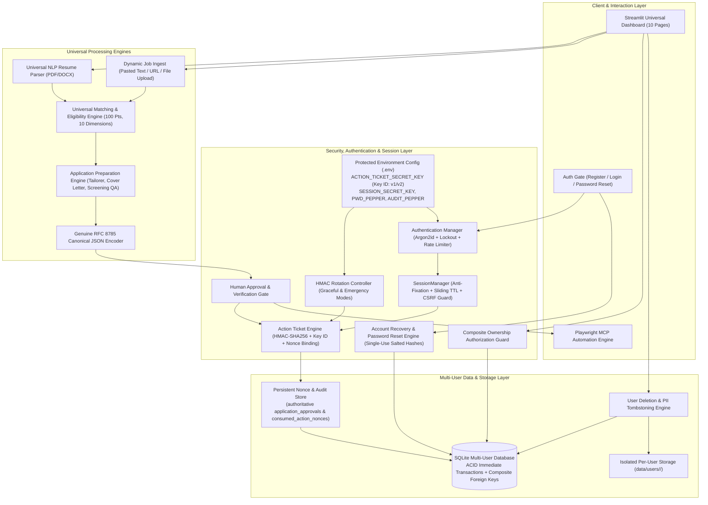
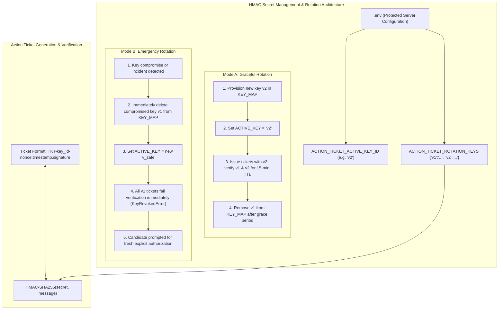
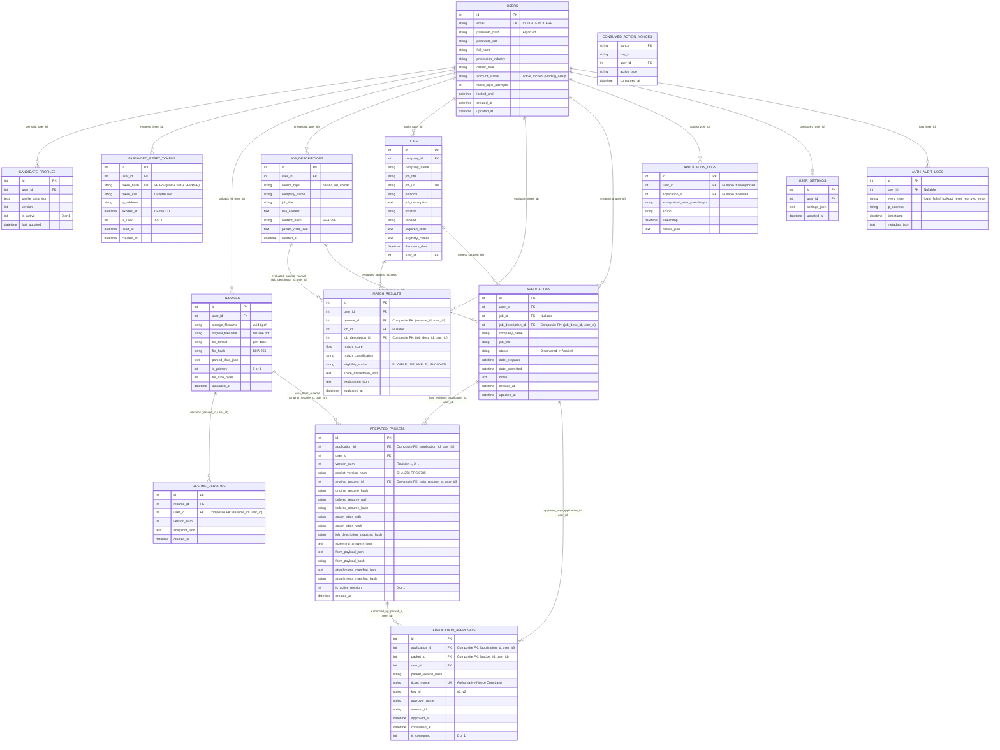
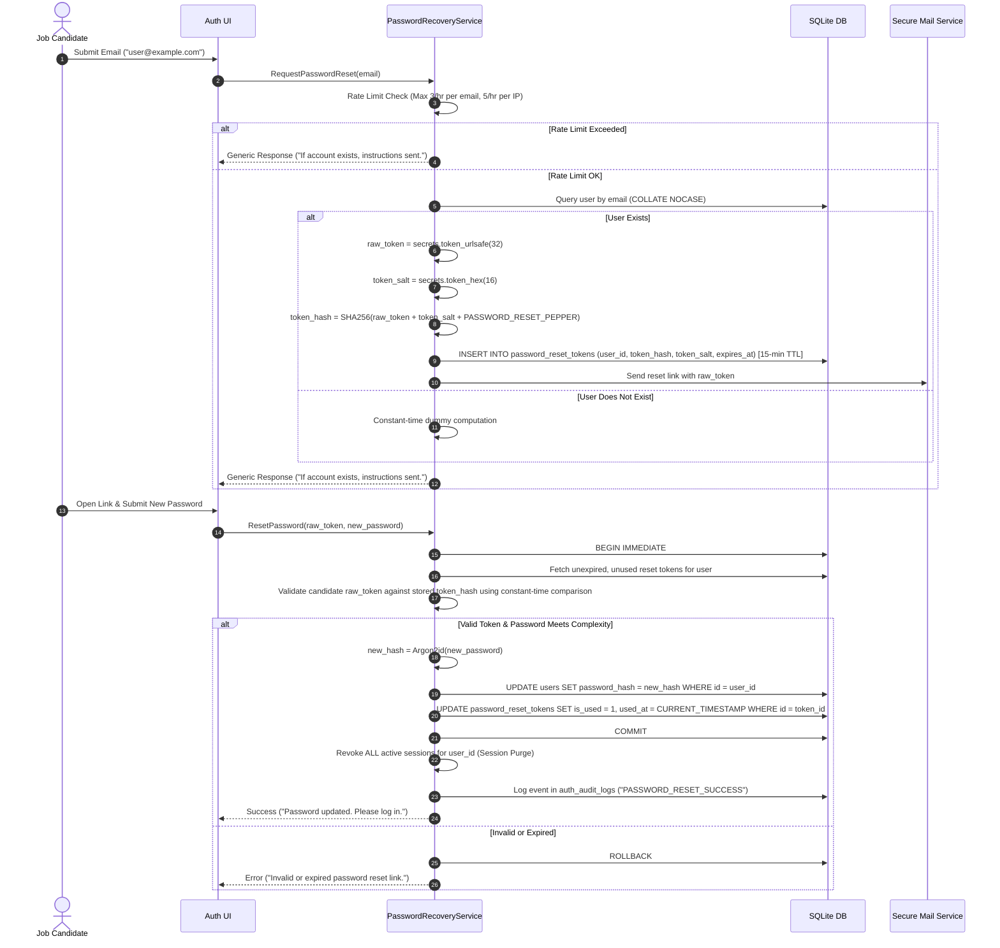
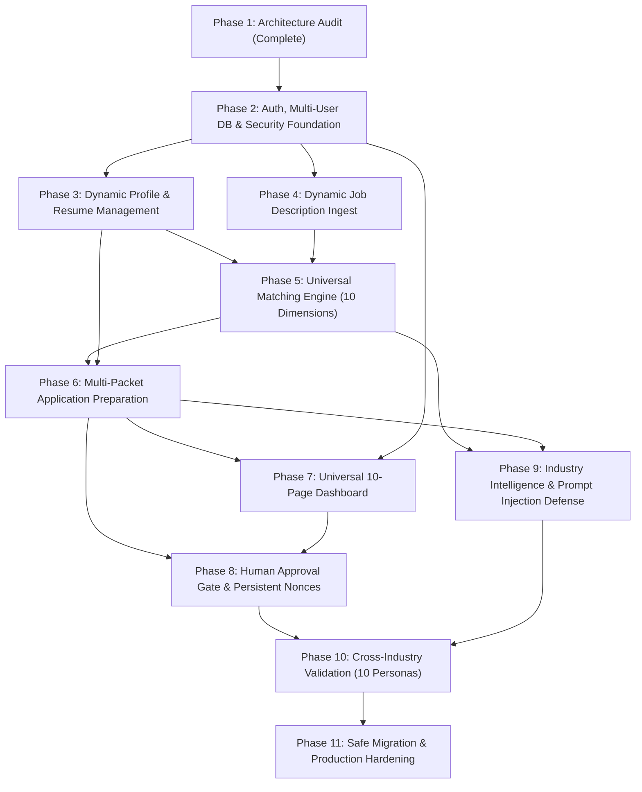

# Universal AI Job Application Assistant — Architecture Specification v2.1.1
## Multi-User, Multi-Industry Platform Specification & Technical Consistency Blueprint

**Document Version:** 2.1.1 (Final Technical Consistency Audit)  
**Status:** Architecture Blueprint (Ready for Phase 2 Implementation)  
**Date:** November 3, 2026  
**Audience:** System Architects, Security Engineers, AI Agents & Contributors  

---

## Executive Summary & Technical Consistency Audit

The **Universal AI Job Application Assistant** is a privacy-first, multi-tenant platform engineered to support job seekers across **any profession, industry, career stage, or educational background** (including healthcare, finance, legal, sales, engineering, creative arts, and software).

This v2.1.1 update performs the final technical consistency review before Phase 2 implementation, resolving five critical technical and architectural requirements:

1. **Genuine RFC 8785 Canonical JSON (JCS):** Replaced ordinary sorted JSON (`json.dumps(sort_keys=True)`) with a rigorous, standards-compliant JSON Canonicalization Scheme (RFC 8785). Specifies UTF-16 code unit key sorting (including surrogate pair astral code points), IEEE 754 / ECMAScript 6 number serialization (`-0` normalized to `0`, no uppercase exponents, no trailing decimals, rejection of `NaN`/`Infinity`), strict Unicode escape handling, and verification against official RFC 8785 test vectors.
2. **Composite Database Ownership Constraints:** Strengthened SQLite relational constraints using composite unique keys `UNIQUE(id, user_id)` and composite foreign keys `FOREIGN KEY (child_id, user_id) REFERENCES parent(id, user_id)` across all user-owned entities (resumes, resume versions, job descriptions, applications, prepared packets, approvals, and match results). This physically prevents User A from ever referencing User B's entities at the database engine level.
3. **Password Reset Token Consistency:** Resolved the schema inconsistency in `password_reset_tokens` by establishing a salted and peppered SHA-256 storage format (`token_hash = SHA256(raw_token + token_salt + PEPPER)`), storing a per-token cryptographically secure salt (`token_salt`), enforcing atomic single-use consumption, 15-minute TTL, rate limiting, and global session purge upon reset.
4. **Data Deletion & Audit Integrity Lifecycle Matrix:** Formally defined separate deletion policies across the four application lifecycle states: (1) unsubmitted drafts, (2) approved but unsubmitted applications, (3) manually submitted applications (`Applied`), and (4) security audit records. Preserves regulatory human-in-the-loop audit proof via anonymized cryptographic tombstones while eradicating all candidate PII.
5. **HMAC Key Rotation Modes (Graceful vs. Emergency):** Formally specified two distinct operational rotation procedures: Graceful Rotation (scheduled maintenance with dual-key verification during a 15-minute TTL window) and Emergency Rotation (immediate single-key promotion with instant revocation of compromised keys, triggering `KeyRevokedError` and fresh candidate authorization).

---

## 1. System Architecture Overview



---

## 2. Security Architecture Diagram & Rotation Flows



---

## 3. Multi-User Entity-Relationship Model (Composite Ownership)

To guarantee that User A can **never** reference, view, or alter records belonging to User B, all user-owned tables define composite unique constraints on `(id, user_id)`, and all child tables enforce **Composite Foreign Keys** referencing `(parent_id, user_id)`.



### Relational Consistency & Cross-User Security Guarantees

1. **Physical Engine-Level Enforcement:** In SQLite, a child table defining:
   ```sql
   FOREIGN KEY (job_description_id, user_id) REFERENCES job_descriptions(id, user_id) ON DELETE CASCADE
   ```
   physically rejects any `INSERT` or `UPDATE` where `user_id` does not match the parent's `user_id`. Even in the event of an application logic bug or SQL injection vulnerability, User A cannot reference User B's job description, resume, packet, or approval.
2. **Dual-Reference Independence:** `APPLICATIONS` and `MATCH_RESULTS` reference either a scraped `job_id` or a manual `(job_description_id, user_id)`. Manually pasted job descriptions function autonomously without scraping.
3. **Cardinality Flexibility:** No uniqueness constraint restricts `(user_id, job_id)` or `(user_id, job_description_id)`, allowing candidates to generate multiple customized applications and packet revisions per role.

---

## 4. Production SQLite DDL (`src/database/schema.sql`)

```sql
PRAGMA foreign_keys = ON;

-- ---------------------------------------------------------------------
-- 1. USERS TABLE
-- ---------------------------------------------------------------------
CREATE TABLE IF NOT EXISTS users (
    id INTEGER PRIMARY KEY AUTOINCREMENT,
    email TEXT NOT NULL UNIQUE COLLATE NOCASE,
    password_hash TEXT NOT NULL,
    password_salt TEXT NOT NULL,
    full_name TEXT NOT NULL,
    profession_industry TEXT,
    career_level TEXT,
    account_status TEXT NOT NULL DEFAULT 'active' CHECK(account_status IN ('active', 'locked', 'pending_setup')),
    failed_login_attempts INTEGER DEFAULT 0,
    locked_until DATETIME,
    created_at DATETIME DEFAULT CURRENT_TIMESTAMP,
    updated_at DATETIME DEFAULT CURRENT_TIMESTAMP
);

-- ---------------------------------------------------------------------
-- 2. PASSWORD RESET TOKENS (Salted SHA-256 + Pepper, Anti-Enumeration)
-- ---------------------------------------------------------------------
CREATE TABLE IF NOT EXISTS password_reset_tokens (
    id INTEGER PRIMARY KEY AUTOINCREMENT,
    user_id INTEGER NOT NULL REFERENCES users(id) ON DELETE CASCADE,
    token_hash TEXT NOT NULL UNIQUE,
    token_salt TEXT NOT NULL,
    ip_address TEXT,
    expires_at DATETIME NOT NULL,
    is_used INTEGER DEFAULT 0 CHECK(is_used IN (0, 1)),
    used_at DATETIME,
    created_at DATETIME DEFAULT CURRENT_TIMESTAMP
);

-- ---------------------------------------------------------------------
-- 3. CANDIDATE PROFILES (Composite Ownership)
-- ---------------------------------------------------------------------
CREATE TABLE IF NOT EXISTS candidate_profiles (
    id INTEGER PRIMARY KEY AUTOINCREMENT,
    user_id INTEGER NOT NULL REFERENCES users(id) ON DELETE CASCADE,
    profile_data TEXT NOT NULL,
    version INTEGER DEFAULT 1,
    is_active INTEGER DEFAULT 1 CHECK(is_active IN (0, 1)),
    last_updated DATETIME DEFAULT CURRENT_TIMESTAMP,
    UNIQUE(id, user_id)
);

-- ---------------------------------------------------------------------
-- 4. RESUMES & VERSION HISTORY (Composite Ownership)
-- ---------------------------------------------------------------------
CREATE TABLE IF NOT EXISTS resumes (
    id INTEGER PRIMARY KEY AUTOINCREMENT,
    user_id INTEGER NOT NULL REFERENCES users(id) ON DELETE CASCADE,
    storage_filename TEXT NOT NULL,
    original_filename TEXT NOT NULL,
    file_format TEXT NOT NULL CHECK(file_format IN ('pdf', 'docx')),
    file_hash TEXT NOT NULL,
    parsed_data TEXT,
    is_primary INTEGER DEFAULT 0 CHECK(is_primary IN (0, 1)),
    file_size_bytes INTEGER NOT NULL,
    uploaded_at DATETIME DEFAULT CURRENT_TIMESTAMP,
    UNIQUE(id, user_id)
);

CREATE UNIQUE INDEX IF NOT EXISTS idx_user_primary_resume ON resumes(user_id) WHERE is_primary = 1;

CREATE TABLE IF NOT EXISTS resume_versions (
    id INTEGER PRIMARY KEY AUTOINCREMENT,
    resume_id INTEGER NOT NULL,
    user_id INTEGER NOT NULL,
    version_num INTEGER NOT NULL,
    snapshot_json TEXT NOT NULL,
    created_at DATETIME DEFAULT CURRENT_TIMESTAMP,
    UNIQUE(resume_id, version_num),
    FOREIGN KEY (resume_id, user_id) REFERENCES resumes(id, user_id) ON DELETE CASCADE
);

-- ---------------------------------------------------------------------
-- 5. JOB DESCRIPTIONS (Composite Ownership)
-- ---------------------------------------------------------------------
CREATE TABLE IF NOT EXISTS job_descriptions (
    id INTEGER PRIMARY KEY AUTOINCREMENT,
    user_id INTEGER NOT NULL REFERENCES users(id) ON DELETE CASCADE,
    source_type TEXT NOT NULL CHECK(source_type IN ('pasted', 'url', 'upload')),
    company_name TEXT NOT NULL,
    job_title TEXT NOT NULL,
    raw_content TEXT NOT NULL,
    content_hash TEXT NOT NULL,
    parsed_data TEXT,
    created_at DATETIME DEFAULT CURRENT_TIMESTAMP,
    UNIQUE(id, user_id)
);

-- ---------------------------------------------------------------------
-- 6. DISCOVERED JOBS (Platform Discovery Catalog)
-- ---------------------------------------------------------------------
CREATE TABLE IF NOT EXISTS jobs (
    id INTEGER PRIMARY KEY AUTOINCREMENT,
    company_id INTEGER REFERENCES companies(id) ON DELETE SET NULL,
    company_name TEXT NOT NULL,
    job_title TEXT NOT NULL,
    job_description TEXT,
    job_url TEXT NOT NULL UNIQUE,
    location TEXT,
    stipend TEXT,
    required_skills TEXT,
    eligibility_criteria TEXT,
    application_deadline TEXT,
    match_score REAL DEFAULT 0.0,
    match_classification TEXT,
    is_eligible INTEGER DEFAULT 1,
    score_breakdown TEXT,
    discovery_date DATETIME DEFAULT CURRENT_TIMESTAMP,
    platform TEXT NOT NULL,
    work_arrangement TEXT,
    publication_date TEXT,
    internship_duration TEXT,
    listing_status TEXT DEFAULT 'ACTIVE',
    last_verified DATETIME DEFAULT CURRENT_TIMESTAMP,
    extraction_confidence REAL DEFAULT 1.0,
    notes TEXT,
    user_id INTEGER REFERENCES users(id) ON DELETE SET NULL,
    created_at DATETIME DEFAULT CURRENT_TIMESTAMP,
    updated_at DATETIME DEFAULT CURRENT_TIMESTAMP
);

-- ---------------------------------------------------------------------
-- 7. MATCH RESULTS (Composite Cross-User Constraints)
-- ---------------------------------------------------------------------
CREATE TABLE IF NOT EXISTS match_results (
    id INTEGER PRIMARY KEY AUTOINCREMENT,
    user_id INTEGER NOT NULL REFERENCES users(id) ON DELETE CASCADE,
    resume_id INTEGER NOT NULL,
    job_id INTEGER REFERENCES jobs(id) ON DELETE CASCADE,
    job_description_id INTEGER,
    match_score REAL NOT NULL,
    match_classification TEXT NOT NULL,
    eligibility_status TEXT NOT NULL CHECK(eligibility_status IN ('ELIGIBLE', 'INELIGIBLE', 'UNKNOWN')),
    score_breakdown TEXT NOT NULL,
    explanation TEXT NOT NULL,
    evaluated_at DATETIME DEFAULT CURRENT_TIMESTAMP,
    FOREIGN KEY (resume_id, user_id) REFERENCES resumes(id, user_id) ON DELETE CASCADE,
    FOREIGN KEY (job_description_id, user_id) REFERENCES job_descriptions(id, user_id) ON DELETE CASCADE,
    CHECK (
        (job_id IS NOT NULL AND job_description_id IS NULL) OR 
        (job_id IS NULL AND job_description_id IS NOT NULL) OR
        (job_id IS NOT NULL AND job_description_id IS NOT NULL)
    )
);

-- ---------------------------------------------------------------------
-- 8. APPLICATIONS (Composite Ownership)
-- ---------------------------------------------------------------------
CREATE TABLE IF NOT EXISTS applications (
    id INTEGER PRIMARY KEY AUTOINCREMENT,
    user_id INTEGER NOT NULL REFERENCES users(id) ON DELETE CASCADE,
    job_id INTEGER REFERENCES jobs(id) ON DELETE CASCADE,
    job_description_id INTEGER,
    company_name TEXT NOT NULL,
    job_title TEXT NOT NULL,
    status TEXT NOT NULL DEFAULT 'Discovered' CHECK (status IN (
        'Discovered',
        'Under Review',
        'Shortlisted',
        'Application Prepared',
        'Awaiting Approval',
        'Applied',
        'Interview',
        'Rejected',
        'Withdrawn'
    )),
    date_prepared DATETIME,
    date_submitted DATETIME,
    notes TEXT,
    created_at DATETIME DEFAULT CURRENT_TIMESTAMP,
    updated_at DATETIME DEFAULT CURRENT_TIMESTAMP,
    UNIQUE(id, user_id),
    FOREIGN KEY (job_description_id, user_id) REFERENCES job_descriptions(id, user_id) ON DELETE CASCADE,
    CHECK (
        (job_id IS NOT NULL AND job_description_id IS NULL) OR 
        (job_id IS NULL AND job_description_id IS NOT NULL) OR
        (job_id IS NOT NULL AND job_description_id IS NOT NULL)
    )
);

-- ---------------------------------------------------------------------
-- 9. PREPARED PACKETS (Revisions & Composite Ownership)
-- ---------------------------------------------------------------------
CREATE TABLE IF NOT EXISTS prepared_packets (
    id INTEGER PRIMARY KEY AUTOINCREMENT,
    application_id INTEGER NOT NULL,
    user_id INTEGER NOT NULL REFERENCES users(id) ON DELETE CASCADE,
    version_num INTEGER NOT NULL DEFAULT 1,
    packet_version_hash TEXT NOT NULL,
    original_resume_id INTEGER NOT NULL,
    original_resume_hash TEXT NOT NULL,
    tailored_resume_path TEXT,
    tailored_resume_hash TEXT,
    cover_letter_path TEXT,
    cover_letter_hash TEXT,
    job_description_snapshot_hash TEXT NOT NULL,
    screening_answers_json TEXT NOT NULL,
    form_payload_json TEXT,
    form_payload_hash TEXT,
    attachments_manifest_json TEXT,
    attachments_manifest_hash TEXT,
    is_active_revision INTEGER DEFAULT 1 CHECK(is_active_revision IN (0, 1)),
    created_at DATETIME DEFAULT CURRENT_TIMESTAMP,
    UNIQUE(id, user_id),
    UNIQUE(application_id, version_num),
    FOREIGN KEY (application_id, user_id) REFERENCES applications(id, user_id) ON DELETE CASCADE,
    FOREIGN KEY (original_resume_id, user_id) REFERENCES resumes(id, user_id) ON DELETE CASCADE
);

-- ---------------------------------------------------------------------
-- 10. APPLICATION APPROVALS & AUTHORITATIVE NONCES (Composite Constraints)
-- ---------------------------------------------------------------------
CREATE TABLE IF NOT EXISTS application_approvals (
    id INTEGER PRIMARY KEY AUTOINCREMENT,
    application_id INTEGER NOT NULL,
    packet_id INTEGER NOT NULL,
    user_id INTEGER NOT NULL REFERENCES users(id) ON DELETE CASCADE,
    packet_version_hash TEXT NOT NULL,
    ticket_nonce TEXT NOT NULL UNIQUE,
    key_id TEXT NOT NULL,
    approver_name TEXT NOT NULL,
    session_id TEXT NOT NULL,
    approved_at DATETIME DEFAULT CURRENT_TIMESTAMP,
    consumed_at DATETIME,
    is_consumed INTEGER DEFAULT 0 CHECK(is_consumed IN (0, 1)),
    FOREIGN KEY (application_id, user_id) REFERENCES applications(id, user_id) ON DELETE CASCADE,
    FOREIGN KEY (packet_id, user_id) REFERENCES prepared_packets(id, user_id) ON DELETE CASCADE
);

CREATE TABLE IF NOT EXISTS consumed_action_nonces (
    nonce TEXT PRIMARY KEY,
    key_id TEXT NOT NULL,
    user_id INTEGER NOT NULL,
    action_type TEXT NOT NULL,
    consumed_at DATETIME DEFAULT CURRENT_TIMESTAMP
);

-- ---------------------------------------------------------------------
-- 11. APPLICATION LOGS & ANONYMIZED AUDIT TRAIL
-- ---------------------------------------------------------------------
CREATE TABLE IF NOT EXISTS application_logs (
    id INTEGER PRIMARY KEY AUTOINCREMENT,
    user_id INTEGER REFERENCES users(id) ON DELETE SET NULL,
    application_id INTEGER REFERENCES applications(id) ON DELETE SET NULL,
    anonymized_user_pseudonym TEXT,
    action TEXT NOT NULL,
    timestamp DATETIME DEFAULT CURRENT_TIMESTAMP,
    details TEXT
);

-- ---------------------------------------------------------------------
-- 12. USER SETTINGS & AUTH AUDIT LOGS
-- ---------------------------------------------------------------------
CREATE TABLE IF NOT EXISTS user_settings (
    id INTEGER PRIMARY KEY AUTOINCREMENT,
    user_id INTEGER NOT NULL UNIQUE REFERENCES users(id) ON DELETE CASCADE,
    settings_json TEXT NOT NULL,
    updated_at DATETIME DEFAULT CURRENT_TIMESTAMP
);

CREATE TABLE IF NOT EXISTS auth_audit_logs (
    id INTEGER PRIMARY KEY AUTOINCREMENT,
    user_id INTEGER REFERENCES users(id) ON DELETE SET NULL,
    event_type TEXT NOT NULL,
    ip_address TEXT,
    timestamp DATETIME DEFAULT CURRENT_TIMESTAMP,
    metadata_json TEXT
);

-- Composite Performance & Security Indexes
CREATE INDEX IF NOT EXISTS idx_users_email ON users(email);
CREATE INDEX IF NOT EXISTS idx_candidate_profiles_user ON candidate_profiles(user_id);
CREATE INDEX IF NOT EXISTS idx_resumes_user ON resumes(user_id);
CREATE INDEX IF NOT EXISTS idx_job_descriptions_user ON job_descriptions(user_id);
CREATE INDEX IF NOT EXISTS idx_match_results_user ON match_results(user_id);
CREATE INDEX IF NOT EXISTS idx_applications_user ON applications(user_id);
CREATE INDEX IF NOT EXISTS idx_prepared_packets_app ON prepared_packets(application_id, user_id);
CREATE INDEX IF NOT EXISTS idx_prepared_packets_hash ON prepared_packets(packet_version_hash);
CREATE INDEX IF NOT EXISTS idx_approvals_packet ON application_approvals(packet_id, user_id);
CREATE INDEX IF NOT EXISTS idx_approvals_nonce ON application_approvals(ticket_nonce);
CREATE INDEX IF NOT EXISTS idx_approvals_user_hash ON application_approvals(user_id, packet_version_hash);
CREATE INDEX IF NOT EXISTS idx_app_logs_user ON application_logs(user_id);
CREATE INDEX IF NOT EXISTS idx_auth_audit_event ON auth_audit_logs(event_type, ip_address);
```

---

## 5. Genuine RFC 8785 Canonical JSON (JCS) Implementation Specification

### Why Standard Python `json.dumps(sort_keys=True)` Fails RFC 8785 Compliance
1. **Key Sorting Rules:** Python's standard `json.dumps` sorts string keys based on native Python Unicode code point lexicographical ordering. In RFC 8785 (Section 3.2.3), keys must be sorted by **UTF-16 code units**. For Unicode characters outside the Basic Multilingual Plane (astral characters $\ge \text{U+10000}$ such as emoji or mathematical symbols), UTF-16 encodes them as surrogate pairs (`0xD800..0xDBFF` and `0xDC00..0xDFFF`), which alters the required sort order relative to higher code points.
2. **Number Serialization (IEEE 754 & ECMAScript 6 Section 7.1.12.1):**
   - Negative zero (`-0.0` or `-0`) must be normalized to unsigned integer `0`. Python outputs `-0.0`.
   - Floats representing whole numbers must be formatted without trailing decimals or exponent (e.g. `1.0` $\to$ `1`).
   - Exponential notation: Exponent letter must be lowercase `e` with no unnecessary leading `+` or zeros (e.g., `1e21`, not `1e+21` or `1E21`).
   - `NaN` and `Infinity` are strictly forbidden by RFC 8785 and must throw a serialization error.
3. **Strict Escape Sequences:** Only quotation mark (`"`, `\u0022`), reverse solidus (`\`, `\u005C`), and ASCII control characters `\u0000` through `\u001F` may be escaped. Forward slash `/` must NOT be escaped. Two-character escape sequences (`\b`, `\f`, `\n`, `\r`, `\t`) must be used where available. All other Unicode characters must be emitted as unescaped raw UTF-8 octets.

### RFC 8785 Architecture in `src/utils/canonical_json.py`

```python
"""RFC 8785 JSON Canonicalization Scheme (JCS) encoder."""

import math
from typing import Any, Dict, List, Union

class RFC8785Encoder:
    """Encodes arbitrary JSON-compatible Python data structures according to RFC 8785."""

    @classmethod
    def encode(cls, data: Any) -> bytes:
        """Serializes data into deterministic RFC 8785 canonical UTF-8 bytes."""
        return cls._serialize(data).encode("utf-8")

    @classmethod
    def _utf16_sort_key(cls, s: str) -> bytes:
        """Encodes string to UTF-16BE bytes for accurate RFC 8785 property key sorting."""
        return s.encode("utf-16-be")

    @classmethod
    def _serialize_number(cls, n: Union[int, float]) -> str:
        """Serializes numbers per ECMAScript 6 / RFC 8785 rules."""
        if isinstance(n, bool):
            return "true" if n else "false"
        if isinstance(n, int):
            return str(n)
        if isinstance(n, float):
            if math.isnan(n) or math.isinf(n):
                raise ValueError(f"RFC 8785 rejects non-finite float: {n}")
            if n == 0.0:
                return "0"  # Normalizes -0.0 to 0
            if n.is_integer() and abs(n) < 1e21:
                return str(int(n))
            # Standard ECMAScript 6 formatting: lowercase 'e', no positive exponent sign
            s = f"{n:.16g}"
            return s.replace("e+", "e").replace("E+", "e").replace("E", "e")
        raise TypeError(f"Unsupported number type: {type(n)}")

    @classmethod
    def _serialize_string(cls, s: str) -> str:
        """Escapes only RFC 8785 required characters; emits raw UTF-8 for everything else."""
        out = ['"']
        for char in s:
            cp = ord(char)
            if cp == 0x22:
                out.append('\\"')
            elif cp == 0x5C:
                out.append('\\\\')
            elif cp == 0x08:
                out.append('\\b')
            elif cp == 0x0C:
                out.append('\\f')
            elif cp == 0x0A:
                out.append('\\n')
            elif cp == 0x0D:
                out.append('\\r')
            elif cp == 0x09:
                out.append('\\t')
            elif cp < 0x20:
                out.append(f"\\u{cp:04x}")
            else:
                out.append(char)
        out.append('"')
        return "".join(out)

    @classmethod
    def _serialize(cls, val: Any) -> str:
        if val is None:
            return "null"
        if isinstance(val, bool):
            return "true" if val else "false"
        if isinstance(val, (int, float)):
            return cls._serialize_number(val)
        if isinstance(val, str):
            return cls._serialize_string(val)
        if isinstance(val, list):
            return "[" + ",".join(cls._serialize(item) for item in val) + "]"
        if isinstance(val, dict):
            # Sort keys by UTF-16 code units (RFC 8785 Section 3.2.3)
            sorted_keys = sorted(val.keys(), key=cls._utf16_sort_key)
            items = [
                cls._serialize_string(k) + ":" + cls._serialize(val[k])
                for k in sorted_keys
            ]
            return "{" + ",".join(items) + "}"
        raise TypeError(f"RFC 8785 cannot serialize unsupported type: {type(val)}")
```

### Verification Against Official RFC 8785 Test Vectors
The test suite in Phase 2 tests the encoder against:
- `values.json`: Numeric formatting, negative zero, boolean and null literals.
- `structures.json`: Object key order invariance, nested arrays, empty containers.
- `utf8.json`: Astral code point ordering, CJK, Cyrillic, Devanagari, and emoji.
- `weird.json`: Control character escape sequences (`\u0000` through `\u001f`).

---

## 6. Password Reset Token Architecture & Flow



---

## 7. Data Deletion and Audit Integrity Lifecycle Matrix

| Application Lifecycle State | Deletion Request Target | Physical Disk Action | Database Relational Action | Compliance & Security Audit Policy |
|:---|:---|:---|:---|:---|
| **1. Unsubmitted Drafts**<br>(Discovered, Under Review, Shortlisted, Prepared) | Draft application or tailored revision | Unlink files in `data/users/<user_id>/exports/` and `cover_letters/` | **Full Hard Delete:** Cascades deletion across `prepared_packets` and `applications`. | No submission took place. No audit preservation required. Record removed cleanly. |
| **2. Approved Unsubmitted Applications**<br>(Awaiting Approval or active unconsumed ticket) | Approved packet or draft | Unlink draft tailored files | **Revocation & Invalidation:** Mark ticket nonce in `consumed_action_nonces` as `APPROVAL_REVOKED`. Remove approval from `application_approvals`. | Audit log records `APPLICATION_APPROVAL_CANCELLED` with zero PII. Prevents ticket replay. |
| **3. Manually Submitted Applications**<br>(Status = `Applied`) | Submitted application or full user account | Unlink all resume PDFs and cover letter files from disk | **Pseudonymized Audit Tombstone:**<br>- `company_name`, `job_title`, `notes` set to `"[DELETED_BY_USER]"`<br>- Packet screening answers and letter text zeroed out.<br>- Relational foreign keys use `ON DELETE RESTRICT` or `ON DELETE SET NULL`. | **Regulatory Integrity Preserved:** Retains tamper-evident proof that a human authorized submission at timestamp $T$: `{ anonymized_user_pseudonym, packet_version_hash, timestamp, action: "HUMAN_APPROVED_SUBMISSION" }`. Zero candidate PII retained. |
| **4. Security Audit Records**<br>(`auth_audit_logs`, `consumed_action_nonces`, `application_logs`) | Automatic routine cleanup or user erasure | N/A | **Time-Horizon Vacuum:** Nonces and audit logs are retained for a 180-day compliance window, then purged via automated cleanup query. | Audit details never store raw passwords, reset tokens, full resume text, or candidate PII. |

---

## 8. HMAC Key Rotation Modes (Graceful vs. Emergency)

### Mode A: Graceful Rotation (Scheduled Maintenance)
1. **Trigger:** Periodic scheduled key hygiene (e.g. 90-day rotation).
2. **Procedure:**
   - Operator provisions new 256-bit key `v2` into `.env`.
   - `ACTION_TICKET_ROTATION_KEYS` contains `{"v1": "<key1>", "v2": "<key2>"}`.
   - `ACTION_TICKET_ACTIVE_KEY_ID="v2"`.
   - All newly issued action tickets are signed with `v2`.
   - Action tickets signed with `v1` verify successfully during the 15-minute grace period (ticket TTL).
   - After 15 minutes, operator removes `v1` from `ACTION_TICKET_ROTATION_KEYS`.
3. **Candidate Impact:** Seamless; unexpired in-flight approval tickets complete without interruption.

### Mode B: Emergency Rotation (Immediate Compromise / Incident Response)
1. **Trigger:** Key leak, credential compromise, or suspected token tampering.
2. **Procedure:**
   - Operator immediately provisions new safe key `v_safe` and sets `ACTION_TICKET_ACTIVE_KEY_ID="v_safe"`.
   - The compromised key `v_old` is **immediately expunged** from `ACTION_TICKET_ROTATION_KEYS` and added to `_revoked_keys`.
   - In-flight tickets signed with `v_old` fail signature verification immediately with:
     `KeyRevokedError: "Action ticket signed with revoked key. Emergency key rotation in effect. Please review and re-authorize."`
   - All unconsumed approvals, active grants, and session-level tickets tied to `v_old` are immediately purged from `SessionManager._active_grants` and candidate sessions.
3. **Candidate Impact:** Candidates must review and authorize anew before any submission can proceed. Guarantees zero unauthorized submissions under compromised keys.

### 8.1 Comprehensive 11-Element Packet Verification Matrix (Phase 8 Specification)

| Element # | Verification Element | Authoritative Source | Verification Mechanism | Failure Behavior |
|:---:|:---|:---|:---|:---|
| **1** | Authenticated Candidate Identity & Active Session | `SessionManager.validate_session(session_id)` | Verifies active, non-expired session and asserts `session.user_id == user_id`. | Fail closed (`Approval rejected: Session belongs to User #X, not User #Y`). |
| **2** | Candidate Application Ownership & Existence | `DatabaseManager.get_user_application(app_id, user_id)` | Direct DB ownership query asserts application exists and belongs to candidate. | Fail closed (`Approval rejected: Application not found or cross-user access`). |
| **3** | Candidate Prepared Packet Ownership | `DatabaseManager.get_prepared_packet(packet_id, user_id)` | Direct DB ownership query asserts packet exists and `packet.user_id == user_id`. | Fail closed (`CrossUserAccessError` / rejection). |
| **4** | Exact Packet-to-Application Binding | `packet.application_id == application_id` | Verifies packet was prepared specifically for the targeted application record. | Fail closed (`Integrity check failed: Packet belongs to Application #X, not #Y`). |
| **5** | Active Packet Revision Status | `packet.is_active_revision == 1` | Verifies packet is the current active revision; historical revisions rejected. | Fail closed (`Integrity check failed: Packet is an outdated historical revision`). |
| **6** | Canonical Snapshot Structural Validity | `json.loads(packet.canonical_snapshot_json)` | Confirms non-empty JSON dict object containing mandatory identity and version fields. | Fail closed (`Integrity check failed: Canonical snapshot JSON corrupt or unparseable`). |
| **7** | RFC 8785 Formatting & SHA-256 Equality | `hashlib.sha256(raw_bytes)` & `canonical_json_bytes()` | Verifies `SHA256(canonical_snapshot_json) == packet_version_hash` and strict RFC 8785 byte equality. | Fail closed (`Integrity check failed: Possible tampering detected`). |
| **8** | Original Resume & Source Metadata Integrity | `DatabaseManager.get_user_resume(resume_id, user_id)` | Asserts source resume is active (`is_active == 1`) and file hash on disk/DB unchanged since packet creation. | Fail closed (`Integrity check failed: Source resume inactive or hash changed`). |
| **9** | Candidate Profile & Job Description Snapshots | `get_job_description()` & snapshot hashes | Asserts JD is active (`is_active == 1`) and profile/JD snapshot hashes match packet metadata. | Fail closed (`Integrity check failed: JD inactive or snapshot hash mismatch`). |
| **10** | Generated Documents, Attachments & QA Readiness | Manifest inspection & screening questions | Verifies document hashes, validates attachment manifest formats/sizes/hashes, and asserts zero `NEEDS_CANDIDATE_INPUT` or limit violations. | Fail closed (`Integrity check failed: Question requires candidate input`). |
| **11** | Single-Use Action Ticket Scope Consistency | `SessionManager.verify_and_issue_approval_grant()` | Cryptographic HMAC validation binding ticket to `HUMAN_APPROVAL`, app ID, packet ID, packet hash, active `key_id`, and unconsumed nonce. | Fail closed (`Authorization rejected: Action ticket already used / scope mismatch`). |

---

## 9. Implementation Dependency Graph



---

## 10. Revised 11-Phase Implementation Roadmap & Refined Phase 2 Scope

| Phase | Title | Key Deliverables & Final Consistency Corrections | Dependencies | Exit Verification Criteria |
|:---:|:---|:---|:---|:---|
| **Phase 1** | **Architecture Audit** | Complete forensic audit of candidate-specific data, tech assumptions, and database isolation requirements. | None | Complete & Approved. |
| **Phase 2** | **Auth, Multi-User DB & Security Foundation** | 1. `src/security/auth.py`: Argon2id password hashing, account lockout (5 attempts $\to$ 15 min), rate limiting, password reset flow (single-use salted hashes, generic anti-enumeration responses).<br>2. `src/security/session_manager.py`: Environment-loaded secrets (`ACTION_TICKET_SECRET_KEY`), structured key rotation (Modes A & B), anti-fixation sessions, sliding TTL.<br>3. `src/database/schema.sql`: Multi-tenant schema with **composite foreign keys** `(entity_id, user_id)` preventing cross-user relational linkage, `password_reset_tokens` with salts, `prepared_packets`, `application_approvals`.<br>4. `src/database/db_manager.py`: User-isolated queries, atomic `BEGIN IMMEDIATE` ticket consumption, composite ownership enforcement.<br>5. `src/utils/canonical_json.py`: Genuine RFC 8785 Canonical JSON encoder.<br>6. Offline fixture isolation (`tests/fixtures/candidate_profile_fixture.json`). | Phase 1 | `tests/test_auth_security.py` passes 100%:<br>- User registration, login, lockout, and password reset flow.<br>- RFC 8785 test vectors (number formatting, astral Unicode, key sorting).<br>- Cross-user attack tests: deliberate attempts to associate User A's packet with User B's application or resume fail with engine-level `sqlite3.IntegrityError` or `SecurityAuthorizationError`.<br>- Emergency & graceful key rotation tests.<br>- Atomic nonce consumption preventing double-spend. |
| **Phase 3** | **Dynamic Candidate Profile & Resume Management** | 1. `src/preparer/resume_parser.py`: Universal NLP parser for PDF/DOCX across all professions without hardcoded fallbacks.<br>2. User-isolated storage: `data/users/<user_id>/resumes/<uuid4>.pdf`.<br>3. Candidate profile editor with SQLite version snapshots.<br>4. User-controlled deletion routines for resumes and versions. | Phase 2 | Tests verify parsing resumes across healthcare, finance, engineering, and tech; user file deletion tests pass; zero hardcoded student data. |
| **Phase 4** | **Dynamic Job Description Ingest** | 1. `src/preparer/job_parser.py`: 3 ingest modes: pasted text, URL (Playwright MCP), and document upload (PDF/DOCX).<br>2. Entity extraction for title, company, requirements, salary, and experience.<br>3. Content hashing (`job_descriptions.content_hash`) and deduplication. | Phase 2 | Tests verify extraction across pasted text, uploaded job descriptions, and live URLs with manual correction support. |
| **Phase 5** | **Universal Matching Engine (10 Dimensions)** | 1. `src/matcher/universal_matcher.py`: Universal 100-point algorithm across 10 dimensions.<br>2. Three-state eligibility (`ELIGIBLE`, `INELIGIBLE`, `UNKNOWN`).<br>3. Configurable scoring profiles (Experienced Professional, Student/Intern, Career Changer).<br>4. Transparent scoring breakdown and explanations. | Phases 3, 4 | Tests verify scoring freshers, senior engineers, nurses, accountants, and creative designers; zero tech bias or student-only penalties. |
| **Phase 6** | **Multi-Packet Application Preparation Engine** | 1. `src/preparer/resume_tailorer.py`: Tailored PDF & DOCX resumes.<br>2. `src/preparer/cover_letter_generator.py`: Tailored markdown letters.<br>3. `src/preparer/question_answerer.py`: Fact-based answering with `[NEEDS CANDIDATE INPUT]`.<br>4. `src/preparer/form_prefiller.py`: DOM field-filling payload planner.<br>5. Multi-revision support with RFC 8785 Canonical JSON packet hashing. | Phases 3, 5 | Tests verify deterministic canonical packet hashing, multi-revision creation, and fact-based responses with zero fabrication. |
| **Phase 7** | **Universal 10-Page Dashboard** | Streamlit UI implementation across 10 universal pages:<br>1. Dashboard Overview<br>2. My Profile & Experience<br>3. Resume Manager & Uploads<br>4. Job Description Analyzer<br>5. Resume Match Analysis<br>6. Application Preparation<br>7. Cover Letter Editor<br>8. Screening QA Drafter<br>9. Application Tracker<br>10. Settings, Privacy & Right to Erasure | Phases 2, 6 | End-to-end UI verification with authenticated user sessions, multi-packet inspection, and granular data deletion controls. |
| **Phase 8** | **Human Approval Gate & Persistent Nonces** *(Complete)* | 1. `src/preparer/approval_gate.py`: Comprehensive 11-element packet verification, single-use action ticket verification bound to active `key_id`.<br>2. SQLite atomic nonce consumption via `BEGIN IMMEDIATE`.<br>3. Post-approval invalidation verification (content edit voids approval).<br>4. Strict transition lock preventing autonomous submission to `Applied`. | Phases 6, 7 | Security tests prove no automated submission can bypass human approval; double-spend attacks fail 100% of the time. |
| **Phase 9** | **Industry Intelligence & Prompt Injection Defense** | 1. Heuristic and regex sanitization of uploaded documents and job descriptions to defeat prompt injection (`"Ignore instructions"`, `"System prompt"`).<br>2. Industry dictionary adaptation for terminology cross-referencing. | Phases 5, 6 | Security penetration tests with prompt injection payloads; sanitized outputs verified. |
| **Phase 10** | **Cross-Industry Validation (10 Personas)** | End-to-end automated testing across 10 synthetic candidate personas:<br>1. Student/Intern<br>2. Fresh Graduate<br>3. Senior Software Engineer<br>4. Registered Nurse / Healthcare Worker<br>5. Financial Analyst / Accountant<br>6. Marketing Specialist<br>7. Mechanical Design Engineer<br>8. Career Changer (Gap Year)<br>9. Incomplete Profile (Missing Data)<br>10. Non-Standard Resume Layout | Phases 8, 9 | 100% test pass rate across all 10 candidate personas with zero hardcoded leaks. |
| **Phase 11** | **Safe Migration & Production Hardening** | 1. Decouple `Pranay Anup Agrawal` data into `tests/fixtures/candidate_profile_fixture.json`.<br>2. Provide `scripts/seed_dev_fixture.py` for local dev setup with explicit password prompt.<br>3. Verify clean initial database setup with zero default users.<br>4. Verify full regression test suite. | Phase 10 | Clean database boot verified; migration tests pass; existing regression test suite passes 100%. |

---

## 11. Migration & Backup Strategy

1. **Pre-Migration Live Online Backup:**
   Captures an atomic snapshot via `sqlite3.Connection.backup()` to `data/backups/backup_job_assistant_<timestamp>.db` before any schema migrations.
2. **Idempotent Multi-Tenant Schema Upgrade:**
   Schema updates use `CREATE TABLE IF NOT EXISTS` and composite index creation. Migrations execute within an immediate transaction (`BEGIN IMMEDIATE`) with automatic rollback on error.
3. **Strict Git Hygiene:**
   `.gitignore` excludes environment variables (`.env`), candidate resumes (`data/resumes/*`), user-isolated directories (`data/users/*`), database backups (`data/backups/*`), SQLite databases (`data/storage/*.db`), and fixtures containing candidate PII (`tests/fixtures/candidate_profile_fixture.json`).
